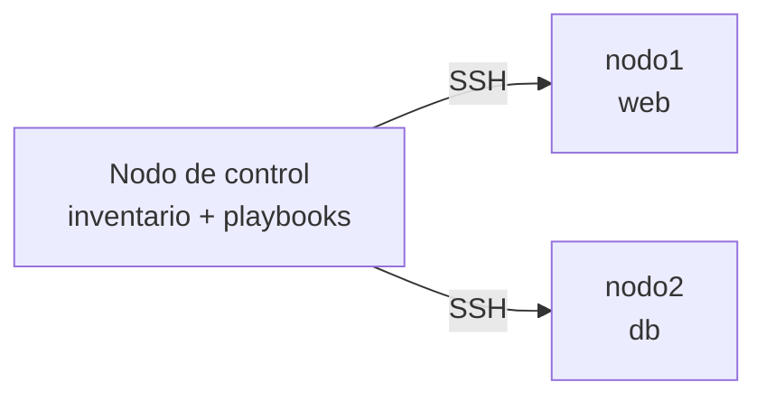

# 1. Automatizar la administración de sistemas

Pensemos en configurar veinte servidores a mano, uno tras otro, repitiendo los mismos pasos. Ansible resuelve justo ese problema: permite describir en ficheros de texto cómo debe quedar un conjunto de servidores y aplicar esa descripción cuantas veces haga falta. El procedimiento se escribe una sola vez, se guarda en Git y se ejecuta igual sobre un equipo que sobre cien.

**¿Qué falla cuando se administra a mano?**

- Cada servidor acaba siendo un poco distinto de los demás sin que nadie lo decida: es lo que se llama *deriva de configuración*.
- Repetir una tarea en muchas máquinas es lento y, sobre todo, fácil de hacer mal.
- El procedimiento vive en la cabeza de quien lo aplicó, o en un documento que con el tiempo se queda desactualizado.

**Qué se gana al automatizar las tareas repetitivas:**

- **Repetibilidad:** el mismo procedimiento da el mismo resultado en todos los nodos.
- **Eficiencia:** una sola orden actúa sobre todos los nodos a la vez.
- **Documentación viva:** el fichero que ejecuta la tarea es, al mismo tiempo, su descripción.
- **Trazabilidad:** con los ficheros en Git se sabe quién cambió qué y cuándo, y siempre se puede volver atrás.

Esta forma de trabajar se conoce como **infraestructura como código** (*Infrastructure as Code*, IaC): la configuración de los sistemas se trata igual que el código de una aplicación, con versiones, revisiones y pruebas.

**Qué es Ansible.** Es una herramienta de código abierto, escrita en Python, que describe las tareas en ficheros **YAML**. Lo más práctico de ella es que **no hay que instalar ningún agente** en los equipos que administra: se conecta por SSH (o por WinRM, en Windows), ejecuta unos pequeños programas llamados *módulos* y los retira al terminar.

Hay dos formas de instalarlo. El paquete `ansible-core` trae el motor y los módulos básicos (los del espacio `ansible.builtin`), y el paquete `ansible` añade, además, un buen número de colecciones de módulos.

**Ansible frente a un script de shell.** Un script de Bash también automatiza, pero describe los *pasos* que hay que dar; Ansible describe el *estado* en el que debe quedar el sistema. Esa diferencia lo cambia casi todo, como se ve en la tabla.

| Aspecto | Script de Bash | Ansible |
|---|---|---|
| Enfoque | Imperativo: lista de órdenes a ejecutar | Declarativo: estado final que se desea |
| Si se ejecuta dos veces | Repite las órdenes; puede fallar o duplicar cambios | Solo cambia lo que no está ya en el estado deseado (idempotencia) |
| Varios nodos | Hay que programar el bucle y la conexión | Se indica el grupo de nodos y Ansible se encarga |
| Informe de resultados | Hay que escribirlo | Resumen automático por nodo y tarea |
| Legibilidad | Depende de cada autor | Estructura fija y legible en YAML |

# 2. Arquitectura: nodo de control, nodos gestionados e idempotencia

Ansible trabaja en modo *push*: desde un único equipo se envía el trabajo a todos los demás. En los servidores administrados no hay ningún servicio de Ansible esperando órdenes de forma permanente.

**Las piezas principales:**

- **Nodo de control:** el equipo donde se instala Ansible y desde el que se lanzan las órdenes. Tiene que ser Linux o macOS (en Windows se recurre a WSL).
- **Nodos gestionados:** los equipos que se administran. Para la mayoría de los módulos basta con que tengan acceso por SSH y Python.
- **Inventario:** la lista de nodos, ordenados en grupos, sobre los que se va a actuar.
- **Módulos:** pequeños programas, cada uno con una misión concreta: instalar un paquete, crear un usuario, copiar un fichero.
- **Playbook:** un fichero YAML que cuenta qué tareas se aplican a qué nodos.

**Qué ocurre cuando se ejecuta una tarea:**

1. Ansible lee el inventario y el playbook en el nodo de control.
2. Se conecta por SSH a cada nodo elegido.
3. Copia allí el módulo necesario, lo ejecuta y recoge el resultado.
4. Borra el módulo del nodo y muestra lo que ha pasado en cada uno.



El nodo de control guarda el inventario y los playbooks; los nodos gestionados solo reciben, ejecutan y descartan los módulos.

**Sin agente.** Como solo hacen falta SSH y Python, un nodo nuevo se puede administrar en cuanto tiene acceso. Otras herramientas, como Puppet, suelen pedir que se instale un agente en cada nodo.

**Acceso y privilegios.** Lo recomendable es autenticarse con clave SSH y no con contraseña. Cuando una tarea necesita permisos de administrador se usa `become`, que equivale a `sudo`: con la opción `-b` en un comando ad-hoc y con `become: true` en un playbook.

**Idempotencia.** Un módulo es idempotente cuando ejecutarlo una vez o diez deja el sistema exactamente igual. No lanza la acción a ciegas: primero mira cómo está el sistema y solo actúa si no coincide con lo deseado. Un ejemplo claro es `ansible.builtin.apt` con `state: present`: instala el paquete únicamente si no está instalado y, si ya lo está, no toca nada.

Gracias a esto, un playbook bien escrito se puede volver a ejecutar sin miedo, y la segunda ejecución funciona como prueba: si todavía aparece algo como «cambiado», es que el sistema no estaba en el estado que se quería.

**Qué cuenta Ansible de cada tarea.** En cada nodo informa del resultado con un estado:

| Estado | Significado |
|---|---|
| `ok` | La tarea se ejecutó y el sistema ya estaba en el estado deseado; no se cambió nada. |
| `changed` | La tarea modificó el sistema para alcanzar el estado deseado. |
| `failed` | La tarea falló; Ansible detiene la ejecución en ese nodo. |
| `skipped` | La tarea no se ejecutó porque no se cumplía su condición (`when`). |
| `unreachable` | No se pudo conectar con el nodo. |

Al final de un playbook aparece el *PLAY RECAP*, un resumen con el número de tareas de cada tipo en cada nodo.

**Ojo con `command` y `shell`:** los módulos `command`, `shell` y `raw` lanzan órdenes sin saber qué efecto tienen. Por eso no son idempotentes por sí mismos, y `command` siempre informa `changed`.

# 3. Inventario y comandos ad-hoc

El inventario le dice a Ansible sobre qué equipos puede actuar y cómo conectarse a ellos. Los comandos ad-hoc, por su parte, permiten usar un módulo directamente desde la terminal, sin necesidad de escribir un playbook.

**El inventario.** Es un fichero (en formato INI por defecto, aunque también admite YAML) donde los nodos se organizan en grupos:

```ini
[web]
nodo1 ansible_host=192.168.56.11

[db]
nodo2 ansible_host=192.168.56.12

[servidores:children]
web
db

[servidores:vars]
ansible_user=admin
```

- `[web]` y `[db]` son **grupos** de nodos, y un mismo nodo puede estar en varios.
- `ansible_host` es la dirección real del nodo; el nombre que va delante es solo un alias.
- `[servidores:children]` crea un grupo formado por otros grupos.
- `[servidores:vars]` define variables para todos los nodos del grupo; `ansible_user` indica con qué usuario se conecta por SSH.
- Existen siempre dos grupos implícitos: `all` (todos los nodos) y `ungrouped` (los que no están en ningún grupo).

Para comprobar cómo interpreta Ansible el inventario sirve `ansible-inventory --graph`, que dibuja el árbol de grupos, o `ansible-inventory --list`, que muestra todos los datos en JSON.

**El fichero `ansible.cfg`.** Sirve para fijar opciones y no repetirlas en cada comando. Ansible lee el que encuentra en el directorio actual, y con este contenido ya no hace falta escribir `-i`:

```ini
[defaults]
inventory = ./inventory.ini
host_key_checking = False
```

`host_key_checking = False` evita la pregunta de confianza que hace SSH en el primer acceso. En un laboratorio resulta cómodo, pero en producción conviene no desactivarlo porque reduce la seguridad.

**Patrones de nodos.** El primer argumento de `ansible` y el campo `hosts` de un playbook admiten patrones para elegir a qué nodos se aplica la orden:

| Patrón | Nodos seleccionados |
|---|---|
| `all` | Todos los del inventario |
| `web` | Los del grupo `web` |
| `nodo1` | Solo ese nodo |
| `web:db` | Los que están en `web` **o** en `db` |
| `servidores:!db` | Los de `servidores` que no están en `db` |

**Comandos ad-hoc.** La forma general es esta:

```bash
ansible <patrón> -m <módulo> -a "<argumentos>" [opciones]
```

Estas son las opciones que más se usan:

| Opción | Efecto |
|---|---|
| `-i fichero` | Usa ese inventario |
| `-u usuario` | Usuario SSH con el que conectar |
| `-b` | Eleva privilegios (`become`) |
| `-K` | Pide la contraseña de `sudo` |
| `--check` | Simula la ejecución sin cambiar nada |

Algunos ejemplos:

```bash
# Comprobar la conexión con todos los nodos
ansible servidores -m ping

# Obtener datos (facts) del sistema
ansible servidores -m ansible.builtin.setup -a "filter=ansible_distribution*"

# Instalar un paquete (necesita privilegios)
ansible servidores -b -m ansible.builtin.apt -a "name=openssh-server state=present"

# Dejar un servicio iniciado y habilitado
ansible servidores -b -m ansible.builtin.service -a "name=ssh state=started enabled=true"

# Ejecutar una orden
ansible servidores -m ansible.builtin.command -a "ss -tln"
```

El módulo `ping` no usa ICMP. Lo que comprueba es que Ansible puede conectarse por SSH, autenticarse y ejecutar Python en el nodo; si todo va bien, responde `pong`.

**Ad-hoc o playbook: cuándo usar cada uno.** Los comandos ad-hoc son ideales para tareas puntuales y para comprobar el estado de los nodos. Si una tarea se va a repetir, o hay que encadenar varias, lo mejor es escribir un playbook: queda guardado y documentado.

# 4. Módulos y playbooks en YAML

Un playbook es un fichero YAML que lista, en orden, las tareas que se aplican a un grupo de nodos. Cada tarea llama a un módulo con unos parámetros.

**Módulos.** Cada módulo tiene un nombre completo con su espacio de nombres (*FQCN*), por ejemplo `ansible.builtin.apt`. Usar el nombre completo evita confusiones entre módulos de distintas colecciones. La documentación de cualquier módulo está en el propio equipo: `ansible-doc ansible.builtin.apt`.

| Módulo | Para qué sirve |
|---|---|
| `ansible.builtin.apt` | Instalar, actualizar o quitar paquetes en Debian y Ubuntu |
| `ansible.builtin.package` | Lo mismo con el gestor de paquetes del sistema, sea cual sea |
| `ansible.builtin.service` | Iniciar, parar, reiniciar o habilitar servicios |
| `ansible.builtin.copy` | Copiar un fichero o escribir un contenido en un fichero |
| `ansible.builtin.file` | Crear directorios, cambiar permisos y propietarios, borrar ficheros |
| `ansible.builtin.template` | Generar un fichero a partir de una plantilla Jinja2 |
| `ansible.builtin.user` y `ansible.builtin.group` | Gestionar cuentas y grupos |
| `ansible.builtin.cron` | Crear o eliminar tareas programadas |
| `ansible.builtin.uri` | Hacer una petición HTTP y comprobar el resultado |
| `ansible.builtin.command` y `ansible.builtin.shell` | Ejecutar órdenes (último recurso, no son idempotentes) |
| `ansible.builtin.debug` | Mostrar un mensaje o el valor de una variable |

**Reglas básicas de YAML:**

- La estructura se marca con **espacios** de sangría (normalmente 2). Nunca con tabuladores.
- Un elemento de lista empieza por un guión y un espacio (`- `).
- Un par clave-valor se escribe `clave: valor` (con espacio tras los dos puntos).
- Los comentarios empiezan por `#`. Un fichero suele comenzar con `---`.
- Los valores que contienen `{{ }}` o `:` conviene entrecomillarlos.

**Estructura de un playbook.** Es una lista de *plays*. Cada play indica sobre qué nodos actúa y qué tareas ejecuta:

```yaml
---
# nginx.yml — Instala y arranca nginx en el grupo web.
- name: Servidor web nginx        # nombre del play
  hosts: web                      # nodos o grupo destino
  become: true                    # eleva privilegios en todas las tareas
  tasks:
    - name: Instalar nginx        # nombre de la tarea
      ansible.builtin.apt:        # módulo
        name: nginx               # parámetros del módulo
        state: present
        update_cache: true

    - name: Arrancar y habilitar nginx
      ansible.builtin.service:
        name: nginx
        state: started
        enabled: true

    - name: Comprobar que nginx responde
      ansible.builtin.uri:
        url: http://localhost
        status_code: 200
```

Las tareas se ejecutan de arriba abajo y, dentro de cada una, en todos los nodos antes de pasar a la siguiente. Si una tarea falla en un nodo, ese nodo deja de ejecutar el resto del play.

**Ejecutar un playbook:**

```bash
ansible-playbook nginx.yml
```

| Opción | Para qué sirve |
|---|---|
| `--syntax-check` | Comprueba la sintaxis YAML y de Ansible sin ejecutar nada |
| `--check` | Simula la ejecución e indica qué cambiaría |
| `--diff` | Muestra las diferencias en los ficheros que se modificarían |
| `-v`, `-vv`, `-vvv` | Aumenta el detalle de la salida |
| `--limit nodo1` | Restringe la ejecución a un nodo o grupo |

Al terminar se muestra un resumen por nodo:

```text
PLAY RECAP *********************************************************************
nodo1   : ok=4    changed=0    unreachable=0    failed=0    skipped=0    rescued=0    ignored=0
```

En la primera ejecución aparecerá `changed` en las tareas que modifiquen el sistema. En la segunda, si el playbook es idempotente, `changed=0`.

**Buenas prácticas desde el principio:** poner nombre a todas las tareas y al play, usar módulos específicos antes que `command` o `shell`, y comprobar siempre con `--syntax-check` y `--check` antes de ejecutar de verdad.

# 5. Variables, facts, bucles y condicionales

Con variables, bucles y condiciones un mismo playbook se adapta a nodos y situaciones distintas sin copiar tareas.

**Variables.** Se usan escribiendo su nombre entre dobles llaves: `{{ nombre }}`. Si el valor empieza por llaves, hay que entrecomillarlo (`"{{ web_directorio }}/index.html"`). Una variable puede ser un texto, un número, un booleano, una lista o un diccionario:

```yaml
web_titulo: "Servidor web de ASO"   # texto
web_puerto: 8080                    # número
web_activo: true                    # booleano
web_servicios:                      # lista
  - nginx
  - ssh
usuario:                            # diccionario
  nombre: ana
  shell: /bin/bash
```

Se accede a un elemento de un diccionario con `usuario.nombre` o `usuario['nombre']`.

**Dónde se definen.** Los lugares más habituales, de menor a mayor precedencia (si una variable está en varios sitios, gana el de más abajo):

1. `defaults/main.yml` de un rol: valores por defecto pensados para ser sobrescritos.
2. Inventario y `group_vars/`: variables comunes a un grupo (`group_vars/web.yml`).
3. `host_vars/`: variables de un solo nodo.
4. La sección `vars:` de un play.
5. Variables extra en la línea de comandos (`-e web_puerto=9000`), que ganan a todas las anteriores.

La regla práctica: lo genérico en `group_vars`, lo particular de un nodo en `host_vars` y los valores por defecto de un rol en `defaults`.

**Facts.** Al empezar cada play, Ansible ejecuta el módulo `setup` y guarda datos del nodo en variables: distribución, versión, direcciones IP, memoria, etc. Se consultan así:

```yaml
{{ ansible_facts['distribution'] }}          # Ubuntu
{{ ansible_facts['distribution_version'] }}  # 24.04
{{ ansible_facts['os_family'] }}             # Debian
```

Además existen *variables mágicas* que da Ansible, como `inventory_hostname` (el nombre del nodo en el inventario). Para ver todos los facts de un nodo: `ansible nodo1 -m ansible.builtin.setup`.

**Bucles.** Con `loop` una tarea se repite para cada elemento de una lista. El elemento actual es `item`:

```yaml
vars:
  usuarios:
    - { nombre: ana, comentario: "Ana Pérez" }
    - { nombre: luis, comentario: "Luis Gómez" }

tasks:
  - name: Crear los usuarios
    ansible.builtin.user:
      name: "{{ item.nombre }}"
      comment: "{{ item.comentario }}"
    loop: "{{ usuarios }}"
    loop_control:
      label: "{{ item.nombre }}"   # muestra solo el nombre en la salida
```

Una tarea con bucle es más corta y fácil de mantener que una tarea repetida por cada usuario.

**Condicionales.** La palabra `when` hace que la tarea solo se ejecute si la condición es verdadera; si no, se marca `skipped`. La condición va sin llaves:

```yaml
- name: Actualizar la caché de apt (solo familia Debian)
  ansible.builtin.apt:
    update_cache: true
  when: ansible_facts['os_family'] == "Debian"
```

Operadores habituales: `==`, `!=`, `and`, `or`, `not`, `in` (por ejemplo, `ansible_facts['distribution'] in ['Ubuntu', 'Debian']`) y `is defined` para saber si existe una variable.

**Guardar el resultado de una tarea.** Con `register` se guarda lo que devolvió una tarea en una variable, que se puede mostrar con `debug` o usar en un `when` posterior:

```yaml
- name: Consultar el espacio libre
  ansible.builtin.command: df -h /
  register: espacio
  changed_when: false     # una consulta no cambia el sistema

- name: Mostrar el resultado
  ansible.builtin.debug:
    msg: "{{ espacio.stdout_lines }}"
```

Con `changed_when: false` se evita que una tarea de solo lectura aparezca como `changed`.

# 6. Plantillas Jinja2 y handlers

Las plantillas generan ficheros de configuración distintos para cada nodo a partir de un único modelo. Los handlers ejecutan una acción, como recargar un servicio, solo cuando algo ha cambiado.

**Plantillas Jinja2.** Una plantilla es un fichero de texto, normalmente con extensión `.j2`, que mezcla texto fijo con variables y lógica. Ansible busca las plantillas en la carpeta `templates/` junto al playbook. Sintaxis básica de Jinja2:

| Sintaxis | Uso |
|---|---|
| `{{ variable }}` | Inserta el valor de una variable |
| ` ... ` | Bucle |
| ` ... ` | Condicional |
| `{# comentario #}` | Comentario que no aparece en el resultado |

Ejemplo de plantilla de configuración de nginx (`templates/aso.conf.j2`):

```jinja
# Gestionado por Ansible. No editar a mano.
server {
    listen {{ web_puerto }};
    server_name {{ inventory_hostname }};
    root {{ web_directorio }};
    index index.html;
}
```

Y una plantilla con bucle (`templates/index.html.j2`):

```jinja
<h1>{{ web_titulo }}</h1>
<p>Nodo: {{ inventory_hostname }} ({{ ansible_facts['distribution'] }})</p>
<ul>

  <li>{{ s }}</li>

</ul>
```

Se despliegan con el módulo `template`:

```yaml
- name: Desplegar la configuración
  ansible.builtin.template:
    src: aso.conf.j2
    dest: /etc/nginx/conf.d/aso.conf
    mode: "0644"
```

El módulo genera el fichero en memoria, lo compara con el que hay en el nodo y **solo lo escribe si es distinto**, así que es idempotente. Si el contenido cambia, la tarea se marca `changed`. Es buena costumbre poner al principio un comentario que avise de que el fichero lo gestiona Ansible.

El módulo `template` admite otros parámetros útiles: `owner`, `group`, `mode` y `backup` (guarda una copia del fichero anterior antes de sobrescribirlo).

**Handlers.** Cuando se cambia la configuración de un servicio hay que recargarlo para que la aplique, pero solo si realmente ha cambiado. Un *handler* es una tarea especial que se ejecuta únicamente si alguna tarea le avisa con `notify` y esa tarea ha informado `changed`:

```yaml
tasks:
  - name: Desplegar la configuración
    ansible.builtin.template:
      src: aso.conf.j2
      dest: /etc/nginx/conf.d/aso.conf
    notify: Recargar nginx

handlers:
  - name: Recargar nginx
    ansible.builtin.service:
      name: nginx
      state: reloaded
```

Reglas importantes sobre los handlers:

- Se ejecutan **solo si** alguna tarea que los notifica ha cambiado algo. Si todo estaba ya en su sitio, no se ejecutan.
- Se ejecutan **una sola vez por play**, aunque los notifiquen varias tareas.
- Se ejecutan **al final del play**, después de todas las tareas.
- Si una tarea falla antes de llegar al final, los handlers pendientes no se ejecutan.
- El nombre del handler en `notify` debe coincidir exactamente con el del handler.

Si hace falta que los handlers pendientes se ejecuten antes, por ejemplo para comprobar que el servicio responde con la nueva configuración, se usa una tarea especial:

```yaml
- name: Aplicar los handlers pendientes ahora
  ansible.builtin.meta: flush_handlers
```

**Un error típico:** comprobar con `uri` que el servicio responde en un puerto nuevo antes de que el handler haya recargado el servicio. La comprobación falla y, al fallar, el handler ni siquiera llega a ejecutarse. La solución es poner `flush_handlers` antes de la comprobación.

# 7. Roles y reutilización

Un rol agrupa tareas, handlers, plantillas y variables de una función concreta (por ejemplo, «servidor web») en una carpeta con estructura fija, para reutilizarlo en varios playbooks y proyectos. Es la unidad de reutilización de Ansible, parecida a una librería de funciones en un lenguaje de programación.

**Cuándo conviene un rol.** Cuando un mismo conjunto de tareas se necesita en varios sitios, o cuando un playbook crece tanto que cuesta leerlo. Con roles, el playbook principal queda corto y legible: indica qué rol se aplica a qué nodos.

**Estructura.** El comando `ansible-galaxy role init` crea el esqueleto de un rol:

```bash
ansible-galaxy role init roles/webserver
```

| Carpeta o fichero | Contenido |
|---|---|
| `tasks/main.yml` | Las tareas del rol. Es el único fichero imprescindible |
| `handlers/main.yml` | Los handlers del rol |
| `defaults/main.yml` | Variables con valor por defecto, de precedencia mínima |
| `vars/main.yml` | Variables del rol de precedencia alta, que no se espera sobrescribir |
| `templates/` | Plantillas Jinja2 del rol (`.j2`) |
| `files/` | Ficheros estáticos que el rol copia con `copy` |
| `meta/main.yml` | Información del rol y sus dependencias |
| `README.md` | Documentación del rol |

Dentro de un rol, el módulo `template` busca las plantillas en la carpeta `templates/` del propio rol, y `copy` en `files/`. Los ficheros `main.yml` de `tasks`, `handlers`, `defaults` y `vars` contienen directamente la lista de tareas, de handlers o el diccionario de variables, sin la cabecera del play (`hosts`, `become`).

**Estructura de un proyecto con roles:**

```text
ansible-aso/
├── ansible.cfg
├── inventory.ini
├── site.yml                  # playbook principal
├── group_vars/
│   └── web.yml
└── roles/
    └── webserver/
        ├── defaults/main.yml
        ├── handlers/main.yml
        ├── tasks/main.yml
        └── templates/
            ├── aso.conf.j2
            └── index.html.j2
```

**Usar un rol.** En el playbook se indica con `roles:`. Se pueden sobrescribir variables al aplicarlo:

```yaml
---
- name: Servidores web
  hosts: web
  become: true
  roles:
    - role: webserver
      vars:
        web_titulo: "Web desplegada con un rol"
```

Ansible busca los roles en la carpeta `roles/` junto al playbook. Un rol puede ejecutarse varias veces en distintos grupos con valores distintos.

**Variables de un rol y precedencia.** Lo habitual es declarar en `defaults/main.yml` todas las variables que el usuario del rol puede cambiar. Como es la precedencia más baja, cualquier valor definido en `group_vars`, en el inventario o en el playbook la sustituye sin tocar el rol.

**Consultar y reutilizar código ajeno.** No hace falta escribir todo desde cero:

- `ansible-doc <módulo>` muestra los parámetros y ejemplos de cualquier módulo instalado, y `ansible-doc -l` los lista.
- **Colecciones:** paquetes que agrupan módulos, roles y plugins de un tema o fabricante. Se identifican con un nombre del tipo `espacio.colección` (por ejemplo, `ansible.posix` o `community.general`) y se instalan con `ansible-galaxy collection install`. Con `ansible-galaxy collection list` se ven las instaladas.
- **Ansible Galaxy:** repositorio público donde la comunidad comparte roles y colecciones. Un rol se instala con `ansible-galaxy role install <nombre>`.

Antes de usar un rol o una colección de terceros conviene revisar su origen, su mantenimiento y su código, porque se ejecutará con privilegios en tus servidores.

# 8. Ansible Vault: gestión de secretos

Ansible Vault cifra ficheros o valores concretos para que contraseñas, claves y tokens puedan guardarse en el repositorio sin quedar en claro. Los playbooks se versionan en Git, y un secreto escrito en texto plano en un repositorio es un secreto filtrado.

**Qué hace.** Cifra con AES-256 con una clave que elige el administrador. Ansible descifra el contenido en memoria al ejecutar, usando esa clave, y no lo vuelve a escribir en claro en el nodo de control.

**Comandos principales:**

| Comando | Para qué sirve |
|---|---|
| `ansible-vault create fichero.yml` | Crea un fichero nuevo directamente cifrado |
| `ansible-vault encrypt fichero.yml` | Cifra un fichero que ya existe |
| `ansible-vault view fichero.yml` | Muestra el contenido sin descifrar el fichero en disco |
| `ansible-vault edit fichero.yml` | Edita un fichero cifrado |
| `ansible-vault decrypt fichero.yml` | Deja el fichero de nuevo en claro |
| `ansible-vault rekey fichero.yml` | Cambia la clave de cifrado |
| `ansible-vault encrypt_string 'valor'` | Cifra solo un valor, para pegarlo dentro de un YAML |

Un fichero cifrado empieza siempre por una línea como `$ANSIBLE_VAULT;1.1;AES256`, seguida de texto hexadecimal ilegible.

**Dar la clave al ejecutar.** Hay dos formas habituales:

```bash
# Pidiendo la clave por teclado
ansible-playbook secretos.yml --ask-vault-pass

# Leyendo la clave de un fichero
ansible-playbook secretos.yml --vault-password-file .vault_pass
```

El fichero de clave (`.vault_pass`) contiene la clave en texto y **nunca debe subirse al repositorio**: se añade a `.gitignore`.

**Organización recomendada.** Se guardan las variables secretas en un fichero cifrado aparte, dentro de `group_vars/<grupo>/`, y se les pone un prefijo `vault_` para reconocerlas:

```yaml
# group_vars/db/vault.yml  (cifrado con ansible-vault)
---
vault_db_password: "Cambiar-Esto-123"
```

El playbook usa la variable como cualquier otra:

```yaml
- name: Escribir la contraseña de la base de datos
  ansible.builtin.copy:
    content: "password={{ vault_db_password }}\n"
    dest: /etc/aso/db.conf
    owner: root
    mode: "0600"
  no_log: true
```

- `mode: "0600"` hace que solo `root` pueda leer el fichero en el nodo destino.
- `no_log: true` evita que Ansible muestre en la salida los valores de esa tarea, incluida la contraseña.

**Aviso práctico:** si el fichero cifrado está en `group_vars/db/`, Ansible lo carga siempre que actúe sobre un nodo del grupo `db`. Por tanto, **cualquier comando** (también un ad-hoc) sobre esos nodos necesita la clave de Vault. Sin ella, Ansible falla con el mensaje `Attempting to decrypt but no vault secrets found`.

**Qué protege Vault y qué no:**

- Protege los datos **en reposo**: en el repositorio y en el disco del nodo de control.
- No protege el secreto una vez desplegado: si se escribe en un fichero del nodo, hay que protegerlo con permisos adecuados.
- No cifra la comunicación con los nodos: eso lo hace **SSH**, que cifra todo el tráfico entre el nodo de control y los nodos gestionados.
- Si la clave de Vault se pierde, no hay forma de recuperar el contenido. Si se sube al repositorio junto con el fichero cifrado, el cifrado no sirve de nada.

# 9. Depuración, buenas prácticas y documentación

Un playbook se prueba por capas: primero la sintaxis, después la simulación y, por último, la ejecución real. Cuando algo falla, el mensaje de error indica la tarea y el motivo.

**Herramientas de depuración:**

| Herramienta | Qué detecta o muestra |
|---|---|
| `ansible-playbook --syntax-check play.yml` | Errores de YAML y de estructura, sin conectar con ningún nodo |
| `ansible-playbook --check --diff play.yml` | Qué cambiaría y las diferencias en ficheros, sin cambiar nada |
| `-v`, `-vv`, `-vvv` | Detalle creciente de la ejecución; `-vvv` incluye la conexión SSH |
| `ansible.builtin.debug` | Muestra el valor de una variable durante la ejecución |
| `--step` y `--start-at-task` | Ejecutar tarea a tarea o empezar en una tarea concreta |
| `ansible-lint` | Revisa el estilo y las malas prácticas del código (se instala aparte) |

La simulación con `--check` es fiable en la mayoría de módulos, pero no en todos: las tareas que dependen del resultado de otras anteriores pueden fallar en modo simulación aunque la ejecución real funcione.

**Errores frecuentes:**

| Síntoma | Causa habitual | Qué revisar |
|---|---|---|
| Error de sintaxis YAML | Sangría incorrecta, tabuladores, falta de espacio tras `:` | La línea que indica el error y la anterior |
| `UNREACHABLE` | No hay conexión SSH con el nodo | IP en `ansible_host`, usuario, clave, SSH activo |
| `Permission denied` o «missing sudo password» | Falta elevar privilegios o sudo pide contraseña | `become: true` o `-b`; configuración de `sudo` en el nodo |
| `is undefined` | Variable sin definir o mal escrita | Nombre de la variable y dónde se define |
| Módulo no encontrado | Nombre del módulo mal escrito o colección no instalada | `ansible-doc` del módulo |
| El handler no se ejecuta | Nombre distinto en `notify`, o ninguna tarea cambió | Que los nombres coincidan exactamente; que haya `changed` |
| `Attempting to decrypt but no vault secrets found` | Falta la clave de Vault | `--ask-vault-pass` o `--vault-password-file` |

El mensaje de error se lee de abajo arriba: la última línea suele decir el motivo y la tarea que falló aparece justo antes.

**Buenas prácticas:**

- Un nombre descriptivo en cada play y cada tarea: es lo que se ve al ejecutar.
- Módulos específicos antes que `command` o `shell`; si hay que usarlos, `changed_when` y `creates` para que no informen cambios falsos.
- Nombres completos de módulo (`ansible.builtin.apt`).
- Ninguna contraseña en claro: Vault y `no_log` en las tareas que las usan.
- Valores que pueden cambiar (puertos, rutas, nombres) en variables, no escritos en las tareas.
- Repositorio Git con commits pequeños y mensajes claros; la clave de Vault fuera del repositorio.
- Probar siempre con `--syntax-check` y `--check` antes de ejecutar sobre nodos reales.

**Documentación de lo que se crea.** Un playbook sin documentar obliga a leerlo entero para saber qué hace. Documentar es parte del trabajo:

- **Cabecera en cada fichero:** un comentario con lo que hace y cómo se ejecuta.
- **`README.md` del repositorio:** propósito, requisitos, estructura de ficheros, comando exacto para ejecutar cada playbook, variables principales y cómo se gestiona Vault (sin incluir ninguna contraseña).
- **Nombres de tareas** que expliquen el *qué* («Instalar nginx») y comentarios para el *porqué* cuando no sea evidente.

Ejemplo de cabecera:

```yaml
---
# usuarios.yml — Crea el grupo operadores y sus usuarios; elimina la cuenta temporal.
# Uso: ansible-playbook usuarios.yml
- name: Gestión de cuentas de usuario
  hosts: servidores
  ...
```

# 10. Chuleta de comandos y relación con la actividad

Esta tabla indica qué apartados de estos apuntes necesitas para cada pregunta de la actividad [[ansible-automatizacion|Automatización de servidores con Ansible]], y la siguiente reúne los comandos que más usarás.

**Qué leer para cada pregunta:**

| Pregunta de la actividad | Tema | Apartados de los apuntes |
|---|---|---|
| 1 | Inventario, `ansible.cfg`, `ping` y facts | 2, 3 |
| 2 | Comandos ad-hoc con `apt` y `service`; idempotencia | 2, 3 |
| 3 | Primer playbook: `apt`, `service`, `uri` | 4 |
| 4 | Cuentas con `user` y `group`; bucles | 4, 5 |
| 5 | Tareas programadas con `cron` | 4 |
| 6 | Variables, plantillas Jinja2, `when`, handlers y `flush_handlers` | 5, 6 |
| 7 | Adaptar un playbook: de `shell` a módulos; `--check --diff` | 4, 6, 9 |
| 8 | Roles, `defaults`, `ansible-doc` | 5, 7 |
| 9 | Ansible Vault, `no_log`, permisos | 8 |
| 10 | README, comentarios y comprobación de sintaxis | 9 |

**Chuleta de comandos:**

| Quiero... | Comando |
|---|---|
| Ver el inventario como árbol | `ansible-inventory --graph` |
| Comprobar la conexión con los nodos | `ansible servidores -m ping` |
| Ver los facts de un nodo | `ansible nodo1 -m ansible.builtin.setup` |
| Filtrar facts | `ansible servidores -m ansible.builtin.setup -a "filter=ansible_distribution*"` |
| Ejecutar un módulo con privilegios | `ansible servidores -b -m <módulo> -a "<argumentos>"` |
| Comprobar la sintaxis de un playbook | `ansible-playbook play.yml --syntax-check` |
| Simular un playbook | `ansible-playbook play.yml --check --diff` |
| Ejecutar un playbook | `ansible-playbook play.yml` |
| Ejecutarlo solo en un nodo | `ansible-playbook play.yml --limit nodo1` |
| Ejecutarlo con más detalle | `ansible-playbook play.yml -vvv` |
| Pasar una variable en la ejecución | `ansible-playbook play.yml -e web_puerto=9000` |
| Ver la ayuda de un módulo | `ansible-doc ansible.builtin.template` |
| Crear el esqueleto de un rol | `ansible-galaxy role init roles/nombre` |
| Cifrar un fichero con Vault | `ansible-vault encrypt fichero.yml` |
| Ver un fichero cifrado | `ansible-vault view fichero.yml` |
| Ejecutar con la clave de Vault | `ansible-playbook play.yml --vault-password-file .vault_pass` |

**Orden de trabajo recomendado ante un playbook nuevo:**

1. Escribirlo con nombres descriptivos en cada tarea.
2. `--syntax-check` para detectar errores de forma.
3. `--check --diff` para ver qué cambiaría.
4. Ejecutarlo de verdad y revisar el `PLAY RECAP`.
5. Ejecutarlo una segunda vez: debe salir `changed=0`.
6. Hacer *commit* en Git con un mensaje que explique el cambio.

**Fuente oficial:** la documentación de Ansible está en [docs.ansible.com](https://docs.ansible.com/ansible/latest/). La ayuda de cada módulo también se consulta sin conexión con `ansible-doc`.
