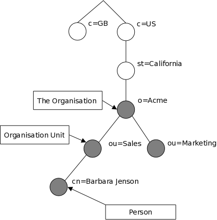
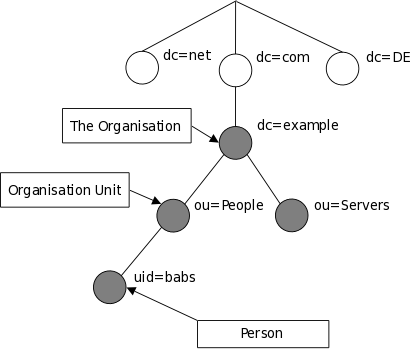

# 1. Introducción a OpenLDAP

En esta unidad aprenderás **qué es un servicio de directorio y cómo facilita la administración de usuarios, equipos y recursos de una organización**.

Utilizaremos OpenLDAP como referencia para comprender cómo se organiza la información y cómo acceden a ella las aplicaciones.

Al terminar, podrás:

- Explicar cuándo resulta útil un servicio de directorio.
- Interpretar **entradas, atributos y nombres distinguidos (DN)**.
- Entender cómo se buscan y modifican los datos mediante LDAP.
- Diferenciar **autenticación, autorización y protección de las comunicaciones**.
- Reconocer la función de **`slapd`**, el servidor de OpenLDAP que utilizaremos en las prácticas.

::: tip
Piensa en una empresa en la que los empleados utilizan varios ordenadores y aplicaciones. ¿Cómo podríamos gestionar sus cuentas y permisos sin configurarlos por separado en cada sistema?

Esta es una de las necesidades que aprenderás a resolver con los servicios de directorio.
:::

::: nota
**Tiempo de lectura orientativo: 1 hora.** Detente en los ejemplos y diagramas, y anota las dudas para comentarlas en clase.

El apartado sobre almacenamiento y bases de datos relacionales es una **ampliación opcional**.
:::

## 1.1. ¿Qué es un servicio de directorio?

Un directorio es una **base de datos especializada**, diseñada específicamente para realizar búsquedas y explorar información, además de admitir funciones básicas de consulta y actualización.

::: nota
Definir un directorio simplemente como una base de datos **optimizada para la lectura** resulta insuficiente: también importa cómo organiza, filtra y permite acceder a la información.
:::

Los directorios suelen contener **información descriptiva basada en atributos** y admitir capacidades avanzadas de filtrado.

Generalmente no admiten los complejos mecanismos de transacciones o reversión que se encuentran en los sistemas de gestión de bases de datos diseñados para manejar grandes volúmenes de actualizaciones complejas. Las actualizaciones de un directorio, cuando se permiten, suelen ser **cambios sencillos que se aplican por completo o no se aplican**.

Los directorios suelen estar ajustados para **responder rápidamente a grandes volúmenes de consultas o búsquedas**.

Los servicios de directorio pueden mantener **copias de su información en varios servidores**, mediante un mecanismo llamado **replicación**. Esto permite:

- Repartir las consultas.
- Atenderlas desde un servidor cercano.
- Mantener el servicio si uno falla.

Sin embargo, los cambios pueden tardar un tiempo en llegar a todas las copias. Durante ese intervalo, los servidores pueden mostrar **información diferente temporalmente**, hasta que se sincronizan.

::: tip
Imaginemos que una empresa tiene un servidor de directorio en Madrid y otro en Barcelona. Si se modifica el teléfono de un empleado en Madrid, el servidor de Barcelona puede seguir mostrando el número anterior hasta recibir la actualización.

Esta diferencia temporal puede ser aceptable para un teléfono, pero requiere especial cuidado cuando afecta a **contraseñas, permisos o cuentas deshabilitadas**.
:::

Hay muchas formas diferentes de proporcionar un servicio de directorio. Los distintos métodos determinan:

- Qué información puede almacenarse.
- Cómo se identifica, consulta y actualiza.
- Cómo se protege frente a accesos no autorizados.

Algunos servicios de directorio tienen un **alcance local**: ofrecen información sobre los usuarios o recursos de un equipo concreto.

Por ejemplo, un servicio que permite consultar los usuarios de una máquina, sin incluir los del resto de equipos de la organización.

Otros servicios son **globales** y abarcan un contexto más amplio, como toda una organización o incluso Internet.

Los servicios globales suelen ser **distribuidos**: sus datos están repartidos entre varias máquinas que cooperan para proporcionar un servicio de directorio común.

Para organizar esa información, utilizan un **espacio de nombres uniforme**: una estructura compartida que permite identificar cada entrada de la misma manera, independientemente del lugar desde el que se consulte.

::: tip
Imagina una universidad con campus en **Madrid, Barcelona y Valencia**. Cada campus mantiene en su servidor la información de sus propios usuarios, pero los tres servidores cooperan para ofrecer un directorio común.

Todos utilizan la misma estructura de nombres:

```text
Universidad
├── Madrid
│   └── Profesorado
│       └── Ana García
├── Barcelona
│   └── Profesorado
│       └── Luis Pérez
└── Valencia
    └── Alumnado
        └── Marta López
```

Desde Madrid puedes buscar a Luis, aunque su información esté almacenada en Barcelona. El servicio puede dirigir la consulta al servidor correspondiente.

Luis tiene la **misma identificación desde cualquier campus**:

`Universidad → Barcelona → Profesorado → Luis Pérez`

El lugar desde el que consultas no cambia a quién identifica ese nombre.
:::

En este ejemplo:

- **Global:** el servicio abarca toda la universidad.
- **Distribuido:** la información está repartida entre servidores que cooperan.
- **Espacio de nombres uniforme:** todos comparten una estructura común para identificar las entradas.

::: nota
**Distribuir y replicar son conceptos diferentes:**

- En este ejemplo, **distribuir** consiste en repartir distintas partes del directorio entre servidores.
- **Replicar** consiste en mantener copias de la misma información en varios servidores.

Ambas técnicas pueden combinarse: cada campus podría tener réplicas de su parte del directorio.
:::

Un **directorio web**, como el proporcionado por el [proyecto Curlie](https://curlie.org/), permite catalogar páginas web y facilita su exploración por categorías y su búsqueda.

El **sistema de nombres de dominio de Internet (DNS)** también organiza información de forma jerárquica y distribuida. Sin embargo, su función principal es resolver **consultas concretas**, como obtener la dirección IP asociada a un nombre de dominio.

::: nota
**Consultar un nombre no es lo mismo que explorar un directorio.**

DNS responde a preguntas sobre nombres y tipos de registro concretos. No ofrece, de forma general, una búsqueda por atributos como «encuentra todos los profesores del campus de Barcelona», propia de un directorio LDAP.
:::

## 1.2. ¿Qué es LDAP?

LDAP significa **Lightweight Directory Access Protocol**, o «protocolo ligero de acceso a directorios».

Define las reglas que permiten a una aplicación comunicarse con un servidor de directorio para:

- **Buscar entradas**, como usuarios, grupos o dispositivos.
- **Consultar sus atributos**, como el nombre o el correo electrónico.
- **Modificar la información almacenada**, siempre que disponga de los permisos necesarios.

Se denomina **ligero** porque se diseñó como una alternativa más sencilla y con menor consumo de recursos que **DAP**, el protocolo de acceso utilizado originalmente por X.500.

::: nota
**«Ligero» no significa que esté limitado a directorios pequeños.** El término hace referencia a la simplificación del protocolo respecto a DAP.
:::

**X.500 es una familia de estándares** que define cómo organizar la información de un directorio:

- Mediante **entradas** que representan personas, organizaciones o recursos.
- Con **atributos** que describen esas entradas.
- Dentro de una **estructura jerárquica** en la que cada entrada tiene un nombre que la identifica.

LDAP toma este modelo como referencia, pero permite acceder a él **sin utilizar toda la infraestructura de protocolos de X.500**.

::: tip
Una aplicación puede utilizar LDAP para buscar la entrada de una profesora y consultar su correo electrónico.

El directorio organiza y almacena esa información; **LDAP establece cómo solicitarla y recibir la respuesta**.
:::

LDAP funciona sobre **TCP/IP** u otros servicios de transferencia orientados a conexión.

Es un protocolo de la [IETF](https://www.ietf.org/) dentro del proceso de estandarización (*Standards Track*). El [RFC 4510](https://www.rfc-editor.org/rfc/rfc4510.txt) proporciona la **hoja de ruta de las especificaciones técnicas de LDAP**, indicando los documentos que definen sus distintos aspectos.

### ¿Qué tipo de información puede almacenarse en el directorio?

El modelo de información de LDAP se basa en **entradas**. Cada entrada representa un elemento del directorio, como una persona, un grupo o un dispositivo.

Una entrada contiene:

- Un **nombre distinguido**, o **DN** (*Distinguished Name*), que la identifica sin ambigüedad dentro del directorio.
- Un conjunto de **atributos** que describen sus características.

Cada atributo tiene un **tipo** y **uno o varios valores**, según lo permita el esquema.

| Tipo de atributo | Qué representa | Ejemplo de valor |
| :-: | :-: | :-: |
| `cn` | Nombre común (*common name*) | `Babs Jensen` |
| `mail` | Dirección de correo electrónico | `babs@example.com` |
| `jpegPhoto` | Fotografía | Datos binarios de una imagen JPEG |

Los nombres de los tipos de atributo suelen ser **abreviaturas fáciles de reconocer**, como `cn` o `mail`.

La **sintaxis** determina qué forma pueden tener los valores de cada atributo: no todos contienen texto; algunos pueden almacenar imágenes u otros tipos de datos.

::: tip
Podemos imaginar una entrada como la ficha de una persona:

- **DN:** `uid=babs,ou=People,dc=example,dc=com`
- **Nombre (`cn`):** Babs Jensen.
- **Correo (`mail`):** babs@example.com.
- **Fotografía (`jpegPhoto`):** una imagen JPEG.

El **DN identifica la ficha completa**; los **atributos describen a la persona**.
:::

::: aviso
**El nombre común no tiene por qué ser único.** 

Puede haber dos personas con el mismo valor de `cn`, pero sus entradas deben tener DN diferentes para poder distinguirlas.
:::

### ¿Cómo se organiza la información?

En LDAP, las entradas del directorio se organizan en una **estructura jerárquica en forma de árbol**, denominada **árbol de información del directorio** o **DIT** (*Directory Information Tree*).

Cada entrada ocupa una posición dentro del árbol y puede tener otras entradas debajo de ella.

### Organización geográfica y organizativa

Tradicionalmente, esta estructura reflejaba **divisiones geográficas u organizativas**:

- En los niveles superiores se situaban los **países**.
- Debajo aparecían **estados y organizaciones**.
- En niveles inferiores se encontraban **unidades organizativas, personas y recursos**, como impresoras o documentos.




::: tip
En la figura 1.1 podemos seguir el recorrido hasta una persona:

**Estados Unidos → California → Acme → Ventas → Barbara Jenson**

Cada nivel sitúa la entrada dentro de un contexto más concreto.
:::

### Organización basada en dominios de Internet

El árbol también puede organizarse a partir de **nombres de dominio de Internet**.

Por ejemplo, el dominio `example.com` puede representarse mediante los componentes `dc=example,dc=com`, donde **`dc` significa componente de dominio** (*domain component*).

Debajo pueden organizarse entradas para personas, servidores u otros recursos.




::: tip
En la figura 1.2, la entrada `uid=babs` se encuentra dentro de `ou=People`, bajo `dc=example,dc=com`.

Su posición completa se expresa mediante este DN:

`uid=babs,ou=People,dc=example,dc=com`
:::

::: aviso
**Utilizar un nombre de dominio en el directorio no crea registros DNS ni configura automáticamente la localización del servidor LDAP.**

La estructura de nombres del directorio y la configuración de DNS están relacionadas, pero deben configurarse por separado.
:::

### El esquema y las clases de objeto

Además de organizar las entradas en el árbol, es necesario definir **qué información puede contener cada una**.

El **esquema** establece las reglas de los datos del directorio: qué tipos de atributo existen, qué valores admiten y cómo se utilizan en las distintas clases de objeto.

Cada entrada tiene un atributo llamado **`objectClass`**, cuyos valores indican las clases de objeto a las que pertenece. Estas clases determinan:

- Qué atributos son **obligatorios**.
- Qué atributos están **permitidos**.

::: nota
El **árbol DIT** determina dónde se encuentra una entrada.

El **esquema y sus clases de objeto** determinan qué información puede contener.
:::

::: aviso
**Una entrada no puede contener cualquier atributo inventado libremente.**

Los atributos deben estar definidos en el esquema y permitidos por las clases de objeto o las reglas aplicables a la entrada.
:::

### ¿Cómo se identifica la información?

Una entrada se identifica mediante su **nombre distinguido**, o **DN** (*Distinguished Name*).

El DN se construye uniendo:

- El **nombre distinguido relativo**, o **RDN** (*Relative Distinguished Name*), de la propia entrada.
- Los RDN de sus entradas antecesoras, separados por comas.

El **RDN identifica la entrada dentro de su nivel del árbol**, mientras que el **DN indica su identificación completa dentro del directorio**.

### Ejemplo: identificar a una persona

La entrada de Barbara Jensen tiene:

- **RDN:** `uid=babs`
- **DN:** `uid=babs,ou=People,dc=example,dc=com`

Podemos descomponer su DN así:

| Componente | Significado |
| --- | --- |
| `uid=babs` | Identifica la entrada del usuario dentro de `People`. |
| `ou=People` | Identifica la unidad organizativa que contiene la entrada. |
| `dc=example` | Componente de dominio `example`. |
| `dc=com` | Componente de dominio `com`. |

::: tip
El DN se escribe **desde la entrada más concreta hacia sus antecesoras**:

`uid=babs → ou=People → dc=example → dc=com`

Para recorrer el árbol desde arriba hasta la persona, seguimos el orden contrario.
:::

::: aviso
**El RDN es `uid=babs`, no simplemente `babs`.** Incluye el tipo de atributo y su valor.

Además, un RDN puede repetirse bajo entradas padre diferentes. Lo que debe ser único dentro del directorio es el **DN completo**.
:::

::: nota
El formato completo del DN se describe en el [RFC 4514](https://www.rfc-editor.org/rfc/rfc4514.txt), «LDAP: representación de nombres distinguidos mediante cadenas de caracteres».
:::

### ¿Cómo se accede a la información?

LDAP permite **consultar y actualizar la información del directorio** mediante operaciones para añadir, eliminar, modificar y renombrar entradas.

Su uso más habitual es la **búsqueda de información**. Para realizarla, se especifican cuatro elementos:

| Elemento | Qué determina |
| --- | --- |
| **Base de búsqueda** | La entrada desde la que comienza la búsqueda. |
| **Ámbito de búsqueda** | Qué parte del árbol se examina a partir de esa base. |
| **Filtro** | Las condiciones que deben cumplir las entradas. |
| **Atributos solicitados** | La información que queremos recuperar de cada entrada encontrada. |

### Ejemplo 1: buscar personas en un subárbol

Queremos localizar las entradas cuyo nombre común sea `Barbara Jensen` dentro del subárbol de `dc=example,dc=com` y recuperar sus direcciones de correo electrónico.

- **Base:** `dc=example,dc=com`.
- **Ámbito:** todo el subárbol, incluida la entrada base y sus descendientes.
- **Filtro:** `(cn=Barbara Jensen)`.
- **Atributo solicitado:** `mail`.

::: tip
Podemos expresar la consulta así:

«Desde `dc=example,dc=com`, busca en todos los niveles las entradas cuyo nombre común sea Barbara Jensen y devuelve su correo electrónico».
:::

### Ejemplo 2: buscar organizaciones en un único nivel

Queremos localizar las organizaciones situadas inmediatamente debajo de `ou=empresas,dc=example,dc=com` cuyo nombre contenga `Acme` y que tengan un teléfono registrado.

Suponiendo que el nombre de la organización se almacena en el atributo `o`:

- **Base:** `ou=empresas,dc=example,dc=com`.
- **Ámbito:** un nivel; solo las entradas hijas directas de la base.
- **Filtro:** `(&(o=*Acme*)(telephoneNumber=*))`.
- **Atributos solicitados:** `o` y `telephoneNumber`.

El filtro combina dos condiciones:

- `(o=*Acme*)`: el nombre de la organización contiene `Acme`.
- `(telephoneNumber=*)`: el atributo de teléfono está presente.

El símbolo **`&`** indica que deben cumplirse **ambas condiciones**.

::: aviso
**Buscar en un nivel no equivale a buscar en todo el subárbol.**

Una búsqueda de un nivel examina únicamente las entradas hijas directas. No incluye la entrada base ni las entradas situadas en niveles más profundos.
:::

::: nota
**Filtrar y seleccionar atributos son tareas diferentes.**

El filtro decide **qué entradas se recuperan**. La selección de atributos decide **qué información se devuelve de esas entradas**, siempre dentro de los permisos de acceso del cliente.
:::

### ¿Cómo se protege la información frente a accesos no autorizados?

Algunos servicios de directorio permiten consultar información públicamente. Otros requieren que el cliente se identifique y restringen qué datos puede consultar o modificar.

LDAP permite que un cliente se **autentique**, es decir, que demuestre su identidad ante el servidor de directorio. A partir de esa identidad, el servidor puede aplicar **reglas de control de acceso** para proteger la información almacenada.

Es importante distinguir dos conceptos:

- **Autenticación:** comprueba quién eres.
- **Autorización:** determina qué puedes consultar o modificar.

::: tip
Una profesora se autentica ante el directorio con su cuenta.

El servidor puede permitirle consultar los correos del profesorado y actualizar su propio teléfono, pero impedirle modificar los datos de otros usuarios.

**Identificarse no significa tener acceso a toda la información.**
:::

LDAP también puede utilizar mecanismos de seguridad que protejan las comunicaciones:

| Propiedad | Qué protege |
| --- | --- |
| **Integridad** | Permite detectar alteraciones no autorizadas de los datos durante la comunicación. |
| **Confidencialidad** | Impide que terceros no autorizados puedan leer la información transmitida. |

Por ejemplo, **TLS** permite proteger la conexión entre el cliente y el servidor LDAP.

::: aviso
**Autenticarse no garantiza que la conexión esté cifrada.**

La protección de las comunicaciones debe configurarse expresamente. Enviar credenciales mediante autenticación simple sobre una conexión sin protección puede exponer la contraseña.
:::

::: nota
**El acceso anónimo no implica acceso completo.** Un servidor puede permitir consultas sin autenticación y limitar qué entradas y atributos son visibles.
:::

## 1.3. ¿Cuándo se debería utilizar LDAP?

En general, conviene utilizar un servidor de directorio cuando se necesita **gestionar información de forma centralizada** y permitir que distintos sistemas accedan a ella mediante **protocolos basados en estándares**, como LDAP.

### Usos habituales

| Uso | Ejemplo |
| --- | --- |
| **Identidades de usuarios y equipos** | Mantener las cuentas que utilizan los servicios de autenticación. |
| **Grupos de usuarios y sistemas** | Organizar empleados por departamento para facilitar la asignación de permisos. |
| **Libreta de direcciones** | Consultar nombres, correos electrónicos y teléfonos. |
| **Representación de la organización** | Reflejar departamentos, sedes y unidades organizativas. |
| **Registro de activos y recursos** | Almacenar información sobre equipos, impresoras y otros recursos. |
| **Configuración de aplicaciones** | Centralizar parámetros que consultan distintas aplicaciones. |
| **Información de telefonía** | Mantener extensiones y datos de configuración de una centralita privada o PBX. |

::: tip
Una empresa puede mantener en el directorio una entrada por empleado con su nombre, correo, teléfono y departamento.

La aplicación de correo consulta su dirección; la intranet utiliza su identidad; y el servidor de archivos puede utilizar sus grupos para decidir qué carpetas permite abrir.

Los servicios comparten una **fuente común de información**, en lugar de mantener esos datos por separado.
:::

### Adaptar el directorio a la información que necesitamos

Los datos deben ajustarse a un **esquema**, que define las clases de objeto y los atributos disponibles.

OpenLDAP incluye [archivos de esquema basados en estándares](https://www.openldap.org/doc/admin26/schema.html#Distributed%20Schema%20Files). Si estos no cubren una necesidad concreta, también se puede definir un [esquema propio](https://www.openldap.org/doc/admin26/schema.html).

::: aviso
**Centralizar datos no hace que todas las aplicaciones los utilicen automáticamente.**

Cada aplicación o servicio debe configurarse para consultar el directorio y utilizar sus datos. Las funciones disponibles dependerán de esa integración.
:::

::: nota
Antes de crear un esquema propio, conviene comprobar si existe uno estándar que cubra la necesidad. Reutilizar esquemas facilita la compatibilidad entre aplicaciones.
:::

No existe una lista cerrada de usos: la elección depende de **qué información se necesita compartir, cómo se consulta y cómo se actualiza**.

## 1.4. ¿Cuándo no se debería utilizar LDAP?

Si necesitas **forzar el modelo del directorio** para adaptarlo a los requisitos de una aplicación, conviene revisar el diseño y valorar otras opciones.

Una **base de datos relacional** puede ser más adecuada cuando:

- Los datos pertenecen a una aplicación y no necesitan compartirse como información de directorio.
- Se necesitan relaciones complejas entre los datos.
- Las actualizaciones requieren transacciones que coordinen varios cambios y permitan deshacerlos conjuntamente si algo falla.

::: tip
Un directorio puede almacenar las identidades y los grupos de los empleados de una tienda.

Para gestionar **pedidos, productos, pagos y existencias**, una base de datos relacional suele encajar mejor. Por ejemplo, registrar una compra puede requerir actualizar conjuntamente el pedido y las existencias.
:::

::: aviso
**Que solo una aplicación utilice los datos no descarta automáticamente LDAP.**

Lo decisivo es si el modelo de directorio y sus operaciones se ajustan a las necesidades. Además, un directorio también utiliza una base de datos para almacenar su información.
:::

::: nota
Para profundizar en esta comparación, consulta [LDAP frente a RDBMS](https://www.openldap.org/doc/admin26/intro.html#LDAP%20vs%20RDBMS).
:::

## 1.5. ¿Cómo funciona LDAP?

LDAP utiliza un **modelo cliente-servidor**. El cliente es una aplicación que se conecta a un servidor LDAP para consultar o modificar la información del directorio.

Puede ser una herramienta de administración, una aplicación web o un servicio que necesita identificar usuarios y consultar sus grupos.

### ¿Dónde se almacena la información?

Uno o varios servidores almacenan las entradas que forman el **árbol de información del directorio**, o **DIT** (*Directory Information Tree*).

Cada entrada representa un elemento, como una persona, un grupo o una unidad organizativa, y contiene **atributos que describen sus características**.

Las entradas se identifican mediante un **nombre distinguido (DN)**, que indica su posición dentro del árbol.

::: tip
El DN `uid=ana,ou=personas,dc=example,dc=com` identifica la entrada del usuario `ana` dentro de la unidad organizativa `personas`, bajo `dc=example,dc=com`.
:::

### ¿Cómo se comunican el cliente y el servidor?

La comunicación suele seguir estos pasos:

1. **Conexión.** El cliente establece una conexión con el servidor, que puede protegerse mediante TLS.
2. **Autenticación.** El cliente puede identificarse mediante una operación de enlace (*bind*). También puede consultar información de forma anónima si el servidor lo permite.
3. **Solicitud.** El cliente solicita una operación, como buscar entradas, añadir una nueva o modificar un atributo. El servidor comprueba si el cliente tiene los permisos necesarios.
4. **Respuesta.** El servidor devuelve el resultado. En una búsqueda, puede devolver las entradas y los atributos solicitados que el cliente tenga permiso para consultar.
5. **Continuación o cierre.** El cliente puede realizar más operaciones sobre la misma conexión o finalizar la sesión mediante una operación de desenlace (*unbind*).

::: aviso
**Conectarse al servidor no equivale a autenticarse, y autenticarse no concede todos los permisos.**

La conexión permite comunicarse; la autenticación establece la identidad; el control de acceso determina qué operaciones están permitidas.
:::

### Ejemplo de una búsqueda

En una búsqueda, el cliente indica la **base**, el **ámbito**, el **filtro** y los **atributos solicitados**.

Una aplicación podría realizar esta consulta:

| Elemento | Valor |
| --- | --- |
| **Base** | `ou=personas,dc=example,dc=com` |
| **Ámbito** | Todo el subárbol de la base. |
| **Filtro** | `(uid=ana)` |
| **Atributos solicitados** | `cn` y `mail`. |

::: tip
La consulta significa:

«Busca dentro de `personas` y sus descendientes las entradas cuyo atributo `uid` sea `ana`, y devuelve su nombre común y su correo electrónico».
:::

### ¿Qué ocurre cuando hay varios servidores?

El directorio puede estar **distribuido entre varios servidores**. Si un servidor no contiene la información solicitada, puede devolver una **referencia a otro servidor LDAP** donde continuar la consulta.

Además, una misma parte del directorio puede mantenerse en varios servidores mediante **replicación**. Esto mejora la disponibilidad y permite repartir las consultas.

::: nota
Dentro de un mismo directorio lógico, **un DN identifica la misma entrada**, independientemente del servidor que atienda la solicitud.
:::

::: aviso
**La misma identificación no garantiza una respuesta idéntica en todo momento.**

La información visible depende de los permisos del cliente y las réplicas pueden tardar en incorporar los cambios.
:::

## 1.6. ¿Qué relación tiene con X.500?

LDAP tiene su origen en **X.500**, la familia de estándares que define el servicio de directorio de OSI.

X.500 utiliza un protocolo de acceso denominado **DAP** (*Directory Access Protocol*). Este funciona sobre una pila completa de protocolos OSI y requiere una infraestructura más compleja que LDAP.

LDAP se diseñó para funcionar sobre **TCP/IP** y ofrecer gran parte de las funciones de DAP con un menor consumo de recursos.

### El funcionamiento original: una pasarela

Inicialmente, los clientes LDAP accedían a los servidores X.500 mediante una **pasarela**, que actuaba como intermediaria entre ambos protocolos:

```text
Cliente LDAP
     │
     │ LDAP
     ▼
Pasarela LDAP/DAP
     │
     │ DAP
     ▼
Servidor X.500
```

La pasarela utilizaba **LDAP para comunicarse con el cliente** y **DAP para comunicarse con el servidor X.500**.

::: tip
Podemos imaginar la pasarela como un intérprete: recibe una solicitud mediante LDAP y la adapta para comunicarse con un servidor que utiliza DAP.
:::

### Acceso directo mediante LDAP

Un servidor de directorio también puede **implementar LDAP directamente**, de modo que el cliente se comunique con él sin necesitar una pasarela.

Este es el enfoque de **OpenLDAP**, cuyo servidor se denomina `slapd`:

```text
Cliente LDAP
     │
     │ LDAP
     ▼
Servidor slapd
     │
     ▼
Datos del directorio
```

`slapd` puede considerarse un servidor de directorio X.500 ligero porque toma como referencia sus modelos, pero **no implementa DAP ni todos los modelos de X.500**.

::: aviso
**Para utilizar OpenLDAP no necesitas instalar un servidor X.500 DAP ni una pasarela.**

`slapd` atiende directamente las solicitudes LDAP.
:::

### Interoperabilidad con X.500 DAP

También es posible replicar información desde un servidor LDAP hacia un **DSA de X.500** (*Directory System Agent*), el componente que presta el servicio de directorio en ese entorno.

Para ello se necesita una **pasarela LDAP/DAP**. OpenLDAP no incluye esa pasarela.

::: nota
La guía de OpenLDAP se centra en proporcionar servicios de directorio mediante **LDAP y `slapd`**, sin desplegar un servicio X.500 DAP.
:::

## 1.7. ¿Qué diferencia hay entre LDAPv2 y LDAPv3?

**LDAPv3** se desarrolló a finales de la década de 1990 para sustituir a **LDAPv2**, incorporando mejoras de seguridad, compatibilidad y extensibilidad.

### Principales mejoras de LDAPv3

| Característica | Qué aporta |
| --- | --- |
| **SASL** | Permite utilizar distintos mecanismos de autenticación. Según el mecanismo, también puede proporcionar integridad y confidencialidad. |
| **TLS** | Protege las comunicaciones mediante cifrado y permite utilizar certificados para autenticar a las partes. |
| **Unicode** | Permite representar caracteres de distintos idiomas. |
| **Referencias y continuaciones** | Permite indicar otros servidores donde continuar una búsqueda. |
| **Descubrimiento del esquema** | Permite consultar las definiciones de los atributos y las clases de objeto del directorio. |
| **Extensibilidad** | Permite ampliar el comportamiento del protocolo mediante controles y operaciones extendidas. |

::: tip
Una herramienta de administración puede consultar el esquema del servidor para conocer los atributos obligatorios de una clase de objeto.

Así puede ayudar al administrador a crear una entrada válida, en lugar de limitarse a enviar datos sin conocer sus requisitos.
:::

::: aviso
**Utilizar LDAPv3 no significa que la conexión esté protegida automáticamente.**

Es necesario configurar los mecanismos de autenticación y la protección de las comunicaciones. Además, no todos los mecanismos SASL proporcionan las mismas garantías.
:::

### ¿Qué ocurre con LDAPv2?

LDAPv2 tiene la consideración de **histórico**, según el [RFC 3494](https://www.rfc-editor.org/rfc/rfc3494.txt).

Las diferencias entre LDAPv2 y LDAPv3, junto con las divergencias entre las antiguas implementaciones, dificultan su interoperabilidad y su despliegue conjunto.

::: aviso
**LDAPv2 debe evitarse en nuevos despliegues.** Para las prácticas utilizaremos LDAPv3.
:::

::: nota
En documentación antigua puede aparecer la expresión **«TLS (SSL)»**. Para el material y las configuraciones de clase utilizaremos el término **TLS**, evitando presentar SSL como una opción equivalente.
:::

## 1.8. LDAP frente a sistemas de gestión de bases de datos relacionales

## Ampliación: almacenamiento de un directorio y bases de datos relacionales

::: nota
**Contenido de ampliación.** Este apartado profundiza en cómo se almacena internamente la información de un directorio. Su lectura es opcional y no es necesaria para realizar las prácticas de administración LDAP de esta unidad.
:::

### El protocolo y el almacenamiento son cosas diferentes

**LDAP define cómo consultar y modificar un directorio**, pero no impone un único sistema de almacenamiento.

El servidor utiliza un componente denominado **backend** para gestionar los datos. En OpenLDAP, el backend **MDB** utiliza **LMDB**, una base de datos integrada de tipo clave-valor.

Por tanto, conviene distinguir:

- **LDAP:** el protocolo utilizado por los clientes.
- **El modelo de directorio:** entradas, atributos, clases de objeto y estructura jerárquica.
- **El backend:** el componente que gestiona el almacenamiento.

### ¿Por qué no utilizar siempre una base de datos relacional?

El modelo de un directorio y el modelo relacional organizan la información de forma diferente.

Un directorio trabaja con entradas que pueden tener:

- Atributos con varios valores.
- Atributos opcionales.
- Varias clases de objeto.
- Una posición dentro de un árbol.

Una base de datos relacional organiza los datos mediante **tablas, filas, columnas y relaciones**.

Representar un directorio mediante tablas requiere decidir cómo trasladar esas características al modelo relacional.

::: tip
Una persona puede tener varias direcciones de correo electrónico.

En LDAP, su entrada puede contener varios valores del atributo `mail`, si el esquema lo permite.

En un diseño relacional normalizado, podríamos utilizar una tabla de personas y otra de direcciones de correo relacionadas con ellas.
:::

Esta transformación es posible, pero añade decisiones de diseño y puede requerir consultar varias tablas para reconstruir una entrada.

### Distintas formas de almacenar la información

| Enfoque | En qué consiste | Principal consideración |
| --- | --- | --- |
| **Distribuir los datos entre tablas** | Representar entradas y atributos mediante un modelo relacional. | Es necesario traducir entre ambos modelos y reconstruir las entradas. |
| **Guardar cada entrada como un bloque de datos** | Almacenar la entrada completa y mantener estructuras adicionales para localizar sus atributos. | Gran parte de la lógica de búsqueda queda a cargo del servidor de directorio. |
| **Ofrecer acceso LDAP a datos relacionales existentes** | Presentar datos de una aplicación como si fueran entradas de un directorio. | Algunas operaciones LDAP pueden quedar limitadas por el esquema y las capacidades del sistema original. |

### La elección de OpenLDAP

El backend MDB de OpenLDAP utiliza LMDB para almacenar la información, junto con las estructuras de indexación que necesita el servidor.

Este enfoque permite gestionar el modelo de directorio sin tener que traducir cada operación a un conjunto de consultas SQL.

::: aviso
**Esto no significa que las bases de datos relacionales sean lentas o inadecuadas en general.**

La elección depende del modelo de datos, las operaciones, los índices y la carga de trabajo. No podemos afirmar que una tecnología sea siempre más rápida que otra.
:::

### Acceso LDAP a datos SQL

OpenLDAP también dispone de **`back-sql`**, un backend que permite ofrecer acceso LDAP a datos almacenados en una base de datos relacional.

Utiliza **ODBC** y una configuración que establece la correspondencia entre los datos relacionales y las entradas LDAP.

Las operaciones disponibles dependen del sistema de base de datos, del esquema y de esa correspondencia. Exponer datos mediante LDAP no garantiza que se puedan realizar todas las operaciones propias de un directorio.

Para profundizar, consulta la sección [Backends de OpenLDAP](https://www.openldap.org/doc/admin26/backends.html) y la página del manual `slapd-sql(5)`.

## 1.9. ¿Qué es slapd y qué puede hacer?

## ¿Qué es slapd?

**`slapd` es el servidor de directorio de OpenLDAP**. Es el proceso que recibe las solicitudes de los clientes, comprueba los permisos y realiza las operaciones sobre los datos del directorio.

Puede utilizarse para desplegar un directorio independiente o formar parte de una infraestructura con varios servidores.

::: nota
Cuando aparece escrito como `slapd(8)`, el número **8** indica la sección del manual de Unix donde se documenta. No forma parte del nombre del programa.
:::

### 1. Comunicación con los clientes

`slapd` implementa **LDAPv3** y permite conexiones mediante:

- **IPv4 e IPv6**, para comunicarse por red.
- **Comunicación local de Unix**, mediante sockets locales.

Los clientes pueden solicitar búsquedas, altas, modificaciones y eliminaciones de entradas, entre otras operaciones.

### 2. Autenticación y seguridad

`slapd` dispone de mecanismos para identificar a los clientes y proteger sus comunicaciones:

| Mecanismo | Función |
| --- | --- |
| **SASL** | Permite utilizar diferentes mecanismos de autenticación mediante la integración con Cyrus SASL. |
| **TLS** | Protege la integridad y confidencialidad de las comunicaciones y permite utilizar certificados. |
| **Control de acceso** | Determina qué entradas y atributos puede consultar o modificar cada cliente. |

::: tip
Podemos configurar el servidor para que un usuario consulte los datos públicos del directorio y modifique su propio teléfono, mientras que una cuenta de administración gestione otras entradas.
:::

::: aviso
**Disponer de estas funciones no significa que estén configuradas automáticamente.**

En la práctica comprobaremos tanto la protección de la conexión como los permisos efectivos de cada cuenta.
:::

### 3. Almacenamiento de la información

`slapd` utiliza **backends** para gestionar el almacenamiento. Entre ellos se encuentra **MDB**, que utiliza la base de datos integrada **LMDB**.

Una misma instancia de `slapd` puede gestionar **varias bases de datos**, correspondientes a distintas partes del directorio.

También admite **Unicode y etiquetas de idioma**, lo que permite trabajar con información en diferentes lenguas.

::: nota
En la práctica nos centraremos en administrar las entradas y su configuración. Los detalles internos del almacenamiento se desarrollan en el apartado de ampliación.
:::

### 4. Replicación y disponibilidad

`slapd` permite mantener copias del directorio mediante **replicación basada en LDAP Sync**.

Existen dos esquemas que conviene distinguir:

| Esquema | Funcionamiento |
| --- | --- |
| **Un proveedor y varios consumidores** | Los cambios se realizan en un proveedor y se propagan a los servidores consumidores. |
| **Múltiples proveedores** | Varios servidores aceptan escrituras y replican los cambios entre ellos. |

La replicación permite mejorar la disponibilidad y repartir las consultas.

::: aviso
**La replicación no sustituye a las copias de seguridad.**

Una eliminación o modificación incorrecta también puede propagarse a las réplicas.
:::

### 5. Configuración y administración

`slapd` permite ajustar su funcionamiento, incluyendo las bases de datos, los mecanismos de seguridad y las reglas de acceso.

La configuración puede gestionarse mediante el propio LDAP. Esto permite realizar determinados cambios dinámicamente, sin depender exclusivamente de la edición de archivos.

En la parte práctica trabajaremos sobre la configuración utilizada por nuestra instalación.

### 6. Otras capacidades

Además de las funciones anteriores, `slapd` dispone de:

- **Procesamiento multihilo:** utiliza un conjunto de hilos para atender solicitudes concurrentes.
- **Módulos y extensiones:** permiten incorporar funciones adicionales.
- **Proxy LDAP con caché:** puede actuar como intermediario y almacenar temporalmente resultados.
- **Integración con fuentes externas:** determinados backends permiten acceder a información de otros sistemas.

::: nota
Estas capacidades se incluyen como referencia. Su disponibilidad depende de la instalación y de los módulos habilitados; no será necesario configurarlas todas para comenzar a administrar un directorio.
:::
