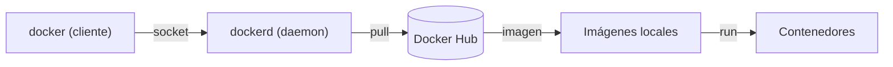

:::nota[Objetivo]
Instalar Docker Engine, ejecutar y gestionar contenedores, medir en qué se diferencian de una máquina virtual y desplegar con Docker Compose una aplicación de dos servicios con datos persistentes. El resultado es un blog WordPress propio en funcionamiento, pensado como punto de partida para ampliarlo en prácticas posteriores.
:::

:::aviso[Antes de empezar]
Esta práctica da por hecho lo siguiente:

- Has leído [[fundamentos-virtualizacion]], en especial los apartados de redes virtuales y de máquinas virtuales y contenedores.
- Tienes una máquina virtual con **Ubuntu Server 24.04 LTS** (64 bits) en VirtualBox, con al menos 2 CPU, 2048 MB de RAM y 20 GB de disco, y con acceso a Internet. Docker Engine admite también Ubuntu 22.04 y 26.04, pero los ejemplos están pensados para la 24.04.
- Tienes tu página web (HTML y CSS) en el equipo anfitrión, en una carpeta cuyo archivo principal se llama `index.html`.
- Escribes cada orden tú mismo y lees su salida antes de pasar a la siguiente. Un error no se salta: se lee, se entiende y se corrige.
- Haces las instantáneas que se indican. Una instantánea no es una copia de seguridad, pero te permite volver al último punto bueno.
:::

## 1. Resultados de aprendizaje

Al terminar la práctica deberías ser capaz de:

1. Instalar Docker Engine desde el repositorio oficial y comprobar que funciona.
2. Distinguir imagen, contenedor, registro, volumen y red, y explicar qué hace cada orden `docker` que uses.
3. Publicar un sitio web estático con un contenedor `nginx` y un directorio del anfitrión montado en él.
4. Gestionar contenedores desde una interfaz web (Portainer) y explicar su relación con la línea de órdenes.
5. Demostrar con medidas qué comparte un contenedor con el anfitrión y qué no, y cuáles son las diferencias frente a una máquina virtual.
6. Describir una aplicación de varios servicios en un archivo de Docker Compose y explicar cómo se conservan sus datos.

| Parte | Contenido | Sesión |
| --- | --- | --- |
| 1 | Preparación: máquina virtual, red y Docker Engine | 1 |
| 2 | Un servidor web con `nginx` y tu página | 1 |
| 3 | Gestión con Portainer | 2 |
| 4 | Contenedor frente a máquina virtual | 2 |
| 5 | Blog con WordPress y MariaDB (Docker Compose) | 3 |

Cada sesión dura 55 minutos.

## 2. Conceptos previos

| Concepto | Definición |
| --- | --- |
| **Imagen** | Plantilla de solo lectura, formada por capas, con el sistema de archivos y la configuración necesarios para ejecutar una aplicación. |
| **Contenedor** | Instancia de una imagen, en ejecución o detenida. Sus procesos corren en el anfitrión, aislados mediante espacios de nombres y limitados mediante cgroups. Tiene una capa de escritura propia que se elimina con el contenedor. |
| **Registro** (*registry*) | Servicio donde se almacenan y descargan imágenes. El registro público por defecto es [Docker Hub](https://hub.docker.com/). |
| **Docker Engine** | El servicio (`dockerd`, el *daemon*) que crea y ejecuta los contenedores. |
| **Cliente** (`docker`) | La orden con la que se le piden cosas al *daemon*, a través del socket `/var/run/docker.sock`. |
| **Etiqueta** (*tag*) | Versión de una imagen: `nginx:alpine` es la imagen `nginx` en su variante `alpine`. Sin etiqueta se usa `latest`. |
| **Volumen** | Almacenamiento gestionado por Docker que sobrevive al contenedor. |
| **Montaje de directorio** (*bind mount*) | Un directorio del anfitrión que se hace visible dentro del contenedor. |
| **Docker Compose** | Herramienta que describe en un archivo YAML un conjunto de servicios, redes y volúmenes, y los crea o destruye juntos. |



## 3. Parte 1: Preparación

### 3.1 Máquina virtual y red

Con la máquina **apagada**, configura el adaptador de red en VirtualBox. Para ver las páginas desde el navegador del anfitrión, la máquina necesita ser alcanzable desde él.

| Opción | Configuración | Cómo se accede |
| --- | --- | --- |
| **Recomendada** | Adaptador 1 en **Adaptador puente** | Con la IP de la máquina: `http://IP:puerto` |
| Alternativa, si el aula no permite el puente | Adaptador 1 en **NAT**, con las reglas de reenvío de puertos de la tabla siguiente | Con `http://localhost:puerto_del_anfitrión` |

Reglas de reenvío para el modo NAT (en *Red → Avanzadas → Reenvío de puertos*):

| Servicio | Puerto de la MV | Puerto del anfitrión |
| --- | --- | --- |
| SSH | 22 | 2222 |
| Servidor web (parte 2) | 8080 | 8080 |
| Segundo servidor web (parte 3) | 8081 | 8081 |
| Portainer (parte 3) | 9443 | 9443 |
| WordPress (parte 5) | 80 | 8088 |

Arranca la máquina y averigua su dirección:

```bash
ip -br address
```

Anota la IP de la interfaz de red (por ejemplo, `enp0s3`). Si usas NAT, la IP de la máquina no se usa desde el anfitrión: usa `localhost` y los puertos de la columna «Puerto del anfitrión».

:::tip[Cómo leer esta práctica]
Cuando el texto diga «`http://IP:8080`» y trabajes con NAT, lee «`http://localhost:8080`». Para WordPress, con NAT, la dirección es `http://localhost:8088`.
:::

### 3.2 Copiar tu página web a la máquina

En la máquina virtual, crea el directorio de trabajo:

```bash
mkdir -p ~/practica-docker
```

Desde una terminal del **anfitrión** (Windows 10 y posteriores, macOS y Linux incluyen `scp`), copia la carpeta de tu web. Sustituye `usuario` y `IP` por los tuyos y `mi-web` por el nombre de tu carpeta:

```bash
scp -r ./mi-web usuario@IP:~/practica-docker/web
```

Con NAT, el puerto de SSH es el 2222 y la dirección es `localhost`:

```bash
scp -P 2222 -r ./mi-web usuario@localhost:~/practica-docker/web
```

Si `scp` no conecta, instala el servidor SSH en la máquina con `sudo apt install openssh-server`.

Comprueba en la máquina virtual que el contenido es el esperado:

```bash
ls -lR ~/practica-docker/web
```

Debe aparecer `index.html` directamente dentro de `web`, no dentro de otra subcarpeta.

:::aviso[Rutas dentro de tu HTML]
Las rutas a la hoja de estilos y a las imágenes deben ser **relativas** (`css/estilo.css`) o partir de la raíz del sitio (`/css/estilo.css`). Una ruta del disco del anfitrión (`C:\...`, `/Users/...`) dejará de funcionar. Además, Linux distingue mayúsculas de minúsculas: `Estilo.css` y `estilo.css` son archivos distintos.
:::

### 3.3 Instalar Docker Engine

Docker se instala desde su **repositorio oficial**. Ubuntu incluye también un paquete propio (`docker.io`), pero el repositorio de Docker proporciona Docker Engine y Docker Compose en versiones actuales.

Primero, las dependencias y la clave con la que Docker firma sus paquetes:

```bash
sudo apt update
sudo apt install ca-certificates curl
sudo install -m 0755 -d /etc/apt/keyrings
sudo curl -fsSL https://download.docker.com/linux/ubuntu/gpg -o /etc/apt/keyrings/docker.asc
sudo chmod a+r /etc/apt/keyrings/docker.asc
```

Después, se declara el repositorio. La orden rellena sola el nombre de la versión de Ubuntu y la arquitectura:

```bash
sudo tee /etc/apt/sources.list.d/docker.sources <<EOF
Types: deb
URIs: https://download.docker.com/linux/ubuntu
Suites: $(. /etc/os-release && echo "${UBUNTU_CODENAME:-$VERSION_CODENAME}")
Components: stable
Architectures: $(dpkg --print-architecture)
Signed-By: /etc/apt/keyrings/docker.asc
EOF
```

Comprueba el archivo creado (`cat /etc/apt/sources.list.d/docker.sources`): la línea `Suites` debe mostrar `noble` en Ubuntu 24.04. Finalmente, se instalan los paquetes:

```bash
sudo apt update
sudo apt install docker-ce docker-ce-cli containerd.io docker-buildx-plugin docker-compose-plugin
```

| Paquete | Función |
| --- | --- |
| `docker-ce` | Docker Engine (el *daemon*) |
| `docker-ce-cli` | La orden `docker` |
| `containerd.io` | El componente que ejecuta los contenedores a bajo nivel |
| `docker-buildx-plugin` | Construcción de imágenes |
| `docker-compose-plugin` | La orden `docker compose` |

Verifica que el servicio está activo y ejecuta la imagen de prueba:

```bash
sudo systemctl status docker
sudo docker run hello-world
```

La salida de `hello-world` describe lo que acaba de ocurrir: el cliente contactó con el *daemon*, este descargó la imagen `hello-world` desde Docker Hub, creó un contenedor a partir de ella y transmitió su salida al cliente. Ese es el ciclo completo de una imagen.

### 3.4 Usar Docker sin `sudo`

Añade tu usuario al grupo `docker`:

```bash
sudo usermod -aG docker $USER
```

El cambio solo se aplica a las sesiones nuevas. Cierra la sesión (`exit`), vuelve a entrar y comprueba:

```bash
groups
docker run --rm hello-world
docker version
docker compose version
```

`groups` debe incluir `docker`. `docker version` muestra dos bloques, *Client* y *Server*: son el cliente y el *daemon* de los que hablaba el apartado 2. La opción `--rm` elimina el contenedor al terminar.

:::aviso[El grupo docker equivale a administrador]
Quien pertenece al grupo `docker` puede iniciar un contenedor que monte el sistema de archivos completo del anfitrión, y por tanto tiene en la práctica los mismos permisos que `root`. En este laboratorio es aceptable. En un servidor real, el grupo debe limitarse a quienes administran el sistema.
:::

Haz una instantánea de la máquina virtual llamada `01-docker-instalado`.

## 4. Parte 2: Un servidor web con nginx

### 4.1 Primer contenedor

```bash
docker run -d --name web -p 8080:80 nginx:alpine
```

| Elemento | Significado |
| --- | --- |
| `docker run` | Crea un contenedor a partir de una imagen y lo inicia. Si la imagen no está en local, la descarga antes. |
| `-d` | Lo ejecuta en segundo plano (*detached*). |
| `--name web` | Le da el nombre `web`. Sin esta opción, Docker asigna uno aleatorio. |
| `-p 8080:80` | Publica el puerto 80 del contenedor en el puerto 8080 de la máquina (`puerto_anfitrión:puerto_contenedor`). |
| `nginx:alpine` | La imagen: el servidor [nginx](https://es.wikipedia.org/wiki/Nginx) sobre la distribución Alpine Linux, que es muy pequeña. |

Comprueba el resultado de tres formas:

```bash
docker ps
docker port web
curl -sI http://localhost:8080
```

`docker ps` lista los contenedores en ejecución, `docker port` muestra la publicación de puertos y `curl -sI` pide solo las cabeceras: deben incluir `HTTP/1.1 200 OK` y `Server: nginx`. Abre ahora `http://IP:8080` en el navegador del anfitrión: aparece la página «Welcome to nginx!».

### 4.2 Examinar el contenedor

```bash
docker logs web
docker top web
docker exec -it web sh
```

Dentro del contenedor, muestra la página que acabas de ver y sal:

```bash
cat /usr/share/nginx/html/index.html
exit
```

| Orden | Qué hace |
| --- | --- |
| `docker logs web` | Muestra lo que el contenedor ha escrito en su salida. Aquí, el registro de accesos de nginx. |
| `docker top web` | Lista los procesos del contenedor. |
| `docker exec -it web sh` | Ejecuta una orden dentro de un contenedor en marcha. `-i` mantiene la entrada abierta y `-t` asigna un terminal. |

La carpeta `/usr/share/nginx/html` es donde la imagen `nginx` guarda el contenido que sirve.

Ciclo de vida de un contenedor:

| Orden | Efecto |
| --- | --- |
| `docker stop web` | Detiene el contenedor. Sigue existiendo. |
| `docker start web` | Vuelve a iniciar un contenedor detenido. |
| `docker ps -a` | Lista todos los contenedores, también los detenidos. |
| `docker rm web` | Elimina un contenedor detenido. `docker rm -f web` lo elimina aunque esté en marcha. |

### 4.3 Publicar tu página

Elimina el contenedor y créalo de nuevo montando tu carpeta en la ruta que sirve nginx:

```bash
docker rm -f web
docker run -d --name web -p 8080:80 -v "$HOME/practica-docker/web:/usr/share/nginx/html:ro" nginx:alpine
```

La opción `-v origen:destino:ro` monta el directorio `origen` del anfitrión en la ruta `destino` del contenedor. `:ro` lo hace de solo lectura: nginx puede leer tu web, pero no modificarla.

:::aviso[Con `-v`, el origen debe ser una ruta absoluta]
Si en `-v` escribes un nombre en lugar de una ruta absoluta (por ejemplo, `web:/usr/share/nginx/html`), Docker lo interpreta como el nombre de un **volumen** y no como un directorio de tu máquina. Por eso se usa `$HOME/...`. Además, si la ruta absoluta no existe, `-v` la crea vacía y con propietario `root`, sin avisar. Si tu página no aparece, comprueba primero que la ruta es correcta.
:::

Abre `http://IP:8080`: debe verse tu página con sus estilos. Comprueba también el contenido montado:

```bash
docker exec web ls /usr/share/nginx/html
```

Ahora edita un texto en la máquina virtual y recarga el navegador:

```bash
nano ~/practica-docker/web/index.html
```

El cambio aparece sin reiniciar el contenedor, porque nginx lee los archivos del directorio montado cada vez que recibe una petición.

### 4.4 El contenedor es efímero

Para ver qué pasa con lo que se escribe dentro de un contenedor sin montaje, crea otro de prueba y modifica su página:

```bash
docker run -d --name prueba -p 8082:80 nginx:alpine
docker exec prueba sh -c 'echo cambiado > /usr/share/nginx/html/index.html'
curl http://localhost:8082
docker rm -f prueba
docker run -d --name prueba -p 8082:80 nginx:alpine
curl http://localhost:8082
docker rm -f prueba
```

La primera petición devuelve `cambiado`. La segunda devuelve la página original de nginx. Lo escrito en la capa del contenedor se elimina con él. En cambio, el contenedor `web` puedes eliminarlo y crearlo de nuevo cuantas veces quieras y tu página sigue ahí, porque vive en el directorio del anfitrión.

:::ejercicio[Entrega de la parte 2]
Guarda como evidencia:

1. Una captura del navegador con tu página servida por el contenedor, donde se vea la dirección.
2. La salida de `docker ps` y de `docker port web`.
3. Una explicación, en tres líneas, de por qué la página de `prueba` se pierde y la de `web` no.
:::

## 5. Parte 3: Gestión con Portainer

[Portainer](https://www.portainer.io/) es una aplicación web para gestionar Docker. Se ejecuta ella misma como un contenedor.

```bash
docker volume create portainer_data
docker run -d -p 8000:8000 -p 9443:9443 --name portainer --restart=always -v /var/run/docker.sock:/var/run/docker.sock -v portainer_data:/data portainer/portainer-ce:lts
```

| Elemento | Significado |
| --- | --- |
| `docker volume create portainer_data` | Crea un volumen con nombre, administrado por Docker, donde Portainer guardará sus datos. |
| `-p 9443:9443` | Puerto de la interfaz web, que usa HTTPS. |
| `-p 8000:8000` | Puerto de un túnel que solo usan los agentes *Edge*. En esta práctica no se utiliza. |
| `--restart=always` | Docker reinicia el contenedor si se detiene y al arrancar el sistema. |
| `-v /var/run/docker.sock:/var/run/docker.sock` | Monta el socket del *daemon*. Así Portainer puede dar órdenes a Docker. |
| `-v portainer_data:/data` | Monta el volumen en `/data`. |
| `portainer/portainer-ce:lts` | La edición Community de Portainer, en su versión de soporte prolongado. |

:::aviso[Portainer controla Docker entero]
Montar `/var/run/docker.sock` da a Portainer el control completo de Docker, y por tanto del anfitrión (véase el aviso del apartado 3.4). Quien acceda a su interfaz tiene esos mismos permisos. En un servidor real, no se expone sin protección ni a Internet.
:::

### 5.1 Primer acceso

Abre `https://IP:9443`. El navegador avisará de que el certificado no es de confianza: Portainer usa un certificado autofirmado, así que es el comportamiento esperado. Acepta la excepción.

Las instalaciones nuevas pueden pedir un **código de configuración** (*setup token*), que Portainer escribe en sus registros en una línea con `setup_token=`. Si la interfaz lo pide, búscalo así:

```bash
docker logs portainer 2>&1 | grep setup_token
```

Después, crea el usuario administrador: el nombre por defecto es `admin` y la contraseña debe tener al menos 12 caracteres. Si se ofrece la configuración de *Edge Compute*, omítela. Cuando aparezca el asistente de entornos, Portainer habrá detectado el Docker local: entra en él con *Get Started*.

### 5.2 Tareas

La interfaz puede variar ligeramente entre versiones; busca los apartados por su nombre.

:::ejercicio[Portainer]
1. En *Containers*, localiza `web` y `portainer`. Anota para cada uno la imagen, el estado y los puertos.
2. Abre los registros (*Logs*) de `web`. Recarga tu página en el navegador y comprueba que aparecen líneas nuevas.
3. Abre las estadísticas (*Stats*) de `web` y anota el uso de CPU y de memoria.
4. Abre una consola (*Console*) en `web` con `/bin/sh` y ejecuta `ls /usr/share/nginx/html`.
5. Detén `web` desde Portainer. Comprueba en la terminal con `docker ps -a` que el estado ha cambiado, y vuelve a iniciarlo. Portainer y la línea de órdenes son dos interfaces de **un mismo** Docker Engine.
6. Crea desde Portainer (*Add container*) un contenedor `web2` con la imagen `nginx:alpine`, el puerto 8081 del anfitrión asignado al 80 del contenedor y un montaje de tipo *Bind* de `/home/TU_USUARIO/practica-docker/web` sobre `/usr/share/nginx/html`, en solo lectura. Abre `http://IP:8081`.
7. En la terminal, ejecuta `docker ps` y comprueba que `web2` aparece aunque no lo hayas creado con `docker run`. Elimínalo después desde Portainer.
:::

Haz una instantánea llamada `02-portainer`.

## 6. Parte 4: Contenedor frente a máquina virtual

La teoría afirma que los contenedores comparten el núcleo del anfitrión y que son más ligeros que una máquina virtual. En esta parte lo vas a **comprobar** con medidas. Descarga antes la imagen que vas a usar, para que el tiempo de descarga no entre en las medidas:

```bash
docker pull alpine
```

### 6.1 ¿Qué núcleo usa un contenedor?

```bash
uname -r
docker run --rm alpine uname -r
docker run --rm alpine cat /etc/os-release
```

`uname -r` muestra la versión del núcleo. Las dos primeras órdenes devuelven **el mismo valor**: el contenedor no tiene núcleo propio. La tercera muestra que el sistema de archivos del contenedor es de Alpine Linux, distinto del Ubuntu de la máquina. Un contenedor trae su propio espacio de usuario (programas y bibliotecas), pero usa el núcleo del anfitrión.

### 6.2 ¿Dónde están los procesos del contenedor?

```bash
ps -eo pid,user,comm | grep nginx
docker top web
```

Los procesos de nginx aparecen en la lista de procesos de la máquina anfitriona, con sus identificadores reales. `docker top` muestra los mismos desde el punto de vista de Docker. Un contenedor es, literalmente, un conjunto de procesos del anfitrión con aislamiento: no hay un segundo sistema operativo arrancando.

### 6.3 Tiempo, espacio y memoria

Mide cada magnitud en el contenedor y en la máquina virtual:

```bash
time docker run --rm alpine true
systemd-analyze
docker images
docker system df
df -h /
docker stats --no-stream
free -h
```

| Orden | Qué mide |
| --- | --- |
| `time docker run --rm alpine true` | Tiempo (`real`) que se tarda en crear, iniciar y destruir un contenedor que no hace nada. |
| `systemd-analyze` | Tiempo de arranque de la máquina virtual, desde el núcleo hasta el sistema listo. No incluye el arranque de VirtualBox. |
| `docker images` | Tamaño de cada imagen descargada. |
| `docker system df` | Espacio total que ocupan las imágenes y los contenedores. |
| `df -h /` | Espacio ocupado en el disco de la máquina virtual. |
| `docker stats --no-stream` | Memoria y CPU que consume cada contenedor en marcha. |
| `free -h` | Memoria usada en la máquina virtual. |

Consulta además en VirtualBox la memoria asignada a la máquina y el tamaño del archivo de disco virtual en el anfitrión.

:::ejercicio[Tabla comparativa]
Completa la tabla con **tus** medidas, incluyendo las unidades:

| Magnitud | Máquina virtual (Ubuntu Server) | Contenedor |
| --- | --- | --- |
| Núcleo (`uname -r`) |  |  |
| Tiempo de arranque |  |  |
| Tamaño en disco |  |  |
| Memoria usada |  |  |

Redacta después una conclusión de cinco líneas: qué magnitudes favorecen al contenedor, cuál es el precio de esa ventaja y en qué caso elegirías una máquina virtual.
:::

### 6.4 Límites de recursos

Los cgroups, que la teoría presenta como base de los contenedores, permiten limitar lo que un contenedor puede consumir:

```bash
docker run -d --name limitado --memory 64m --cpus 0.5 nginx:alpine
docker stats --no-stream limitado
docker rm -f limitado
```

En la columna `MEM USAGE / LIMIT` aparece `64MiB` como límite. Si el proceso intentara usar más memoria, el núcleo lo terminaría. El contenedor `limitado` no publica ningún puerto, así que no es accesible desde fuera; para esta prueba no hace falta.

## 7. Parte 5: Un blog con WordPress y MariaDB

[WordPress](https://es.wikipedia.org/wiki/WordPress) es un gestor de contenidos que necesita dos servicios: el servidor web con PHP que genera las páginas y una base de datos que guarda las entradas y los usuarios. Para esta aplicación se usan las imágenes oficiales `wordpress` y `mariadb`. Con `docker run` habría que ejecutar dos contenedores, crear una red, dos volúmenes y pasar a cada uno una docena de opciones. Docker Compose lo describe todo en un archivo.

### 7.1 Los archivos del proyecto

Crea un directorio para el blog y entra en él:

```bash
mkdir ~/blog
cd ~/blog
```

Crea el archivo `compose.yaml`:

```bash
nano compose.yaml
```

Con este contenido (la sangría de YAML son **espacios**, nunca tabuladores):

```yaml
services:
  db:
    image: mariadb:lts
    restart: unless-stopped
    environment:
      MARIADB_ROOT_PASSWORD: ${DB_ROOT_PASSWORD}
      MARIADB_DATABASE: wordpress
      MARIADB_USER: wordpress
      MARIADB_PASSWORD: ${DB_PASSWORD}
    volumes:
      - db_data:/var/lib/mysql
    healthcheck:
      test: ["CMD", "healthcheck.sh", "--connect", "--innodb_initialized"]
      start_period: 10s
      interval: 10s
      timeout: 5s
      retries: 3

  wordpress:
    image: wordpress:latest
    restart: unless-stopped
    depends_on:
      db:
        condition: service_healthy
    ports:
      - "80:80"
    environment:
      WORDPRESS_DB_HOST: db
      WORDPRESS_DB_USER: wordpress
      WORDPRESS_DB_PASSWORD: ${DB_PASSWORD}
      WORDPRESS_DB_NAME: wordpress
    volumes:
      - wp_data:/var/www/html

volumes:
  db_data:
  wp_data:
```

Y crea el archivo `.env`, que contiene las contraseñas. Elige dos contraseñas **distintas y de al menos 16 caracteres**; no uses las mismas que en ningún otro sitio:

```bash
nano .env
chmod 600 .env
```

```text
DB_ROOT_PASSWORD=pon-aqui-la-contraseña-de-root
DB_PASSWORD=pon-aqui-la-contraseña-de-wordpress
```

Docker Compose lee automáticamente el archivo `.env` del directorio del proyecto y sustituye las variables `${...}` del `compose.yaml`. `chmod 600` hace que solo tu usuario pueda leerlo.

| Elemento del archivo | Qué hace |
| --- | --- |
| `services` | Los contenedores de la aplicación: `db` (MariaDB) y `wordpress`. |
| `image` | La imagen de cada servicio. `mariadb:lts` es la versión de soporte prolongado de MariaDB. |
| `environment` | Variables de entorno que configuran la imagen. En `db` crean la base de datos y el usuario la primera vez que arranca. En `wordpress` indican cómo conectarse. |
| `volumes` (en un servicio) | Dónde se montan los volúmenes: `/var/lib/mysql` guarda los datos de MariaDB y `/var/www/html` los archivos de WordPress. |
| `volumes` (al final) | Declara los volúmenes con nombre `db_data` y `wp_data`. |
| `healthcheck` | Una comprobación periódica que dice si MariaDB acepta conexiones y ha terminado de iniciarse. |
| `depends_on` con `service_healthy` | `wordpress` no se inicia hasta que `db` está en buen estado. |
| `ports` | Publica el puerto 80 del contenedor `wordpress` en el 80 de la máquina. **`db` no publica ningún puerto.** |
| `restart: unless-stopped` | Docker reinicia el contenedor si falla o si se reinicia el sistema, salvo que lo hayas detenido tú. |
| `WORDPRESS_DB_HOST: db` | WordPress localiza la base de datos por el **nombre del servicio**: Compose crea una red para el proyecto y un DNS interno que resuelve `db` a la dirección del contenedor. |

:::aviso[Las variables de entorno son visibles]
Las contraseñas pasadas por variables de entorno se pueden ver con `docker inspect` por quien tenga acceso a Docker. Es aceptable en un laboratorio. En producción, las imágenes admiten variables acabadas en `_FILE` (por ejemplo, `MARIADB_PASSWORD_FILE`) para leer el valor de un archivo gestionado como secreto.
:::

### 7.2 Validar y desplegar

```bash
docker compose config
```

Esta orden comprueba la sintaxis y muestra el archivo con las variables ya sustituidas. Si hay un error de YAML o falta una variable, lo indica aquí, antes de crear nada. Despliega:

```bash
docker compose up -d
docker compose ps
```

La primera vez descarga las dos imágenes. `docker compose ps` debe mostrar `db` con estado `healthy` y `wordpress` en ejecución. Si algo no arranca, mira los registros:

```bash
docker compose logs db
docker compose logs -f wordpress
```

`-f` sigue los registros en directo; se sale con `Ctrl+C`, que no detiene los contenedores.

### 7.3 Instalar WordPress

Abre `http://IP` (con NAT, `http://localhost:8088`). WordPress muestra su asistente de instalación:

1. Elige el idioma.
2. Escribe el título del sitio y crea el usuario administrador. **No uses `admin`** como nombre de usuario y elige una contraseña robusta.
3. Inicia sesión en `http://IP/wp-admin`.

:::ejercicio[Primera entrada del blog]
Crea una entrada con el título «Mi primer contenedor». En ella:

1. Explica con tus palabras qué es un contenedor y en qué se diferencia de una máquina virtual, apoyándote en las medidas de la parte 4.
2. Incluye una captura de `docker compose ps`.
3. Pega el contenido de tu `compose.yaml` en un bloque de código y explica en una frase qué hace cada uno de los dos servicios.

Publica la entrada y comprueba que aparece en la portada.
:::

### 7.4 Examinar la red y los volúmenes

```bash
docker network ls
docker compose exec wordpress getent hosts db
docker volume ls
ss -tln | grep -E ':(80|3306)\b'
```

| Orden | Qué debes observar |
| --- | --- |
| `docker network ls` | Una red `blog_default`, creada por Compose. El prefijo es el nombre del directorio del proyecto. |
| `docker compose exec wordpress getent hosts db` | La dirección IP interna de `db`, resuelta desde el contenedor `wordpress`. |
| `docker volume ls` | Los volúmenes `blog_db_data` y `blog_wp_data`, además de `portainer_data`. |
| `ss -tln` | El puerto 80 está a la escucha; el 3306 de MariaDB **no**. |

La base de datos solo es accesible desde la red interna del proyecto. Es una buena práctica de seguridad: el único servicio expuesto es el que tiene que serlo.

### 7.5 Persistencia

Primero, detén y elimina los contenedores y la red del proyecto:

```bash
docker compose down
docker compose ps
docker volume ls
```

`docker compose ps` no muestra ningún contenedor, pero los volúmenes siguen existiendo. Vuelve a desplegar:

```bash
docker compose up -d
```

Recarga el blog: tu entrada **sigue ahí**, y no ha hecho falta reinstalar nada. Los contenedores se han destruido y creado de nuevo; los datos estaban en los volúmenes.

Antes de seguir, guarda la captura de la persistencia que se pide en el apartado 8.

### 7.6 Copia de seguridad de la base de datos

Un volumen no es una copia de seguridad: si se pierde el disco o se eliminan los volúmenes, se pierde todo. Una copia lógica de la base de datos se hace con `mariadb-dump`, ejecutado dentro del contenedor:

```bash
docker compose exec -T db sh -c 'mariadb-dump -u root -p"$MARIADB_ROOT_PASSWORD" wordpress' > copia-wordpress.sql
ls -lh copia-wordpress.sql
head copia-wordpress.sql
```

`$MARIADB_ROOT_PASSWORD` se expande **dentro** del contenedor, donde existe esa variable, gracias a las comillas simples. `-T` evita que Compose asigne un terminal: con terminal, la salida redirigida a un archivo puede llevar caracteres de control que estropean la copia. El resultado queda en un archivo de tu directorio; `head` debe mostrar las primeras líneas del volcado (comentarios `-- MariaDB dump` y órdenes SQL).

La base de datos guarda las entradas y los usuarios, pero no las imágenes que subes a WordPress: esas están en el volumen `wp_data`, junto con los temas y los complementos. Para copiarlo se usa un contenedor temporal que monta el volumen y tu directorio actual, y empaqueta el contenido con `tar`:

```bash
docker run --rm -v blog_wp_data:/datos:ro -v "$PWD":/copia alpine tar czf /copia/wp-data.tar.gz -C /datos .
ls -lh wp-data.tar.gz
```

| Elemento | Significado |
| --- | --- |
| `-v blog_wp_data:/datos:ro` | Monta el volumen del blog en `/datos`, en solo lectura. El nombre lleva el prefijo del proyecto (apartado 7.4). |
| `-v "$PWD":/copia` | Monta tu directorio actual (`~/blog`) en `/copia`, para que el archivo quede fuera del contenedor. |
| `tar czf /copia/wp-data.tar.gz -C /datos .` | Empaqueta y comprime todo el contenido de `/datos` en `wp-data.tar.gz`. |

Este método sirve para copiar cualquier volumen. Copia los dos archivos, `copia-wordpress.sql` y `wp-data.tar.gz`, fuera de la máquina virtual con `scp`.

Haz una instantánea llamada `03-blog`.

### 7.7 Perder el blog y recuperarlo

Haz este apartado **solo cuando hayas recogido todas tus evidencias** y tengas las dos copias del apartado 7.6. La orden `docker compose down -v` elimina también los volúmenes, y con ellos la base de datos y los archivos de WordPress. **No se puede deshacer.**

```bash
docker compose down -v
docker volume ls
docker compose up -d
```

Los volúmenes `blog_db_data` y `blog_wp_data` ya no aparecen y Compose crea otros vacíos. Al abrir de nuevo el sitio aparece el asistente de instalación: el blog ha desaparecido. **No lo completes.** Espera a que `docker compose ps` muestre `db` como `healthy` y restaura primero la base de datos:

```bash
docker compose exec -T db sh -c 'mariadb -u root -p"$MARIADB_ROOT_PASSWORD" wordpress' < copia-wordpress.sql
```

Después, los archivos de WordPress. Se detiene el servicio para que no escriba en el volumen mientras se restaura, se desempaqueta la copia en el volumen nuevo y se vuelve a iniciar:

```bash
docker compose stop wordpress
docker run --rm -v blog_wp_data:/datos -v "$PWD":/copia alpine tar xzf /copia/wp-data.tar.gz -C /datos
docker compose start wordpress
```

Esta vez el volumen se monta sin `:ro`, porque hay que escribir en él. `tar xzf` desempaqueta el archivo y, al ejecutarse como `root`, conserva los propietarios originales de los archivos.

Recarga el sitio: vuelven tu entrada, con su captura, y tu usuario administrador. Has recuperado el blog completo a partir de dos archivos.

Si algo sale mal, vuelve a la instantánea `03-blog`.

## 8. Qué entregar

1. Las evidencias de la parte 2 (apartado 4.4).
2. Las respuestas de la tarea de Portainer (apartado 5.2).
3. La tabla comparativa y su conclusión (apartado 6.3).
4. La entrada «Mi primer contenedor» publicada en el blog, con la captura y el `compose.yaml`.
5. Una captura que demuestre la persistencia: la entrada visible después de `docker compose down` y `docker compose up -d`.
6. La salida de `ls -lh copia-wordpress.sql wp-data.tar.gz` y una captura del blog recuperado tras `docker compose down -v` (apartado 7.7).
7. Las respuestas a las preguntas del apartado 10.

## 9. Solución de problemas

| Síntoma | Causa probable y solución |
| --- | --- |
| `permission denied while trying to connect to the Docker daemon socket` | Tu usuario no está en el grupo `docker` o no has reiniciado la sesión. Comprueba `groups`. |
| `port is already allocated` o `address already in use` | Otro contenedor o servicio usa ese puerto. Averigua cuál con `docker ps` y `ss -tlnp`, y elimina el contenedor o cambia el puerto. |
| nginx devuelve **403 Forbidden** | La carpeta montada está vacía (la ruta del `-v` es incorrecta), no contiene `index.html` o los archivos no son legibles. Revisa con `docker exec web ls -l /usr/share/nginx/html`. |
| La página se ve sin estilos o sin imágenes | Rutas incorrectas en el HTML o diferencias de mayúsculas y minúsculas en los nombres. Abre las herramientas del navegador (`F12`), pestaña *Red*, y mira qué peticiones devuelven 404. |
| El navegador del anfitrión no conecta | Con puente: comprueba la IP con `ip -br address`. Con NAT: comprueba la regla de reenvío del puerto. En ambos casos, comprueba con `curl` dentro de la máquina que el contenedor responde. |
| Portainer avisa de certificado no seguro | Es lo esperado: el certificado es autofirmado. |
| Portainer muestra que la instancia se ha detenido por seguridad (*timed out for security purposes*) | Si no se crea el usuario administrador en unos 5 minutos desde el arranque, Portainer se detiene. Reinícialo con `docker restart portainer` y crea el usuario enseguida. |
| WordPress redirige a otra dirección o carga sin estilos | WordPress guarda la dirección con la que se instaló. Si ha cambiado la IP de la máquina (el puente usa DHCP) o has pasado de NAT a puente, sigue usando la antigua. Vuelve a la dirección original o, si no tienes nada que conservar, `docker compose down -v` y reinstala. |
| `Error establishing a database connection` en WordPress | MariaDB aún no ha terminado de iniciarse (espera y mira `docker compose ps`) o las contraseñas no coinciden. MariaDB crea el usuario **solo la primera vez**: si cambias `.env` después, la contraseña de la base de datos no cambia. Si no tienes nada que conservar, `docker compose down -v` y vuelve a desplegar. |
| `variable is not set` o valores vacíos en `docker compose config` | El archivo `.env` no existe, tiene otro nombre o no está en el mismo directorio que `compose.yaml`. |
| `no space left on device` | Revisa `docker system df`. Las imágenes y contenedores que no uses se eliminan con `docker system prune`, que pide confirmación y borra lo que no esté en uso. Léelo antes de aceptar. |

## 10. Preguntas de reflexión

:::ejercicio[Reflexión]
1. ¿Qué dos mecanismos del núcleo de Linux aíslan y limitan un contenedor? Indica en qué punto de la práctica has visto actuar cada uno.
2. ¿Por qué `uname -r` devuelve lo mismo en la máquina virtual y en el contenedor? ¿Qué consecuencia tiene para ejecutar en este anfitrión un contenedor de Windows?
3. ¿Qué diferencia hay entre una imagen y un contenedor? ¿Por qué lo que se escribe dentro de un contenedor desaparece al eliminarlo?
4. ¿Cuándo usarías un montaje de directorio (como en `nginx`) y cuándo un volumen con nombre (como en MariaDB)?
5. ¿Por qué `db` no publica puertos y `wordpress` sí? ¿Cómo encuentra WordPress a la base de datos?
6. ¿Qué diferencia hay entre `docker compose down` y `docker compose down -v`?
7. El blog funciona dentro de una máquina virtual. ¿Qué inconvenientes de la virtualización, descritos en el aviso «No es gratis» del apartado 2 de [[fundamentos-virtualizacion]], siguen afectándole? ¿Qué copias harías y dónde las guardarías?
:::

## 11. Resumen de órdenes

| Orden | Función |
| --- | --- |
| `docker run` | Crea e inicia un contenedor a partir de una imagen |
| `docker ps`, `docker ps -a` | Lista los contenedores en marcha o todos |
| `docker stop`, `docker start`, `docker rm` | Detiene, inicia y elimina contenedores |
| `docker logs`, `docker top`, `docker stats` | Registros, procesos y consumo de un contenedor |
| `docker exec` | Ejecuta una orden dentro de un contenedor en marcha |
| `docker images`, `docker pull` | Lista las imágenes locales y descarga una |
| `docker volume ls`, `docker network ls` | Lista volúmenes y redes |
| `docker system df`, `docker system prune` | Espacio usado y limpieza de lo que no se usa |
| `docker compose config` | Valida el archivo y muestra el resultado con las variables sustituidas |
| `docker compose up -d`, `docker compose down` | Crea y destruye todos los servicios del proyecto |
| `docker compose ps`, `docker compose logs`, `docker compose exec` | Estado, registros y órdenes dentro de un servicio |
