Seguro que alguna vez has oído frases como «este portátil tiene 16 GB de RAM», «le he puesto un SSD y ahora va volando» o «la gráfica no cabe en la caja». En este tema vas a entender qué significan.

Vamos a abrir un ordenador, por fuera y por dentro, y a conocer sus piezas una a una: para qué sirve cada una, cómo se reconoce y cómo saber si es compatible con las demás. Al terminar serás capaz de mirar las características de un ordenador en una tienda y entender lo que estás comprando.

No hace falta aprenderse modelos de memoria. Lo importante es saber **qué hace cada pieza y dónde buscar la información** cuando la necesites: en el manual, en la web del fabricante o en el propio sistema.

::: aviso
Antes de tocar el interior de un ordenador: apágalo, desenchufa el cable de corriente y toca una parte metálica de la caja para descargar la electricidad estática. **Nunca abras una fuente de alimentación ni el cargador de un portátil**: por dentro pueden guardar electricidad peligrosa aunque estén desenchufados.
:::

| Apartado | Qué vas a aprender |
| --- | --- |
| 1. Partes de un ordenador | Cómo se organiza cualquier sistema informático |
| 2. Caja y fuente de alimentación | Dónde va todo y de dónde sale la energía |
| 3. Placa base | La pieza que conecta todo lo demás |
| 4. Procesador | El cerebro del equipo y cómo se refrigera |
| 5. Memoria RAM | La mesa de trabajo del ordenador |
| 6. Almacenamiento | Dónde se guardan tus archivos |
| 7. Tarjetas de expansión y puertos | Cómo se amplía un equipo y cómo se conecta |
| 8. BIOS, UEFI y SETUP | El programa que arranca el ordenador |
| 9. Actividad final | La ficha técnica de un ordenador real |

# 1. Partes de un ordenador

## Unidades funcionales

Da igual que hablemos de un móvil, un portátil o un ordenador de sobremesa: todos hacen lo mismo. **Reciben datos, los procesan y devuelven un resultado**. Para hacerlo, todos tienen las mismas partes, que llamamos **unidades funcionales**:

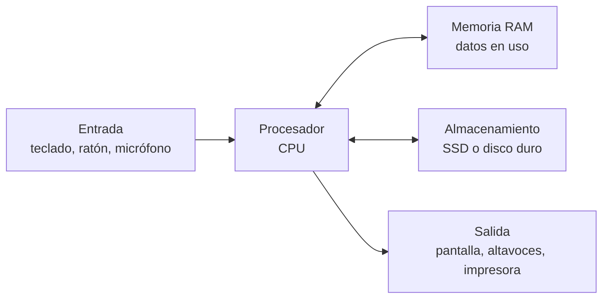

| Unidad | Qué hace | Ejemplos |
| --- | --- | --- |
| Entrada | Mete datos u órdenes en el ordenador | Teclado, ratón, micrófono, webcam |
| Procesador | Hace los cálculos y da las órdenes | CPU |
| Memoria principal | Guarda lo que se está usando en este momento | RAM |
| Almacenamiento | Guarda los archivos aunque se apague el equipo | SSD, disco duro, pendrive |
| Salida | Muestra o entrega el resultado | Pantalla, altavoces, impresora |

Piensa en lo que pasa cuando escribes un mensaje en el ordenador. El teclado (entrada) manda cada letra. El procesador la recibe y la coloca en la RAM, donde está abierto el programa. La pantalla (salida) te enseña lo que has escrito. Y cuando pulsas «Guardar», el archivo se copia al SSD (almacenamiento) para que no se pierda al apagar.

Algunos aparatos son de **entrada y salida** a la vez. Una pantalla táctil, por ejemplo, te muestra imágenes y también recoge tus toques.

::: nota
Este esquema se llama [arquitectura de von Neumann](https://es.wikipedia.org/wiki/Arquitectura_de_von_Neumann), por el matemático que lo describió en 1945. Casi ochenta años después, los ordenadores siguen funcionando con la misma idea.
:::

::: ejercicio
**E1. ¿Entrada o salida?** Clasifica estos dispositivos en entrada, salida, entrada y salida, procesamiento, memoria o almacenamiento: teclado, pantalla táctil, SSD, memoria RAM, impresora, micrófono, procesador, altavoz, pendrive, webcam, mando de consola con vibración.
:::

## Tipos de equipos

Hay ordenadores de muchos tamaños, pero por dentro tienen las mismas unidades funcionales. Lo que cambia es cómo están colocadas.

- **Ordenador de sobremesa.** Las piezas van separadas dentro de una caja y se pueden cambiar o ampliar. Es el que montaremos en clase.
- **Portátil.** Todo está muy apretado para que quepa en poco espacio y funcione con batería. Muchas piezas van soldadas y no se pueden cambiar.
- **Mini PC.** Un ordenador completo en una caja del tamaño de un libro. Muy usados en oficinas y aulas.
- **Móviles, tabletas y placas como la Raspberry Pi.** Usan un **[SoC](https://es.wikipedia.org/wiki/Sistema_en_un_chip)** (*System on a Chip*, sistema en un chip): un solo chip que lleva dentro el procesador, la gráfica y muchos controladores.
- **Servidores.** Ordenadores pensados para estar encendidos día y noche dando servicio a muchos usuarios a la vez, como los que hay detrás de una web o de una plataforma de vídeo.

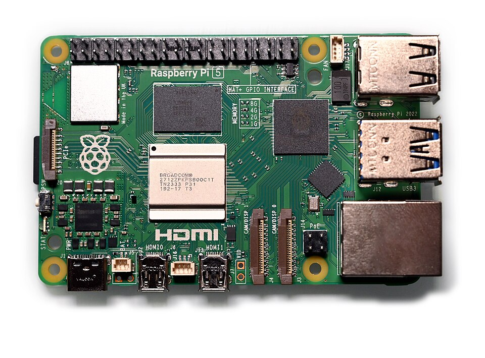{.mediana}

*Raspberry Pi 5. El chip cuadrado plateado del centro es el SoC: procesador, gráfica y controladores en una sola pieza.*

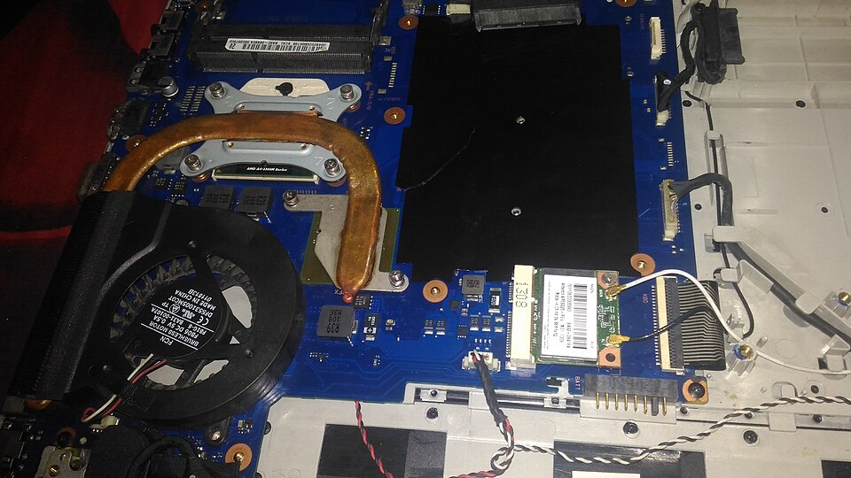{.mediana}

*Interior de un portátil durante una reparación. Fíjate en lo juntas que están las piezas.*

::: ejercicio
**E2. Cada equipo para su uso.** ¿Qué tipo de equipo recomendarías en cada caso? Justifícalo en una línea.

1. Una estudiante que lleva el ordenador a clase todos los días.
2. Un jugador que quiere ir cambiando piezas con el tiempo.
3. Una tienda que necesita un equipo pequeño en el mostrador para cobrar.
4. Una empresa que quiere tener su web y su correo en sus propias máquinas.
5. Un aula de tecnología que quiere controlar sensores y luces con un ordenador barato.
:::

# 2. Caja y fuente de alimentación

## Caja

La **caja** (también llamada chasis o torre) protege las piezas, las sujeta en su sitio y ayuda a que el aire circule para refrigerarlas. Por fuera tiene el botón de encendido, algunos puertos USB y las rejillas de ventilación. Por dentro tiene sitio para la placa base, la fuente, los discos y las tarjetas.

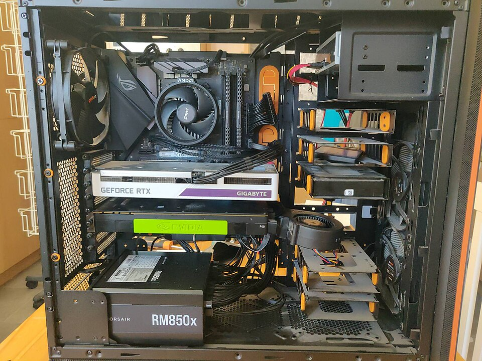{.mediana}

*Interior de una torre. Arriba, el disipador del procesador; en el centro, dos tarjetas gráficas; abajo, la fuente de alimentación.*

No todas las placas caben en todas las cajas. El tamaño de la placa se llama **factor de forma**, y la caja tiene que ser compatible con él. Los tres más comunes son estos:

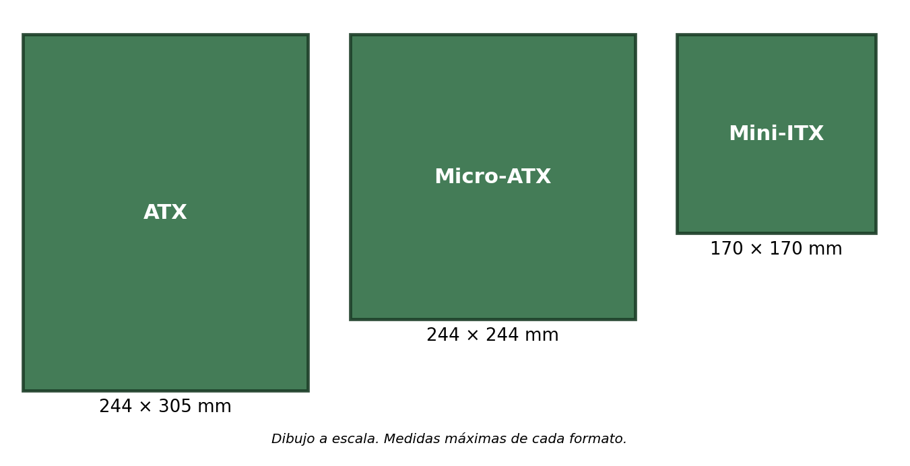{.mediana}

| Formato | Tamaño máximo | Dónde se usa |
| --- | --- | --- |
| ATX | 30,5 × 24,4 cm | Torres normales. Es el más común |
| Micro-ATX | 24,4 × 24,4 cm | Torres más pequeñas, equipos de oficina |
| Mini-ITX | 17 × 17 cm | Equipos muy compactos |

Una caja grande suele admitir placas más pequeñas: en una caja ATX caben una Micro-ATX y una Mini-ITX. Al revés no funciona: una placa ATX no cabe en una caja Mini-ITX.

::: tip
Antes de comprar una caja, mira en su ficha tres datos: qué formatos de placa admite, la **longitud máxima de la tarjeta gráfica** y la **altura máxima del disipador**. Son los tres motivos más habituales por los que «no cabe».
:::

::: ejercicio
**E3. ¿Cabe o no cabe?** Responde y explica por qué:

1. Una placa Micro-ATX en una caja ATX.
2. Una placa ATX en una caja Micro-ATX.
3. Una tarjeta gráfica de 33 cm en una caja que admite gráficas de hasta 30 cm.
4. Un disipador de 16 cm de alto en una caja que admite disipadores de hasta 16,5 cm.
:::

## Fuente de alimentación

La **[fuente de alimentación](https://es.wikipedia.org/wiki/Fuente_de_alimentación)** coge la corriente del enchufe (corriente alterna, 230 V en España) y la convierte en las tensiones bajas de corriente continua que necesitan las piezas: 12 V, 5 V y 3,3 V.

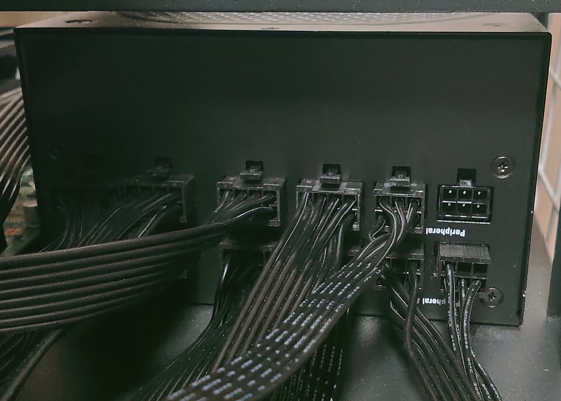{.mediana}

*Fuente modular: los cables se enchufan solo si se necesitan.*

Lo primero que se mira de una fuente es su **potencia**, en vatios (W). Una fuente de 650 W puede dar *hasta* 650 W, pero eso no significa que el ordenador los gaste siempre: un equipo navegando por Internet puede consumir 80 W y jugando, 400 W. La fuente tiene que aguantar el momento de más consumo y conviene dejar algo de margen.

También verás el sello **80 PLUS** (Bronze, Gold, Platinum…). Indica la **eficiencia**: cuánta energía se pierde en forma de calor al convertir la corriente. Una fuente Gold desperdicia menos que una Bronze, se calienta menos y gasta menos luz.

Según sus cables, hay fuentes de tres tipos:

- **No modulares:** todos los cables vienen fijos, se usen o no.
- **Semimodulares:** los cables imprescindibles son fijos y el resto se enchufa si hace falta.
- **Modulares:** todos los cables se pueden quitar. El montaje queda más ordenado.

::: aviso
Los cables de una fuente modular **no sirven para otra fuente**, aunque encajen. Cada fabricante coloca los cables por dentro a su manera, y un cable de otra marca puede quemar los componentes.
:::

## Conectores de la fuente

Cada pieza recibe la corriente por un conector distinto. Están diseñados para que solo encajen en su sitio, pero algunos se parecen mucho entre sí.

| Conector | Contactos | Para qué |
| --- | --- | --- |
| ATX principal | 24 | Alimenta la placa base |
| CPU (EPS) | 8, a menudo dividido en 4+4 | Alimenta el procesador |
| PCIe | 8, a menudo dividido en 6+2 | Alimenta la tarjeta gráfica |
| 12V-2x6 (antes 12VHPWR) | 16 | Alimenta tarjetas gráficas modernas de mucho consumo |
| SATA | 15 | Alimenta discos duros y SSD de 2,5" |

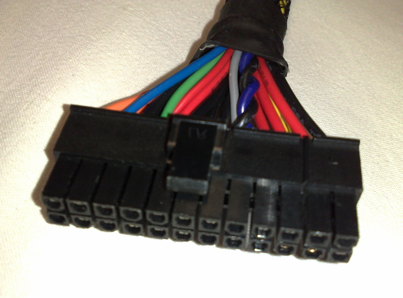{.mediana}

*Conector ATX de 24 contactos, el más grande de la fuente.*

::: aviso
El conector de CPU (EPS) y el de la gráfica (PCIe) tienen 8 contactos los dos y se parecen mucho, pero **no son intercambiables**. Busca la etiqueta «CPU» o «PCIe» en el propio cable y no lo fuerces nunca.
:::

::: ejercicio
**E4. Lee la etiqueta.** Esta es la tabla de salidas de una fuente de ejemplo:

| Salida | +3,3 V | +5 V | +12 V |
| --- | --- | --- | --- |
| Corriente máxima | 20 A | 20 A | 54 A |

1. Calcula la potencia máxima que puede dar la salida de +12 V con la fórmula `P = V × I`.
2. La etiqueta pone «650 W». ¿Por qué no puedes sumar las tres salidas y esperar que den más de 650 W a la vez?
3. Busca la etiqueta de una fuente del aula o una foto de la ficha de una fuente actual y anota su potencia y su certificación 80 PLUS.
:::

::: ejercicio
**E5. Cada cable a su sitio.** Relaciona cada conector con la pieza que alimenta: ATX de 24 contactos, EPS 4+4, PCIe 6+2, SATA de 15 contactos, 12V-2x6. Piezas: tarjeta gráfica de gama alta, procesador, SSD de 2,5", placa base, tarjeta gráfica de gama media.
:::

# 3. Placa base

## Qué es la placa base

La **[placa base](https://es.wikipedia.org/wiki/Placa_base)** es la pieza más grande de dentro del ordenador y la que conecta todas las demás. Es como el sistema de calles de una ciudad: el procesador, la memoria, los discos y las tarjetas son los edificios, y la placa base es la red de calles que los une y por la que llega la corriente a cada uno.

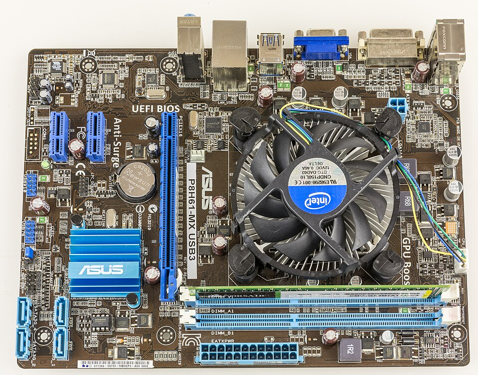{.mediana}

*Placa base Micro-ATX con el procesador y su ventilador montados.*

En cualquier placa base vas a encontrar estas zonas:

| Elemento | Para qué sirve |
| --- | --- |
| Zócalo (*socket*) | Donde se coloca el procesador |
| Ranuras de RAM | Donde se pinchan los módulos de memoria |
| Ranuras PCIe | Donde se conectan la tarjeta gráfica y otras tarjetas |
| Ranuras M.2 | Donde se colocan los SSD más rápidos |
| Puertos SATA | Donde se conectan discos duros y SSD de 2,5" |
| Conector ATX de 24 contactos y EPS | Por donde entra la corriente de la fuente |
| Chipset | Chip que reparte el trabajo de comunicación entre las piezas |
| Pila | Mantiene la hora y la configuración cuando el ordenador está desenchufado |
| Panel trasero | Los conectores que se ven por detrás de la torre |
| Conectores internos | Para el frontal de la caja: botones, USB y audio |

::: tip
Cada placa trae un **manual** con un dibujo de dónde está cada cosa. Es la herramienta más útil para montar un ordenador: no hace falta memorizar la posición de nada, solo saber buscarla. Casi todos los manuales se pueden descargar de la web del fabricante buscando el modelo exacto de la placa.
:::

::: ejercicio
**E6. Explora la placa base.** Con la ficha de la placa base de clase y la actividad *Explora la placa base*, localiza en una placa real o en la foto de arriba: el zócalo, las ranuras de RAM, una ranura PCIe, el conector de 24 contactos y la pila. Escribe al lado de cada uno para qué sirve, con tus palabras.
:::

## Panel trasero

El **panel trasero** son los conectores de la placa que asoman por detrás de la torre. Ahí se enchufan el monitor, el cable de red, los periféricos USB y los altavoces.

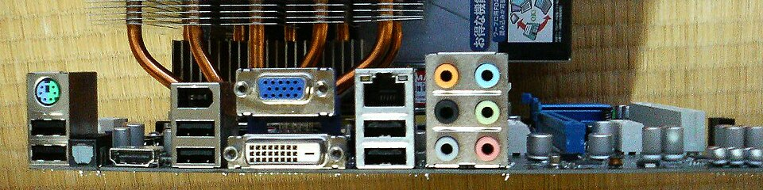

*Panel trasero de una placa de 2008. Tiene puertos que hoy ya casi no se ven.*

| Conector | Para qué |
| --- | --- |
| USB-A y USB-C | Ratón, teclado, pendrive, móvil y casi cualquier periférico |
| HDMI y DisplayPort | Monitor, con imagen y sonido digital |
| Ethernet (RJ45) | Cable de red |
| Jacks de audio | Altavoces, auriculares y micrófono |
| Antenas Wi-Fi | En placas con Wi-Fi integrado |
| PS/2 y VGA | Teclado o ratón antiguos y monitores antiguos. Solo en placas viejas o de oficina |

::: nota
Las salidas de vídeo de la placa base (HDMI o DisplayPort) solo funcionan si el procesador tiene **gráficos integrados**. Si el procesador no los tiene, el monitor se conecta a la tarjeta gráfica.
:::

::: ejercicio
**E7. Puertos de hoy y de ayer.** En la foto del panel trasero, identifica todos los conectores que puedas. Marca cuáles siguen usándose hoy y cuáles han desaparecido de las placas nuevas. Después haz lo mismo con el panel trasero de un ordenador del aula y compara.
:::

## Conectores internos

Los botones y los USB del frontal de la caja llegan a la placa por unos cables finos que se conectan a grupos de patillas llamados **cabeceras** (*headers*).

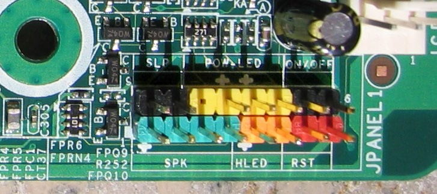{.mediana}

*Cabecera del panel frontal: botón de encendido, reinicio y luces de la caja.*

| Cabecera | Se conecta a | Cómo la reconoces |
| --- | --- | --- |
| Panel frontal (F_PANEL) | Botón de encendido, reinicio y luces | Pequeños cables sueltos con nombres como POWER SW, RESET SW, HDD LED |
| USB 2.0 | USB frontales antiguos | 9 patillas en dos filas, con un hueco |
| USB 3.0 (5 Gbit/s) | USB frontales azules | Conector ancho de 19 patillas con una pestaña |
| USB-C frontal | El USB-C de la caja | Conector pequeño y alargado |
| Audio (HD_AUDIO) | Auriculares y micrófono del frontal | 9 patillas en dos filas, con el hueco en otra posición que el USB 2.0 |
| Ventiladores (CPU_FAN, SYS_FAN) | Ventiladores | 4 patillas en fila |

::: aviso
La cabecera USB 2.0 y la de audio se parecen mucho: las dos tienen 9 patillas. **Nunca conectes una en el sitio de la otra.** Lee el nombre impreso en la placa o mira el manual.
:::

::: ejercicio
**E8. El panel frontal.** En el manual de una placa (o en la foto de arriba), localiza dónde van POWER SW, RESET SW, POWER LED y HDD LED.

1. Los LED tienen «+» y «−». ¿Qué pasa si conectas un LED al revés?
2. ¿Y si conectas al revés el botón de encendido?
:::

# 4. Procesador

## Qué hace el procesador

El **[procesador](https://es.wikipedia.org/wiki/Unidad_central_de_procesamiento)** o **CPU** es el cerebro del ordenador. Lee las instrucciones de los programas, una detrás de otra, y las ejecuta: sumar, comparar, mover datos de un sitio a otro… Hace miles de millones de estas operaciones por segundo.

Hoy en día hay dos grandes fabricantes de procesadores para ordenadores: **Intel** y **AMD**. Los móviles y los Mac usan otro tipo de procesadores, basados en la arquitectura **ARM**.

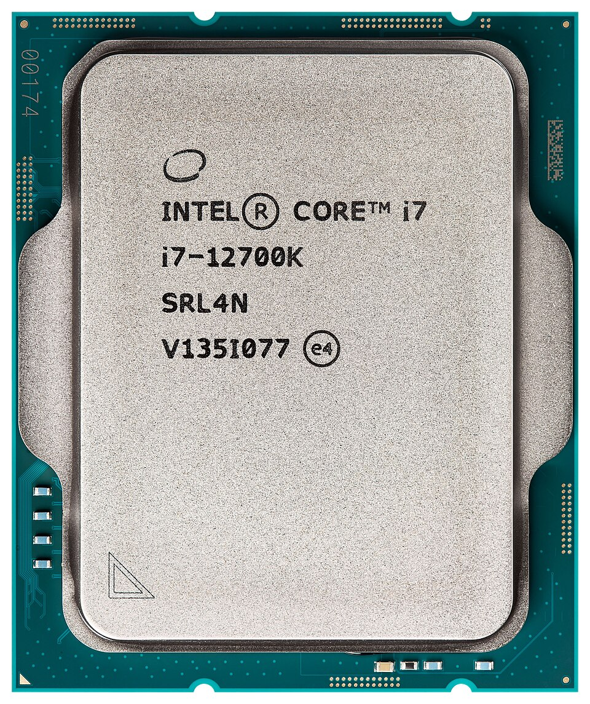{.pequena} 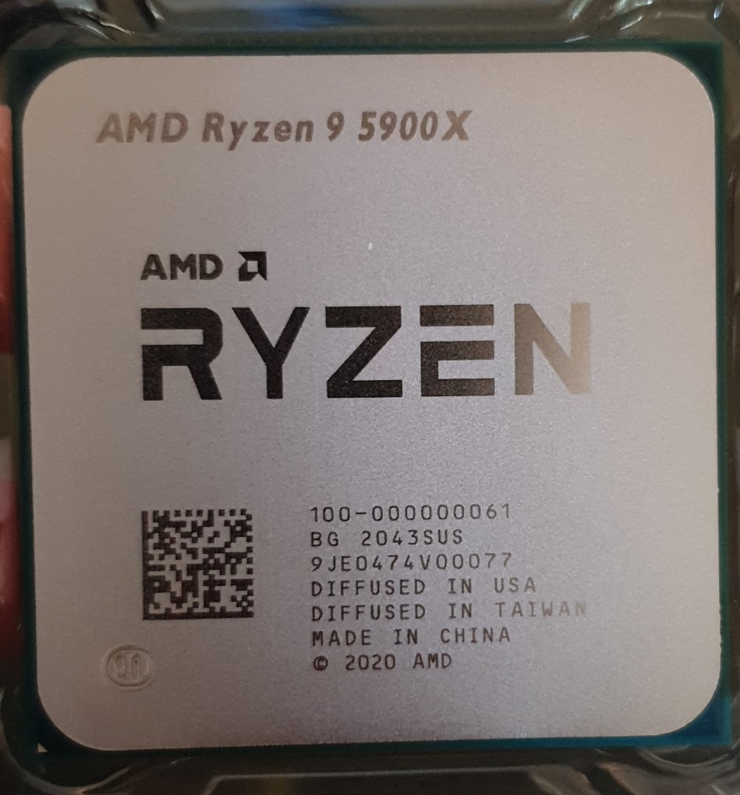{.pequena}

*Arriba, un Intel Core i7. Abajo, un AMD Ryzen 9.*

## Características del procesador

Cuando mires la ficha de un procesador vas a encontrar estos datos:

| Característica | Qué significa | Ejemplo |
| --- | --- | --- |
| Núcleos | Cuántos «procesadores» tiene dentro. Cada núcleo trabaja por su cuenta, así que puede hacer varias tareas a la vez | 8 núcleos |
| Hilos | Cuántas tareas puede llevar a la vez. Muchos procesadores dan dos hilos por núcleo | 16 hilos |
| Frecuencia | Cuántos ciclos de trabajo hace por segundo, en gigahercios (GHz) | 4,5 GHz |
| Memoria caché | Una memoria pequeñísima y muy rápida dentro del propio procesador, para tener a mano los datos que más usa | 32 MB |
| Gráficos integrados | Si lleva una tarjeta gráfica básica dentro | Sí / No |
| Consumo (TDP) | Cuánto calor produce, en vatios. Sirve para elegir el disipador | 65 W |
| Zócalo | En qué placas encaja | AM5, LGA1851 |

::: nota
**Más GHz no siempre es más rápido.** Un procesador moderno a 4 GHz hace mucho más trabajo que uno de hace diez años a 4 GHz, porque en cada ciclo hace más cosas. Para comparar procesadores de distinta generación hay que mirar pruebas de rendimiento, no solo la frecuencia.
:::

Los nombres comerciales siguen siempre el mismo patrón: la marca, la gama y el modelo. En **Intel Core Ultra 7 265K** y **AMD Ryzen 7 9700X**, el número 7 indica la gama (3 y 5 son gamas básicas y medias; 7 y 9, altas), y el resto del nombre indica la generación y el modelo concreto. Las letras finales también dan pistas: en Intel, por ejemplo, la K indica que se puede subir la frecuencia y la F, que no tiene gráficos integrados.

## Zócalo

El **[zócalo](https://es.wikipedia.org/wiki/Zócalo_de_CPU)** (*socket*) es el sitio de la placa donde se coloca el procesador. Cada familia de procesadores tiene el suyo, y **un procesador solo funciona en una placa con su mismo zócalo**.

Hay dos formas de hacer el contacto entre el procesador y la placa:

- **LGA**: las patillas están en el zócalo de la placa y el procesador tiene contactos planos. Lo usan Intel y los AMD modernos.
- **PGA**: las patillas están en el procesador. Lo usaban los AMD hasta el zócalo AM4.

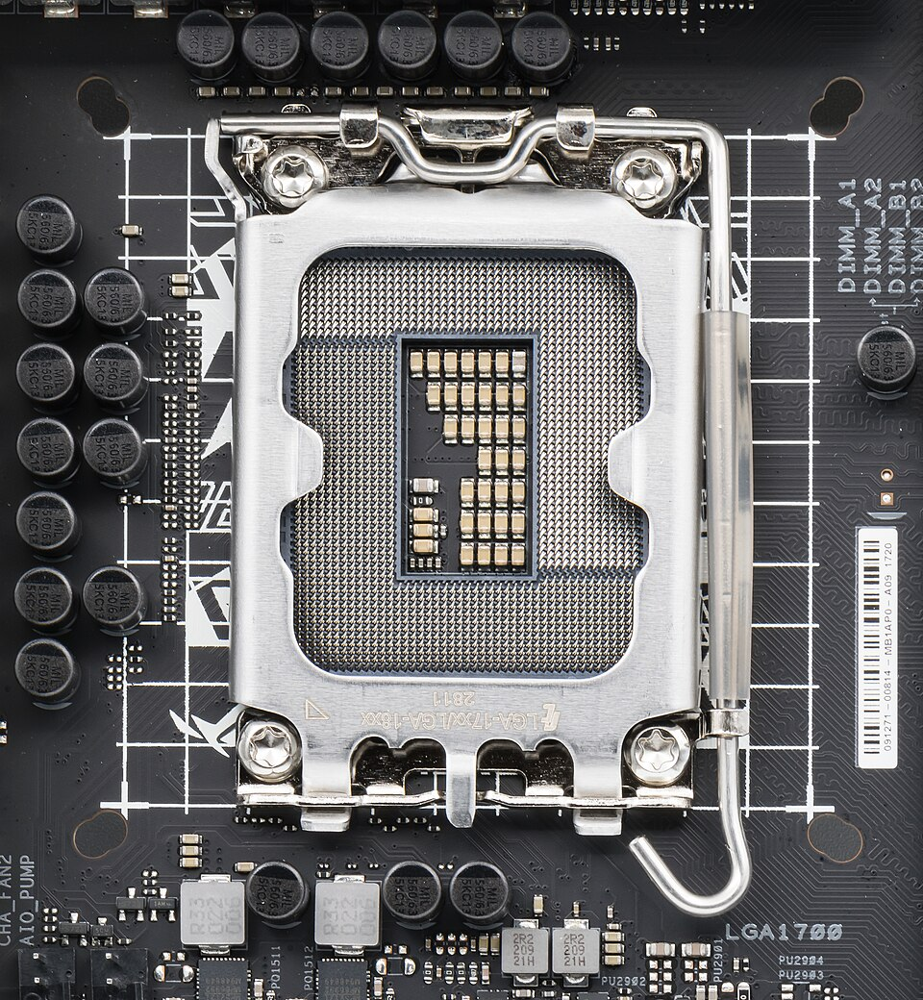{.pequena} 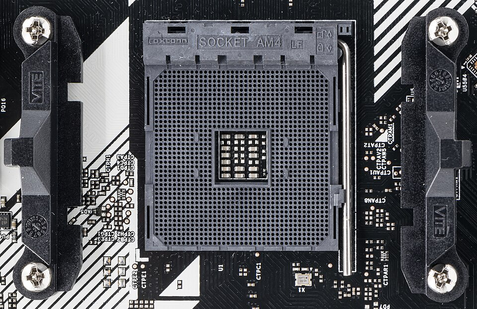{.pequena}

*Arriba, zócalo LGA 1700 de Intel, con las patillas en la placa. Abajo, zócalo AM4 de AMD, con agujeros para las patillas del procesador.*

| Zócalo | Fabricante | Procesadores |
| --- | --- | --- |
| LGA 1700 | Intel | Core de 12.ª, 13.ª y 14.ª generación |
| LGA 1851 | Intel | Core Ultra serie 200 |
| AM4 | AMD | Ryzen serie 1000 a 5000 |
| AM5 | AMD | Ryzen serie 7000 en adelante |

::: aviso
Las patillas de un zócalo LGA son finísimas y se doblan con nada. **No toques nunca el zócalo con los dedos** y deja puesta la tapa de plástico hasta que vayas a colocar el procesador. Una patilla doblada puede inutilizar la placa.
:::

::: ejercicio
**E9. Ficha de un procesador.** Elige un procesador que se venda hoy, de Intel o de AMD. En la web del fabricante (Intel o AMD), busca y anota: nombre completo, número de núcleos e hilos, frecuencia máxima, memoria caché, si tiene gráficos integrados, consumo (TDP) y zócalo.
:::

::: ejercicio
**E10. ¿Son compatibles?** Busca el zócalo de cada procesador y de cada placa y di si funcionarían juntos:

1. AMD Ryzen 7 9700X con una placa con chipset B650.
2. Intel Core Ultra 5 245K con una placa con chipset B760.
3. AMD Ryzen 5 5600 con una placa con chipset B650.
4. Intel Core i5-14400 con una placa con chipset B760.
:::

## Refrigeración

Mientras trabaja, el procesador se calienta mucho. Si no se le quita ese calor, baja su velocidad para protegerse y, en casos extremos, el ordenador se apaga. Para refrigerarlo se usan tres piezas:

- El **[disipador](https://es.wikipedia.org/wiki/Disipador)**: un bloque de metal (aluminio o cobre) con muchas láminas finas que reparte el calor y lo pasa al aire.
- El **ventilador**: mueve el aire a través de las láminas del disipador para sacar el calor.
- La **[pasta térmica](https://es.wikipedia.org/wiki/Pasta_térmica)**: una capa fina que se pone entre el procesador y el disipador. Rellena los huecos microscópicos entre las dos superficies para que el calor pase bien.

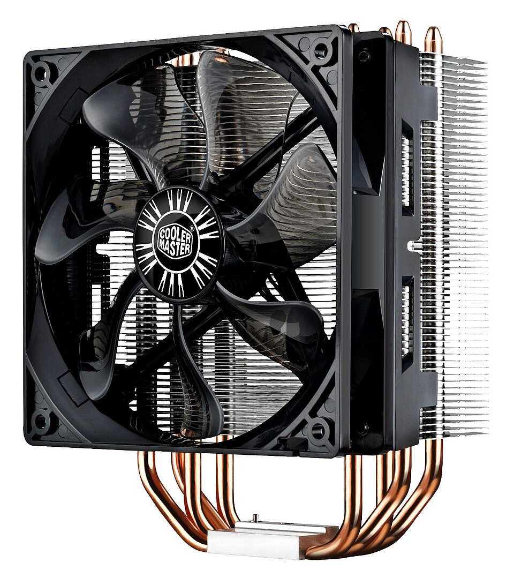{.pequena} 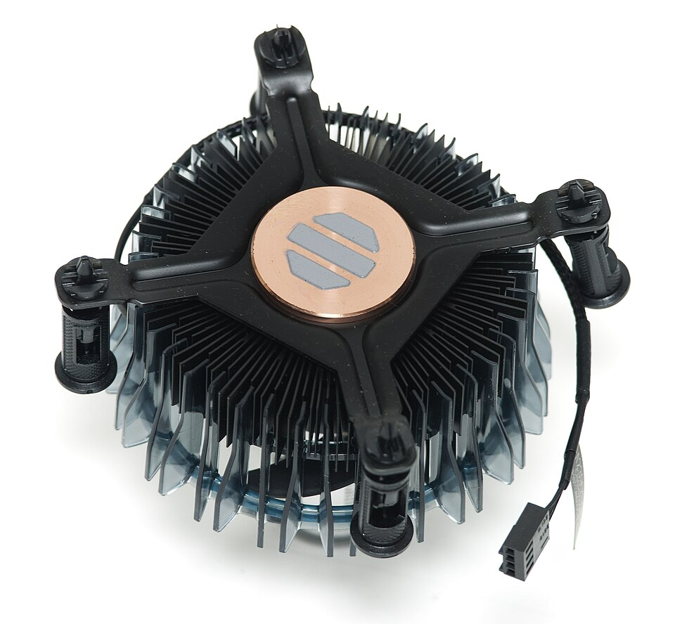{.pequena}

*Arriba, un disipador de torre con ventilador. Abajo, la base de un disipador con pasta térmica ya aplicada.*

Además de los disipadores con ventilador existe la **refrigeración líquida**, que lleva el calor con un líquido hasta un radiador. Se usa en equipos potentes o con poco espacio.

::: tip
Con la pasta térmica, **menos es más**: basta con una gota del tamaño de un guisante en el centro del procesador. Al apretar el disipador, se reparte sola. Si pones demasiada, rebosa y ensucia el zócalo.
:::

::: ejercicio
**E11. Montar el disipador.** Ordena estos pasos para montar un disipador y explica qué pasaría si te saltas el paso de la pasta térmica: conectar el cable del ventilador a CPU_FAN, poner la pasta térmica, colocar el procesador en el zócalo, apoyar el disipador recto sobre el procesador, atornillar el disipador en cruz.
:::

# 5. Memoria RAM

## Qué es la RAM

La **[memoria RAM](https://es.wikipedia.org/wiki/Memoria_de_acceso_aleatorio)** es donde el ordenador guarda lo que está usando en este momento: los programas abiertos, la pestaña del navegador, el documento que estás escribiendo.

Imagínate que el almacenamiento es una estantería y la RAM es tu mesa de trabajo. Los libros están guardados en la estantería, pero para trabajar con uno lo pones encima de la mesa. Cuanto más grande es la mesa, más cosas puedes tener abiertas a la vez sin tener que ir y volver a la estantería.

La RAM es muy rápida, pero tiene un problema: **se borra cuando se apaga el ordenador**. Por eso hay que guardar los archivos en el almacenamiento antes de apagar.

| Uso del ordenador | RAM recomendada hoy |
| --- | --- |
| Ofimática y navegar | 8 GB |
| Uso general, estudios, varias aplicaciones a la vez | 16 GB |
| Juegos, edición de vídeo o fotos | 32 GB o más |

## Módulos de memoria

La RAM viene en **módulos** (también llamados «memorias» o «peines») que se pinchan en las ranuras de la placa. Hay dos formatos:

- **DIMM**: módulos largos, para ordenadores de sobremesa.
- **SO-DIMM**: módulos cortos, para portátiles y mini PC.

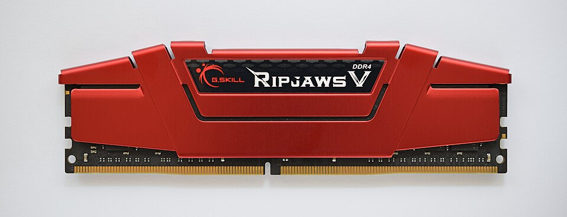{.mediana}

*Módulo DIMM DDR4 para sobremesa, con disipador rojo.*

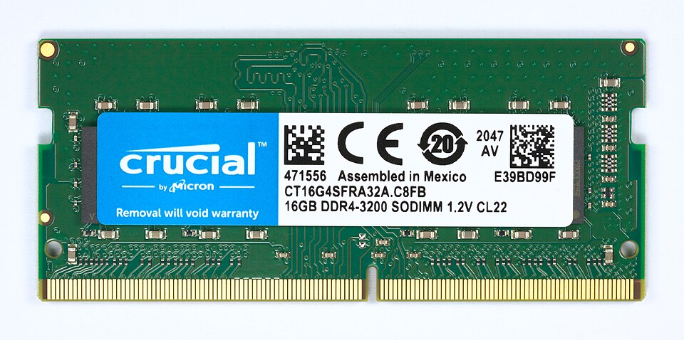{.pequena}

*Módulo SO-DIMM DDR4 para portátil. Fíjate en que es mucho más corto.*

En muchos portátiles finos, la RAM va **soldada a la placa** y no se puede ampliar. Si vas a comprar un portátil, mira cuánta RAM trae, porque quizá sea la que tenga para siempre.

## Generaciones DDR

La memoria de los ordenadores se llama **DDR** y va por generaciones: DDR3, DDR4 y DDR5. Cada generación es más rápida y gasta menos energía que la anterior.

| Generación | Contactos (DIMM) | Velocidad típica | Dónde la encontrarás |
| --- | --- | --- | --- |
| DDR3 | 240 | 1600 MT/s | Ordenadores de hace más de diez años |
| DDR4 | 288 | 3200 MT/s | Muchos ordenadores de los últimos años |
| DDR5 | 288 | 4800–6400 MT/s | Ordenadores nuevos |

**Las generaciones no son intercambiables.** Cada placa admite solo una, y la muesca del módulo está en una posición distinta en cada generación para que no se pueda pinchar donde no toca. Aunque DDR4 y DDR5 tienen el mismo número de contactos, una DDR5 no entra en una ranura DDR4.

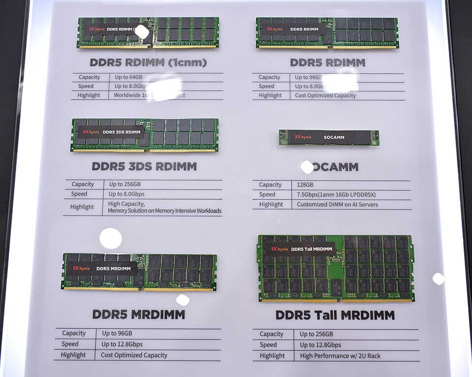{.mediana}

*Distintos formatos de módulos DDR5: DIMM para sobremesa y servidor y SO-DIMM para portátil.*

::: tip
**Mejor dos módulos que uno.** Casi todas las placas trabajan en **doble canal**: si pones dos módulos iguales en las ranuras que indica el manual, la memoria va bastante más rápida que con uno solo. Por eso es mejor poner 2 × 8 GB que 1 × 16 GB.
:::

::: ejercicio
**E12. ¿Cuánta RAM tiene tu ordenador?** En un ordenador con Windows, abre el **Administrador de tareas** (`Ctrl+Mayús+Esc`), ve a **Rendimiento → Memoria** y anota: capacidad total, velocidad, ranuras usadas y formato. ¿Se podría ampliar? ¿Cuánta RAM está usando ahora mismo?
:::

::: ejercicio
**E13. Elige la memoria.** Tienes una placa de sobremesa con zócalo AM5 y dos ranuras de memoria. ¿Cuál de estos módulos sirve? Explica por qué los otros no.

1. 16 GB DDR4 DIMM 3200 MT/s.
2. 16 GB DDR5 SO-DIMM 5600 MT/s.
3. 16 GB DDR5 DIMM 5600 MT/s.

Después explica por qué sería mejor comprar dos módulos de 8 GB que uno de 16 GB.
:::

# 6. Almacenamiento

## Tipos de almacenamiento

El **almacenamiento** es donde se guardan el sistema operativo, los programas y tus archivos. A diferencia de la RAM, **no se borra al apagar el ordenador**. Hoy conviven tres tipos:

- **[Disco duro](https://es.wikipedia.org/wiki/Unidad_de_disco_duro) (HDD).** Guarda los datos en discos magnéticos que giran a gran velocidad, mientras un brazo con un cabezal lee y escribe. Es barato y tiene mucha capacidad, pero es lento y delicado: un golpe con el disco en marcha puede romperlo.
- **[SSD](https://es.wikipedia.org/wiki/Unidad_de_estado_sólido) SATA.** Guarda los datos en chips de memoria, sin piezas móviles. Es mucho más rápido, silencioso y resistente que un disco duro. Tiene el mismo tamaño que un disco duro de portátil (2,5") y se conecta igual.
- **SSD M.2 NVMe.** Un SSD con forma de chicle que se pincha directamente en la placa. Es el más rápido de los tres y el que llevan casi todos los ordenadores nuevos.

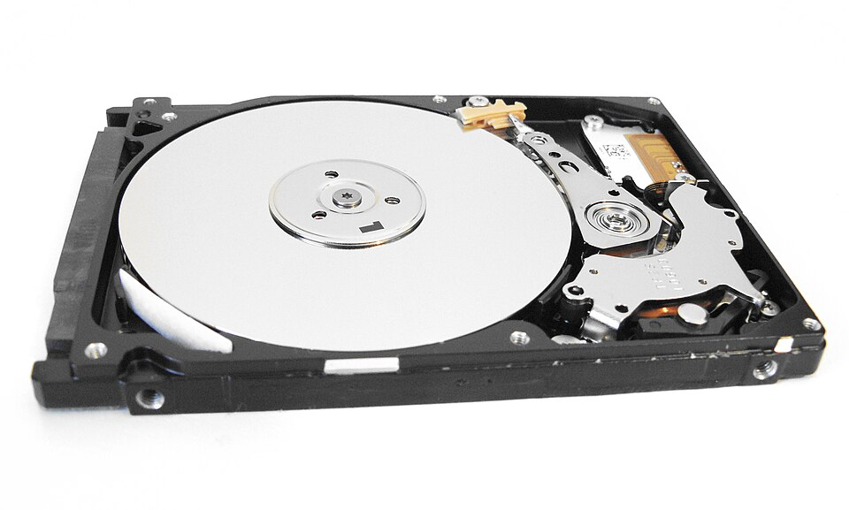{.mediana}

*Interior de un disco duro de 2,5": el disco que gira y el brazo con el cabezal.*

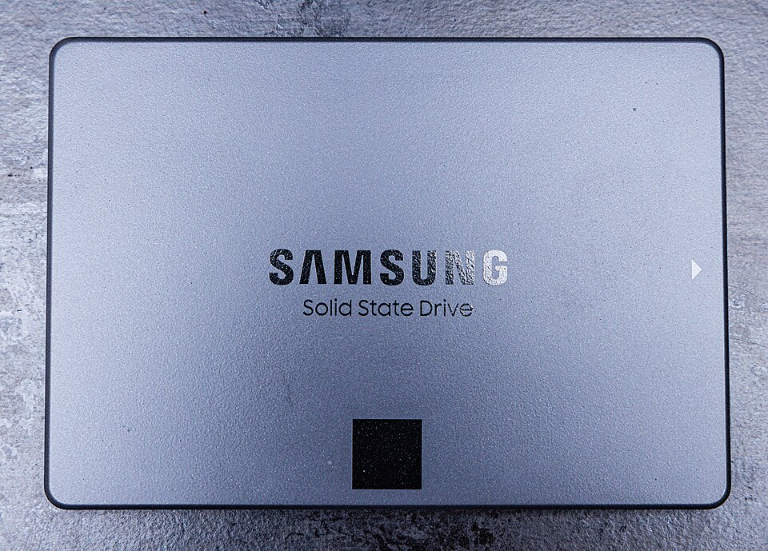{.pequena} 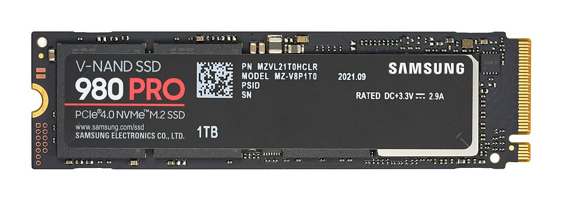{.pequena}

*Arriba, un SSD SATA de 2,5". Abajo, un SSD M.2 NVMe.*

| | Disco duro (HDD) | SSD SATA | SSD M.2 NVMe |
| --- | --- | --- | --- |
| Cómo guarda los datos | Discos magnéticos que giran | Chips de memoria | Chips de memoria |
| Velocidad aproximada | 100–250 MB/s | 550 MB/s | 3.500–7.000 MB/s o más |
| Ruido | Sí | No | No |
| Precio por GB | El más barato | Intermedio | Similar al SSD SATA |
| Uso típico hoy | Guardar mucha información: copias de seguridad, vídeos | Ampliar equipos antiguos | Disco principal de los equipos nuevos |

::: nota
Cambiar un disco duro por un SSD es la mejora que más se nota en un ordenador antiguo. El sistema arranca en segundos en lugar de minutos y los programas se abren casi al instante.
:::

## Conexiones de almacenamiento

Los discos duros y los SSD de 2,5" se conectan con **dos cables**: uno de **datos** que va a un puerto SATA de la placa y otro de **alimentación** que viene de la fuente. Son conectores distintos, y hacen falta los dos.

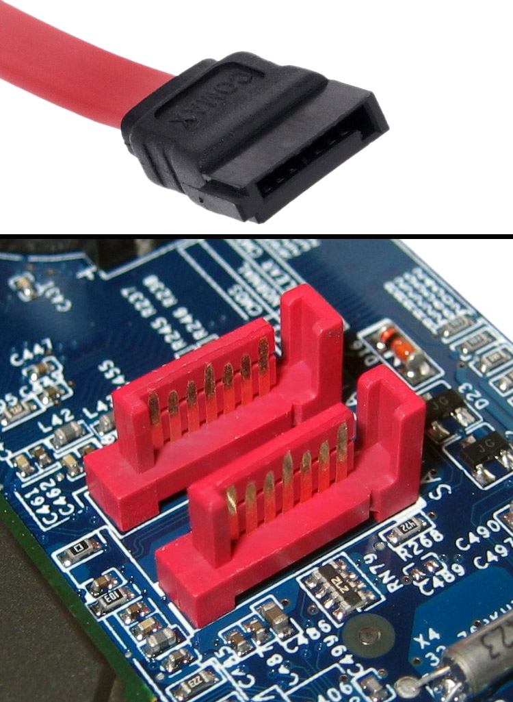{.pequena}

*Cable de datos SATA (arriba) y puertos SATA de una placa base (abajo).*

Los SSD **[M.2](https://es.wikipedia.org/wiki/M.2)** no necesitan cables: se pinchan en su ranura de la placa y se sujetan con un tornillo o una pestaña.

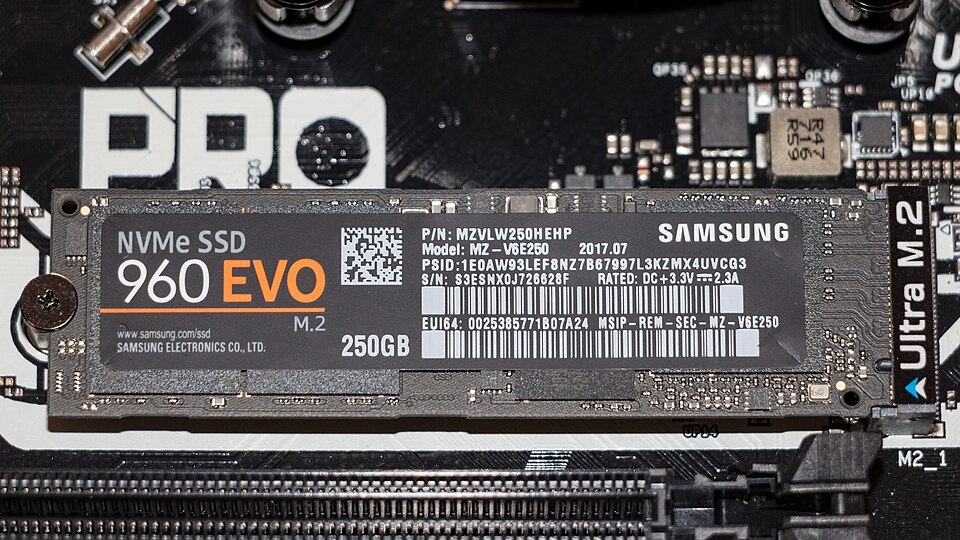{.mediana}

*SSD M.2 instalado en la placa base.*

En la ficha de un SSD M.2 verás dos datos importantes:

- **El tamaño**, con un número de cuatro cifras: **2280** significa 22 mm de ancho y 80 mm de largo. Es el más común en sobremesa. En portátiles pequeños también se usan 2242 y 2230.
- **La interfaz**: casi todos los M.2 actuales son **NVMe**, pero existen M.2 SATA, más lentos. Algunas ranuras solo admiten uno de los dos tipos, así que hay que comprobarlo en el manual de la placa.

## Unidades de capacidad

| Unidad | Equivale a | Para que te hagas una idea |
| --- | --- | --- |
| 1 kilobyte (KB) | 1.000 bytes | Un mensaje de texto corto |
| 1 megabyte (MB) | 1.000 KB | Una canción en MP3 son unos 4 MB |
| 1 gigabyte (GB) | 1.000 MB | Una película en buena calidad, de 2 a 5 GB |
| 1 terabyte (TB) | 1.000 GB | Unas 250.000 fotos de móvil |

::: nota
¿Por qué un disco de 1 TB aparece en Windows como «931 GB»? Porque el fabricante cuenta de 1.000 en 1.000 y Windows cuenta de 1.024 en 1.024. No falta espacio: es el mismo, contado de dos formas distintas.
:::

::: ejercicio
**E14. ¿Qué disco compro?** En una tienda online, busca un disco duro de 2 TB, un SSD SATA de 1 TB y un SSD M.2 NVMe de 1 TB. Anota el precio de cada uno y calcula el precio por GB (precio ÷ capacidad en GB). ¿Cuál elegirías para el disco principal de un ordenador nuevo? ¿Y para guardar copias de seguridad?
:::

::: ejercicio
**E15. ¿Encaja este SSD?** Una placa base tiene una ranura M.2 que, según el manual, admite «M.2 2280, solo PCIe NVMe». ¿Sirven estos SSD? Explica por qué.

1. SSD M.2 2280 NVMe de 1 TB.
2. SSD M.2 2280 SATA de 1 TB.
3. SSD SATA de 2,5" de 1 TB.
4. SSD M.2 2230 NVMe de 512 GB.
:::

# 7. Tarjetas de expansión y puertos

## Ranuras PCIe

Las **ranuras de expansión** permiten añadir tarjetas a la placa base para darle funciones nuevas. Hoy todas son **[PCI Express](https://es.wikipedia.org/wiki/PCI_Express)** (PCIe) y las hay de distintos tamaños: **x1**, **x4**, **x8** y **x16**. El número indica cuántos «carriles» de datos tiene la ranura: cuantos más, más información puede pasar a la vez, igual que una autopista con más carriles.

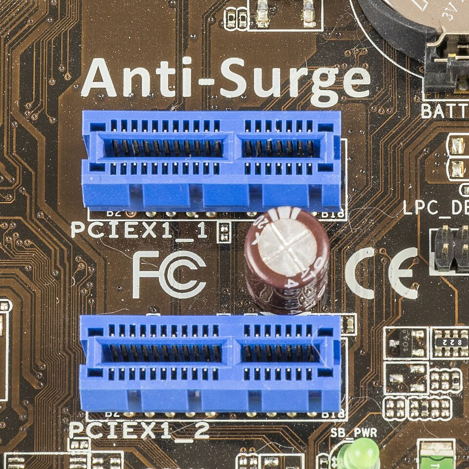{.pequena}

*Dos ranuras PCIe x1, las más cortas. En la foto de la placa base completa del apartado 3 puedes ver la ranura x16, mucho más larga.*

La ranura x16, la más larga, se reserva normalmente para la tarjeta gráfica. Las cortas sirven para tarjetas de red, de sonido, de Wi-Fi o para añadir más puertos USB.

## Tarjeta gráfica

La **[tarjeta gráfica](https://es.wikipedia.org/wiki/Tarjeta_gráfica)** se encarga de crear la imagen que ves en la pantalla. Lleva su propio procesador, llamado **GPU**, y su propia memoria, llamada **VRAM**.

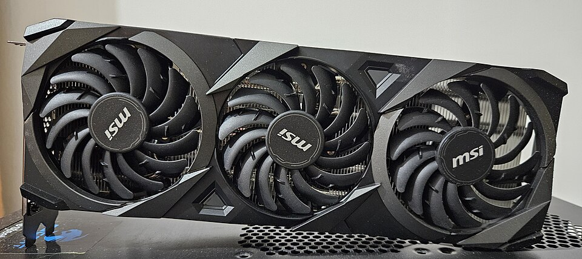{.mediana}

*Tarjeta gráfica con tres ventiladores.*

Hay dos tipos de gráficos:

- **Integrados**: van dentro del procesador. Son suficientes para ofimática, navegar, ver vídeos y juegos sencillos.
- **Dedicados**: una tarjeta independiente, mucho más potente. Hace falta para juegos exigentes, edición de vídeo, diseño 3D o inteligencia artificial.

Las gráficas potentes consumen mucha energía (algunas, más de 300 W) y necesitan sus propios cables de la fuente. Antes de comprar una, comprueba que **cabe en la caja**, que **la fuente tiene potencia y conectores suficientes** y que la placa tiene una ranura PCIe x16 libre.

::: ejercicio
**E16. ¿Hace falta una gráfica?** Para cada usuario, di si basta con los gráficos integrados del procesador o si necesita una tarjeta dedicada. Justifícalo.

1. Un administrativo que usa el correo, hojas de cálculo y videollamadas.
2. Un youtuber que edita vídeo en 4K.
3. Un estudiante que juega a juegos de navegador y ve series.
4. Una diseñadora que hace modelos 3D para arquitectura.
:::

## Otras tarjetas

- **Tarjeta de red**: para conectar el ordenador a la red por cable o por Wi-Fi, si la placa no lo trae o se quiere más velocidad.
- **Tarjeta de sonido**: para mejorar la calidad del sonido o conectar micrófonos e instrumentos profesionales.
- **Tarjeta de puertos**: añade más USB u otros conectores.
- **Capturadora**: graba o retransmite la imagen de una videoconsola o una cámara.

Muchas de estas funciones también existen como dispositivos externos que se conectan por USB, sin abrir el ordenador.

## Puertos USB

El **[USB](https://es.wikipedia.org/wiki/Universal_Serial_Bus)** es el puerto más usado para conectar periféricos. Su nombre ha cambiado tantas veces que hoy los fabricantes recomiendan fijarse en la **velocidad** que aparece junto al logotipo, más que en el número de versión:

| Nombre | Velocidad máxima | Cómo reconocerlo |
| --- | --- | --- |
| USB 2.0 | 480 Mbit/s | Conector negro o blanco |
| USB 5 Gbps (antes USB 3.0 o 3.2 Gen 1) | 5 Gbit/s | Conector azul o logotipo «SS 5» |
| USB 10 Gbps (USB 3.2 Gen 2) | 10 Gbit/s | Logotipo «SS 10», a veces conector turquesa |
| USB4 / Thunderbolt | 40 Gbit/s o más | Solo en USB-C, con su logotipo |

Además de la velocidad, hay que distinguir la **forma del conector**: el **USB-A** es el rectangular de toda la vida y el **USB-C** es el pequeño y ovalado, que se puede enchufar en cualquier posición.

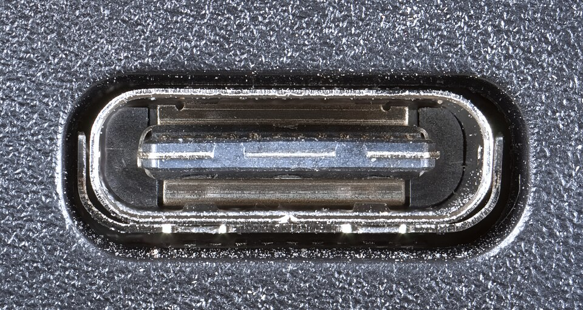{.pequena}

*Puerto USB-C de un portátil.*

::: aviso
Que dos puertos sean USB-C no significa que hagan lo mismo. Uno puede servir solo para datos y otro, además, para cargar el portátil o conectar un monitor. Míralo en los símbolos que hay junto al puerto o en la ficha del equipo.
:::

::: ejercicio
**E17. Los puertos de tus aparatos.** Elige dos aparatos: tu móvil y un ordenador del aula, por ejemplo. Haz una tabla con todos sus puertos: tipo de conector, velocidad o versión (si aparece) y para qué lo usarías. Busca la ficha del modelo si no lo ves claro.
:::

# 8. BIOS, UEFI y SETUP

## El firmware

Cuando enciendes el ordenador, el sistema operativo todavía no está cargado. ¿Quién se encarga de arrancar? Un programa pequeño grabado en un chip de la placa base: el **firmware**.

Tradicionalmente se llamaba **[BIOS](https://es.wikipedia.org/wiki/BIOS)**. Los ordenadores actuales usan su sustituto, **[UEFI](https://es.wikipedia.org/wiki/Unified_Extensible_Firmware_Interface)**, aunque mucha gente lo sigue llamando BIOS. Su trabajo es:

1. Comprobar que las piezas básicas funcionan: procesador, memoria, gráfica.
2. Buscar en los discos un sistema operativo.
3. Pasarle el control a ese sistema operativo para que arranque.

## Pila de la placa base

En la placa hay una **pila de botón**, normalmente una CR2032, que mantiene en marcha el reloj del ordenador cuando está desenchufado. Si un ordenador pierde la fecha y la hora cada vez que se desenchufa, lo más probable es que la pila esté gastada.

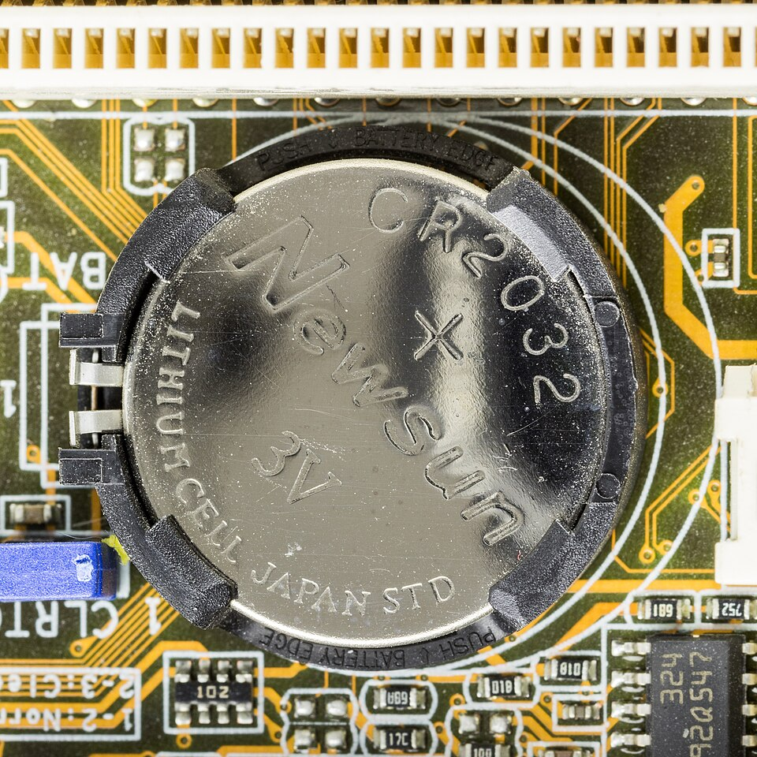{.pequena}

*Pila CR2032 en su soporte de la placa base.*

::: nota
El firmware está guardado en una memoria que **no se borra** aunque se quite la pila. Quitar la pila no «desinstala la BIOS»: como mucho, devuelve algunos ajustes a los valores de fábrica.
:::

## SETUP

El **SETUP** es el menú de configuración del firmware. Para entrar hay que pulsar una tecla justo al encender, antes de que arranque el sistema operativo. La tecla depende del fabricante: las más habituales son **Supr**, **F2**, **F10** o **F12**, y suele aparecer en pantalla durante un segundo.

Desde el SETUP puedes ver qué procesador, qué memoria y qué discos ha detectado la placa, ver las temperaturas y cambiar el **orden de arranque**: desde qué disco o pendrive se intenta arrancar primero. Lo usarás cuando instales un sistema operativo.

::: ejercicio
**E18. Explora el SETUP.** En un ordenador del aula, con el permiso del profesor:

1. Averigua la tecla para entrar en el SETUP y entra.
2. Anota el procesador, la memoria y los discos que aparecen.
3. Busca el orden de arranque y, si aparecen, las temperaturas y la velocidad de los ventiladores.
4. Sal **sin guardar los cambios**.
:::

::: aviso
No cambies opciones del SETUP que no conozcas, como voltajes, contraseñas o el modo de los discos. Un ajuste equivocado puede hacer que el ordenador no arranque.
:::

# 9. Actividad final

::: ejercicio
**E19. La ficha técnica de un ordenador.** Prepara la ficha completa de un ordenador. Puede ser uno del aula, el de tu casa o uno que elijas de una tienda online. Si es un equipo real, saca la información con el programa **CPU-Z** o con **Información del sistema** de Windows (`msinfo32`), y con el manual de la placa.

| Componente | Datos que tienes que anotar |
| --- | --- |
| Caja | Tipo (torre, mini PC, portátil…) y formatos de placa que admite |
| Placa base | Fabricante, modelo, formato y chipset |
| Procesador | Modelo completo, núcleos, hilos, frecuencia y zócalo |
| Refrigeración | Tipo de disipador |
| Memoria RAM | Capacidad, generación (DDR4, DDR5…), formato y ranuras libres |
| Almacenamiento | Tipo (HDD, SSD SATA, M.2 NVMe) y capacidad |
| Gráfica | Integrada o dedicada, y modelo |
| Fuente | Potencia y certificación 80 PLUS |
| Puertos | Lista de los puertos traseros y frontales |

Al final, escribe tres mejoras que le harías a ese ordenador y explica por qué. Comprueba que son compatibles: que la memoria es de la generación correcta, que el SSD encaja en la placa, que la fuente aguanta…
:::

# Ampliación

Estos ejercicios son para quien termine antes o quiera saber más.

::: ejercicio
**A1. Memoria de una imagen.** Una pantalla Full HD tiene 1920 × 1080 píxeles y cada píxel usa 32 bits de color. Calcula cuántos bytes ocupa una imagen completa de la pantalla (recuerda: 1 byte = 8 bits). Repite el cálculo para una pantalla 4K (3840 × 2160). ¿Cuántas veces más ocupa?
:::

::: ejercicio
**A2. Relación de aspecto.** La relación de aspecto compara el ancho y el alto de una pantalla. Simplifica estas resoluciones hasta llegar a su relación de aspecto: 1920 × 1080, 2560 × 1600 y 1280 × 1024. ¿Cuáles son 16:9?
:::

::: ejercicio
**A3. Dos monitores.** Diseña cómo conectarías dos monitores a un ordenador del aula: qué salidas tiene, qué cables necesitas y si hace falta algún adaptador. Explica la diferencia entre **duplicar** la pantalla y **extenderla**.
:::

::: ejercicio
**A4. Tecnologías que desaparecieron.** Investiga para qué servían estas tecnologías y por qué ya no se usan: el disco duro IDE, el puerto PS/2, el puerto VGA, la unidad de DVD y el disquete. Para cada una, di qué la ha sustituido hoy.
:::

::: ejercicio
**A5. Monta un PC por piezas.** Con un presupuesto de 800 €, elige en una tienda online todas las piezas de un ordenador para estudiar y jugar: caja, fuente, placa, procesador, disipador, RAM, SSD y gráfica. Comprueba que todo es compatible: zócalo, generación de RAM, formato de placa y caja, potencia de la fuente y tamaño de la gráfica.
:::
