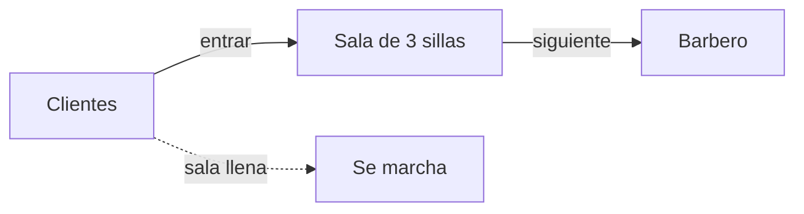

# El encargo

Una barbería muy pequeña tiene **una sala de espera con 3 sillas**, una silla de trabajo y un barbero. Las reglas son las de siempre:

- Si no hay clientes, el barbero **se duerme** en su silla.
- Cuando llega un cliente y el barbero duerme, lo **despierta**.
- Si el barbero está ocupado y hay una silla libre, el cliente **espera sentado**.
- Si no queda ninguna silla libre, el cliente **se marcha**.

Cada barbero y cada cliente es un **hilo**. Tu trabajo es conseguir que, pase lo que pase con el reparto de la CPU, se cumpla siempre que:

> **atendidos + perdidos = clientes que han llegado**

y que nunca haya más clientes sentados que sillas.



::: nota
Necesitas un JDK (Java 17 o posterior). Compila todos los archivos con `javac *.java` y ejecuta con `java Main ingenua`, `java Main monitor` o `java Main semaforos 2`, donde el segundo argumento es el número de barberos.
:::

# Conocimientos previos

- Crear y arrancar hilos con `Thread` y esperar su final con `join()`.
- Qué es una **condición de carrera** y una **sección crítica**.
- `synchronized`, `wait()` y `notifyAll()`.
- La clase `java.util.concurrent.Semaphore`: `acquire()`, `release()` y `tryAcquire()`.

# Parte 1. El contrato de la barbería

Los barberos y los clientes no saben cómo está hecha la barbería por dentro: solo usan esta interfaz. Así podrás cambiar la implementación sin tocar nada más.

```java
public interface Barberia {

    /** Un cliente intenta entrar. Devuelve false si no hay ninguna silla libre. */
    boolean entrar(int idCliente) throws InterruptedException;

    /** El barbero espera al siguiente cliente y devuelve su id.
     *  Devuelve -1 si la barbería ha cerrado y no queda nadie esperando. */
    int siguiente() throws InterruptedException;

    /** Se avisa de que no van a llegar más clientes. */
    void cerrar();
}
```

Y los dos tipos de hilo:

```java
import java.util.concurrent.ThreadLocalRandom;

public class Barbero extends Thread {

    private final Barberia barberia;
    private int atendidos = 0;

    public Barbero(Barberia barberia, int numero) {
        super("Barbero-" + numero);
        this.barberia = barberia;
    }

    public int getAtendidos() {
        return atendidos;
    }

    @Override
    public void run() {
        try {
            while (true) {
                int id = barberia.siguiente();
                if (id < 0) {
                    break;
                }
                System.out.println("[" + getName() + "] corta el pelo al cliente " + id);
                Thread.sleep(ThreadLocalRandom.current().nextInt(150, 350));
                atendidos++;
                System.out.println("[" + getName() + "] termina con el cliente " + id);
            }
        } catch (InterruptedException e) {
            Thread.currentThread().interrupt();
        }
        System.out.println("[" + getName() + "] cierra");
    }
}
```

```java
import java.util.concurrent.atomic.AtomicInteger;

public class Cliente extends Thread {

    private final Barberia barberia;
    private final int id;
    private final AtomicInteger perdidos;

    public Cliente(Barberia barberia, int id, AtomicInteger perdidos) {
        super("Cliente-" + id);
        this.barberia = barberia;
        this.id = id;
        this.perdidos = perdidos;
    }

    @Override
    public void run() {
        try {
            System.out.println("[cliente " + id + "] llega");
            if (!barberia.entrar(id)) {
                perdidos.incrementAndGet();
                System.out.println("[cliente " + id + "] no hay sitio: se marcha");
            }
        } catch (InterruptedException e) {
            Thread.currentThread().interrupt();
        }
    }
}
```

El programa principal crea los barberos, lanza 15 clientes con llegadas irregulares, espera a que todos hayan intentado entrar, cierra la barbería y cuenta los resultados.

```java
import java.util.ArrayList;
import java.util.List;
import java.util.concurrent.ThreadLocalRandom;
import java.util.concurrent.atomic.AtomicInteger;

public class Main {

    static final int SILLAS = 3;
    static final int CLIENTES = 15;

    public static void main(String[] args) throws InterruptedException {
        String version = args.length > 0 ? args[0] : "monitor";
        int numBarberos = args.length > 1 ? Integer.parseInt(args[1]) : 1;

        Barberia barberia;
        if (version.equals("ingenua")) {
            barberia = new BarberiaIngenua(SILLAS);
        } else if (version.equals("semaforos")) {
            barberia = new BarberiaSemaforos(SILLAS);
        } else {
            barberia = new BarberiaMonitor(SILLAS);
        }

        List<Barbero> barberos = new ArrayList<>();
        for (int i = 1; i <= numBarberos; i++) {
            Barbero b = new Barbero(barberia, i);
            barberos.add(b);
            b.start();
        }

        AtomicInteger perdidos = new AtomicInteger();
        List<Cliente> clientes = new ArrayList<>();
        for (int i = 1; i <= CLIENTES; i++) {
            if (ThreadLocalRandom.current().nextInt(3) > 0) {   // a veces llegan dos a la vez
                Thread.sleep(ThreadLocalRandom.current().nextInt(50, 250));
            }
            Cliente c = new Cliente(barberia, i, perdidos);
            clientes.add(c);
            c.start();
        }
        for (Cliente c : clientes) {
            c.join();
        }

        barberia.cerrar();
        int atendidos = 0;
        for (Barbero b : barberos) {
            b.join();
            atendidos += b.getAtendidos();
        }

        System.out.println();
        System.out.println("Clientes que han llegado: " + CLIENTES);
        System.out.println("Atendidos:                " + atendidos);
        System.out.println("Perdidos:                 " + perdidos.get());
        System.out.println("Atendidos + perdidos:     " + (atendidos + perdidos.get()));
    }
}
```

# Parte 2. La versión ingenua

Esta implementación **está mal a propósito**: no sincroniza nada.

```java
import java.util.ArrayDeque;
import java.util.Queue;

/** Versión SIN sincronizar. Está mal a propósito. */
public class BarberiaIngenua implements Barberia {

    private final int sillas;
    private final Queue<Integer> sala = new ArrayDeque<>();
    private volatile boolean cerrada = false;

    public BarberiaIngenua(int sillas) {
        this.sillas = sillas;
    }

    @Override
    public boolean entrar(int id) throws InterruptedException {
        if (sala.size() < sillas) {          // 1. comprueba si hay silla...
            Thread.sleep(5);                 //    (el cliente "se sienta": pasa tiempo)
            sala.add(id);                    // 2. ...y la ocupa
            System.out.println("[cliente " + id + "] espera (" + sala.size() + "/" + sillas + ")");
            if (sala.size() > sillas) {
                System.out.println("   ¡ERROR! Hay " + sala.size() + " clientes en una sala de " + sillas + " sillas");
            }
            return true;
        }
        return false;
    }

    @Override
    public int siguiente() throws InterruptedException {
        while (sala.isEmpty()) {             // espera activa: no duerme de verdad
            if (cerrada) {
                return -1;
            }
            Thread.sleep(10);
        }
        return sala.poll();
    }

    @Override
    public void cerrar() {
        cerrada = true;
    }
}
```

:::ejercicio[Caza el error]
1. Ejecuta `java Main ingenua` varias veces. ¿Aparece algún mensaje `¡ERROR!`? ¿Coincide siempre la suma de atendidos y perdidos?
2. Explica entre qué dos líneas de `entrar` puede cambiar el hilo y por qué eso permite que haya más clientes que sillas.
3. Identifica otros dos problemas de esta versión (pista: mira cómo espera el barbero y qué pasa con la cola `ArrayDeque` cuando varios hilos la tocan a la vez).
:::

# Parte 3. Solución con monitor

Un **monitor** protege la sala con `synchronized` y usa `wait()` y `notifyAll()` para dormir y despertar al barbero.

```java
import java.util.ArrayDeque;
import java.util.Queue;

public class BarberiaMonitor implements Barberia {

    private final int sillas;
    private final Queue<Integer> sala = new ArrayDeque<>();
    private boolean cerrada = false;

    public BarberiaMonitor(int sillas) {
        this.sillas = sillas;
    }

    @Override
    public synchronized boolean entrar(int id) {
        if (sala.size() == sillas) {
            return false;
        }
        sala.add(id);
        System.out.println("[cliente " + id + "] espera (" + sala.size() + "/" + sillas + ")");
        notifyAll();                         // por si el barbero está dormido
        return true;
    }

    @Override
    public synchronized int siguiente() throws InterruptedException {
        boolean dormido = false;
        while (sala.isEmpty() && !cerrada) {
            if (!dormido) {
                System.out.println("[" + Thread.currentThread().getName() + "] no hay clientes: se duerme");
                dormido = true;
            }
            wait();
        }
        if (dormido) {
            System.out.println("[" + Thread.currentThread().getName() + "] se despierta");
        }
        if (sala.isEmpty()) {
            return -1;                       // cerrada y sin nadie esperando
        }
        return sala.poll();
    }

    @Override
    public synchronized void cerrar() {
        cerrada = true;
        notifyAll();
    }
}
```

:::ejercicio[Dormir y despertar]
1. ¿Por qué `siguiente` comprueba la condición dentro de un `while` y no de un `if`?
2. ¿Qué ocurre en `cerrar()` si no se llama a `notifyAll()`?
3. Ejecuta `java Main monitor 2`. ¿Qué barbero atiende a más clientes? ¿Es siempre el mismo?
:::

::: aviso
**El aviso perdido.** Si llamas a `notify()` cuando nadie espera, el aviso desaparece y un `wait()` posterior se queda dormido para siempre. Los semáforos no tienen este problema, como verás en el ejemplo `AvisoPerdido` de más abajo.
:::

# Parte 4. Solución con semáforos

Aquí se usan dos semáforos: `mutex`, que da exclusión mutua sobre la sala, y `clientes`, que cuenta un permiso por cada cliente sentado. Un permiso liberado se **conserva**, así que no hay avisos perdidos.

```java
import java.util.ArrayDeque;
import java.util.Queue;
import java.util.concurrent.Semaphore;

public class BarberiaSemaforos implements Barberia {

    private final int sillas;
    private final Queue<Integer> sala = new ArrayDeque<>();
    private final Semaphore mutex = new Semaphore(1);      // exclusión mutua sobre la sala
    private final Semaphore clientes = new Semaphore(0);   // un permiso por cliente esperando

    public BarberiaSemaforos(int sillas) {
        this.sillas = sillas;
    }

    @Override
    public boolean entrar(int id) throws InterruptedException {
        mutex.acquire();
        try {
            if (sala.size() == sillas) {
                return false;
            }
            sala.add(id);
            System.out.println("[cliente " + id + "] espera (" + sala.size() + "/" + sillas + ")");
            clientes.release();              // avisa: hay un cliente más
            return true;
        } finally {
            mutex.release();
        }
    }

    @Override
    public int siguiente() throws InterruptedException {
        if (!clientes.tryAcquire()) {        // no hay permiso: el barbero se duerme
            System.out.println("[" + Thread.currentThread().getName() + "] no hay clientes: se duerme");
            clientes.acquire();
            System.out.println("[" + Thread.currentThread().getName() + "] se despierta");
        }
        mutex.acquire();
        try {
            return sala.isEmpty() ? -1 : sala.poll();   // sala vacía = permiso de cierre
        } finally {
            mutex.release();
        }
    }

    @Override
    public void cerrar() {
        clientes.release();                  // permiso extra para despertar al barbero
    }
}
```

Observa el truco de `cerrar()`: libera un permiso extra para despertar al barbero, que al ver la sala vacía entiende que es la señal de cierre.

:::ejercicio[Más de un barbero]
1. Ejecuta `java Main semaforos 2` varias veces. Con dos barberos, a veces uno de ellos **no termina nunca**. Averigua por qué: ¿cuántos permisos de cierre se liberan y cuántos barberos los necesitan?
2. Corrige `siguiente()` para que funcione con cualquier número de barberos.
:::

## Pista para el último ejercicio

El barbero que ve la sala vacía debe **pasar el permiso de cierre** al siguiente antes de salir.

```java
    public int siguiente() throws InterruptedException {
        if (!clientes.tryAcquire()) {        // no hay permiso: el barbero se duerme
            System.out.println("[" + Thread.currentThread().getName() + "] no hay clientes: se duerme");
            clientes.acquire();
            System.out.println("[" + Thread.currentThread().getName() + "] se despierta");
        }
        mutex.acquire();
        try {
            if (sala.isEmpty()) {            // permiso de cierre
                clientes.release();         // se lo pasa al siguiente barbero
                return -1;
            }
            return sala.poll();
        } finally {
            mutex.release();
        }
    }
```

# Parte 5. Comparar con un ejemplo mínimo

Para ver la diferencia entre `wait/notify` y los semáforos sin la barbería de por medio, ejecuta este programa:

```java
import java.util.concurrent.Semaphore;

public class AvisoPerdido {

    public static void main(String[] args) throws InterruptedException {
        // 1. notify() antes de wait(): el aviso se pierde
        Object monitor = new Object();
        Thread esperaMonitor = new Thread(() -> {
            synchronized (monitor) {
                try {
                    monitor.wait();
                } catch (InterruptedException e) {
                    Thread.currentThread().interrupt();
                }
            }
        });
        synchronized (monitor) {
            monitor.notify();                // nadie espera todavía
        }
        esperaMonitor.start();
        esperaMonitor.join(1000);
        System.out.println("Con wait/notify, el hilo sigue esperando: " + esperaMonitor.isAlive()
                + " (estado " + esperaMonitor.getState() + ")");

        // 2. release() antes de acquire(): el permiso se conserva
        Semaphore semaforo = new Semaphore(0);
        Thread esperaSemaforo = new Thread(() -> {
            try {
                semaforo.acquire();
            } catch (InterruptedException e) {
                Thread.currentThread().interrupt();
            }
        });
        semaforo.release();                  // nadie espera todavía
        esperaSemaforo.start();
        esperaSemaforo.join(1000);
        System.out.println("Con Semaphore, el hilo sigue esperando: " + esperaSemaforo.isAlive());

        esperaMonitor.interrupt();           // para que el programa termine
    }
}
```

Y este, un buzón de un solo mensaje entre un productor y un consumidor, es el patrón básico del monitor:

```java
public class Buzon {

    private String mensaje;                  // null = buzón vacío

    public synchronized void depositar(String m) throws InterruptedException {
        while (mensaje != null) {            // lleno: espera
            wait();
        }
        mensaje = m;
        notifyAll();                         // avisa a quien espere un mensaje
    }

    public synchronized String recoger() throws InterruptedException {
        while (mensaje == null) {            // vacío: espera
            wait();
        }
        String m = mensaje;
        mensaje = null;
        notifyAll();                         // avisa a quien espere hueco
        return m;
    }

    public static void main(String[] args) throws InterruptedException {
        Buzon buzon = new Buzon();
        Thread productor = new Thread(() -> {
            try {
                for (int i = 1; i <= 3; i++) {
                    buzon.depositar("mensaje " + i);
                }
            } catch (InterruptedException e) {
                Thread.currentThread().interrupt();
            }
        });
        Thread consumidor = new Thread(() -> {
            try {
                for (int i = 1; i <= 3; i++) {
                    System.out.println("Recibido: " + buzon.recoger());
                }
            } catch (InterruptedException e) {
                Thread.currentThread().interrupt();
            }
        });
        productor.start();
        consumidor.start();
        productor.join();
        consumidor.join();
    }
}
```

# Entrega

Un documento con:

1. La salida de `java Main ingenua` donde se vea el fallo y tu explicación de la condición de carrera.
2. Respuestas razonadas a los ejercicios de las partes 3 y 4.
3. La versión corregida de `siguiente()` y la salida de `java Main semaforos 3` con los tres barberos terminando.
4. Una comparación breve: ¿qué solución te parece más fácil de razonar, y por qué?
