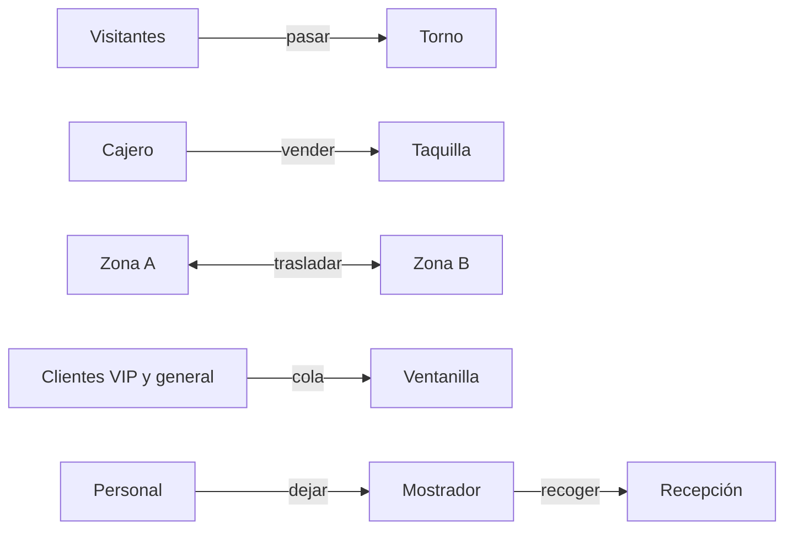
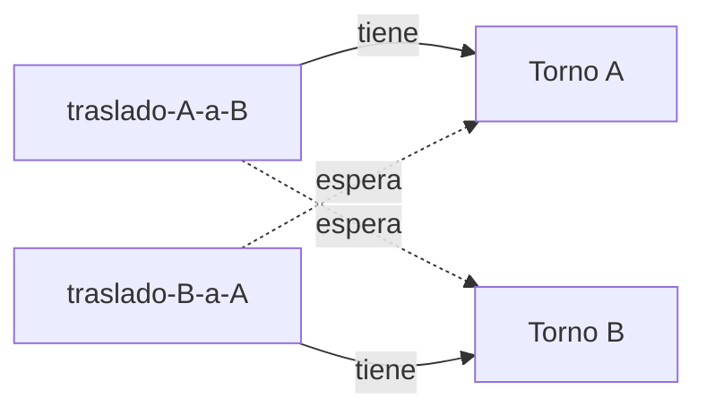

# El encargo

Mañana abre sus puertas el festival **Luna Nueva**, y a ti te ha tocado la guardia de informática. Hay un torno de entrada que cuenta a la gente, cajeros que venden entradas hasta la hora de cierre, dos zonas del recinto entre las que el personal pasa gente de una a otra, una ventanilla VIP y un mostrador de objetos perdidos.

En las pruebas, con un solo hilo, todo iba como la seda. Pero mañana habrá gente por todas partes a la vez, y el sistema ya ha demostrado que no lo aguanta: falla, y no siempre de la misma manera.

Cada parte de este caso te da un programa con un fallo distinto. En todas harás el mismo recorrido:

1. **Provócalo:** ejecuta el programa hasta que lo veas fallar con tus propios ojos.
2. **Obsérvalo:** apunta qué ha pasado exactamente y qué esperabas que pasara.
3. **Entiéndelo:** explica por qué ocurre con tus palabras. Ponerle nombre al fallo no basta.
4. **Arréglalo:** corrígelo con la herramienta de Java que toque.
5. **Compruébalo:** ejecútalo varias veces y asegúrate de que no vuelve.



::: nota
Necesitas un JDK (Java 17 o posterior), que incluye `javac` y `jstack`. Compila todos los archivos con `javac *.java` y ejecuta un escenario con `java Main carrera`, `java Main visibilidad`, `java Main interbloqueo`, `java Main livelock`, `java Main inanicion` o `java Main objetos`.

Los programas escriben con tres prefijos: `[+]` para contar lo que hace el programa, `[!]` para un aviso y `[X]` para un error.
:::

::: aviso
Los fallos de concurrencia **dependen de la máquina**: el número de núcleos, lo ocupado que esté tu equipo y la versión de Java cambian las cifras y, a veces, el momento en que aparece el fallo. Si un escenario no falla a la primera, no pasa nada: repítelo cinco o diez veces y apunta cuántas veces falla.
:::

# Conocimientos previos

- Crear y arrancar hilos con `Thread`, y esperar a que terminen con `join()`.
- Qué es una **condición de carrera** y una **sección crítica**.
- `synchronized`, `wait()` y `notify()`.
- Lo básico de `java.util.concurrent`: `ReentrantLock` y las colas bloqueantes.

# Por dónde empezar

Todos los escenarios cuelgan de una misma clase `Main`, que elige qué parte ejecutar según el argumento que le pases. Guárdala en la misma carpeta que el resto de archivos.

```java
public class Main {

    public static void main(String[] args) throws Exception {
        String escenario = args.length > 0 ? args[0] : "";
        switch (escenario) {
            case "carrera":
                Carrera.ejecutar();
                break;
            case "visibilidad":
                Visibilidad.ejecutar();
                break;
            case "interbloqueo":
                Interbloqueo.ejecutar();
                break;
            case "livelock":
                Livelock.ejecutar();
                break;
            case "inanicion":
                Inanicion.ejecutar();
                break;
            case "objetos":
                ObjetosPerdidos.ejecutar();
                break;
            default:
                System.out.println("[!] Uso: java Main carrera | visibilidad | interbloqueo | livelock | inanicion | objetos");
        }
    }
}
```

Varias partes necesitan llevar una cuenta (cuántos clientes se han atendido, cuántos objetos se han entregado). Para no repetir código usan esta clase, que sí es segura entre hilos porque sus dos métodos son `synchronized`. En la parte 1 verás por qué hace falta.

```java
/** Un contador que se puede usar desde varios hilos: sus dos métodos son synchronized. */
public class Contador {

    private int valor = 0;

    public synchronized void incrementar() {
        valor++;
    }

    public synchronized int valor() {
        return valor;
    }
}
```

| Parte | Escenario | Qué sale mal |
| --- | --- | --- |
| 1. Un torno | `carrera` | El torno se come personas: la cuenta no cuadra. |
| 2. Establecer hora de cierre | `visibilidad` | Un hilo no se entera de que ya es hora de cerrar. |
| 3. Dos tornos | `interbloqueo` | Dos traslados se quedan esperándose para siempre. |
| 4. Por favor, usted primero | `livelock` | Todos ceden el paso y nadie pasa. |
| 5. VIP | `inanicion` | Una parte del público no llega a ser atendida. |
| 6. Objetos perdidos | `objetos` | Todos se duermen esperando y nadie los despierta. |

# Parte 1. Un torno

Empezamos por lo más sencillo: un torno que cuenta a la gente que entra. Ocho filas de visitantes lo cruzan a la vez, con 100 000 personas cada una (es una simulación acelerada, claro). Al final, el torno tendría que marcar 800 000.

```java
/** Parte 1. Ocho filas de visitantes cruzan el mismo torno a la vez. */
public class Carrera {

    static class Torno {
        private int personas = 0;

        void pasar() {
            personas++;
        }

        int personas() {
            return personas;
        }
    }

    static class FilaDeVisitantes extends Thread {
        private final Torno torno;
        private final int visitantes;

        FilaDeVisitantes(String nombre, Torno torno, int visitantes) {
            super(nombre);
            this.torno = torno;
            this.visitantes = visitantes;
        }

        @Override
        public void run() {
            for (int v = 0; v < visitantes; v++) {
                torno.pasar();
            }
        }
    }

    static void ejecutar() throws InterruptedException {
        final int filas = 8;
        final int visitantesPorFila = 100_000;
        Torno torno = new Torno();

        FilaDeVisitantes[] hilos = new FilaDeVisitantes[filas];
        for (int i = 0; i < filas; i++) {
            hilos[i] = new FilaDeVisitantes("fila-" + (i + 1), torno, visitantesPorFila);
            hilos[i].start();
        }
        for (FilaDeVisitantes hilo : hilos) {
            hilo.join();
        }

        int esperadas = filas * visitantesPorFila;
        System.out.println("[+] Personas esperadas: " + esperadas);
        System.out.println("[+] Personas contadas:  " + torno.personas());
        if (torno.personas() != esperadas) {
            System.out.println("[X] El torno ha perdido " + (esperadas - torno.personas()) + " personas");
        }
    }
}
```

**Provócalo y obsérvalo.** Ejecuta `java Main carrera` cinco veces y apunta cuántas personas cuenta el torno en cada ocasión.

:::ejercicio[Entiende la carrera]
1. ¿Coincide la cuenta con las personas esperadas en alguna ejecución? ¿Y de una ejecución a otra?
2. `personas++` parece una sola instrucción, pero la máquina la hace en varios pasos. ¿Cuáles? Dibuja una tabla con dos filas de visitantes y escribe un reparto de turnos de la CPU en el que **dos personas cuenten como una sola**.
3. ¿Cuál es la sección crítica de este programa?
:::

:::ejercicio[Arréglalo]
Corrige el torno de **dos formas distintas** y compáralas: una con `synchronized` y otra con un `ReentrantLock` que bloquees y desbloquees tú. ¿Cuál te parece más fácil de leer? ¿Cuál es más fácil de usar mal? Después ejecuta el escenario cinco veces: la cuenta debe cuadrar siempre.
:::

# Parte 2. Establecer hora de cierre

Un cajero vende entradas sin parar hasta que llega la hora de cierre. Al cabo de un segundo, el hilo principal establece esa hora cambiando `cerrada` a `true`, y espera hasta 3 segundos a que el cajero se dé por enterado.

```java
/** Parte 2. Un cajero vende entradas hasta que llega la hora de cierre. */
public class Visibilidad {

    private static boolean cerrada = false;
    private static long vendidas = 0;

    static class Cajero extends Thread {

        Cajero() {
            super("cajero");
            setDaemon(true);
        }

        @Override
        public void run() {
            while (!cerrada) {
                vendidas++;
            }
        }
    }

    static void ejecutar() throws InterruptedException {
        Cajero cajero = new Cajero();
        cajero.start();

        Thread.sleep(1000);
        cerrada = true;                              // se establece la hora de cierre
        System.out.println("[+] Hora de cierre. Espero al cajero...");

        cajero.join(3000);
        if (cajero.isAlive()) {
            System.out.println("[X] El cajero sigue vendiendo 3 segundos después del cierre");
        } else {
            System.out.println("[+] El cajero ha parado tras vender " + vendidas + " entradas");
        }
    }
}
```

**Provócalo y obsérvalo.** Ejecuta `java Main visibilidad`. El hilo principal cambia `cerrada` **antes** de ponerse a esperar. ¿Debería parar el cajero? ¿Para?

:::ejercicio[Entiende la visibilidad]
1. Ejecuta `java -Xint Main visibilidad`, que obliga a la máquina virtual a interpretar el código sin optimizarlo. ¿Qué ocurre ahora? ¿Qué te dice eso sobre la causa del fallo?
2. Añade `System.out.print("");` dentro del bucle del cajero y ejecuta de nuevo. ¿Se arregla? La línea no hace nada visible, así que investiga por qué influye.
3. Con tus palabras: ¿por qué un hilo puede no ver nunca un cambio que ha hecho otro? ¿Qué garantiza el lenguaje cuando no usas ninguna herramienta de sincronización?
:::

:::ejercicio[Arréglalo]
Corrígelo con **una sola palabra clave** en la declaración de `cerrada`. Y luego piensa: ¿habría bastado esa palabra clave para arreglar la parte 1? ¿Por qué sí o por qué no?
:::

# Parte 3. Dos tornos

El recinto tiene dos zonas, A y B, y cada una tiene su torno, que cuenta la gente que hay dentro. A veces el personal tiene que pasar gente de una zona a otra. Para que la cuenta salga bien, cada traslado bloquea **primero** el torno de origen y **después** el de destino. Dos personas del personal trabajan a la vez: una pasa gente de A a B y la otra de B a A.

```java
/** Parte 3. Dos zonas con su torno cada una; el personal pasa gente de una a la otra. */
public class Interbloqueo {

    static class Torno {
        final String nombre;
        int personas;

        Torno(String nombre, int personas) {
            this.nombre = nombre;
            this.personas = personas;
        }
    }

    static void trasladar(Torno origen, Torno destino, int cantidad) throws InterruptedException {
        synchronized (origen) {
            Thread.sleep(10);                      // se cuenta a la gente que sale
            synchronized (destino) {
                origen.personas -= cantidad;
                destino.personas += cantidad;
            }
        }
    }

    static class Traslado extends Thread {
        private final Torno origen;
        private final Torno destino;

        Traslado(String nombre, Torno origen, Torno destino) {
            super(nombre);
            this.origen = origen;
            this.destino = destino;
            setDaemon(true);
        }

        @Override
        public void run() {
            try {
                for (int i = 0; i < 100; i++) {
                    trasladar(origen, destino, 1);
                }
                System.out.println("[+] " + getName() + " ha terminado sus traslados");
            } catch (InterruptedException e) {
                Thread.currentThread().interrupt();
            }
        }
    }

    static void ejecutar() throws InterruptedException {
        Torno a = new Torno("A", 1000);
        Torno b = new Torno("B", 1000);
        Traslado deAaB = new Traslado("traslado-A-a-B", a, b);
        Traslado deBaA = new Traslado("traslado-B-a-A", b, a);
        deAaB.start();
        deBaA.start();

        long limite = System.currentTimeMillis() + 5000;
        deAaB.join(5000);
        deBaA.join(Math.max(1, limite - System.currentTimeMillis()));
        if (deAaB.isAlive() || deBaA.isAlive()) {
            long pid = ProcessHandle.current().pid();
            System.out.println("[X] Llevan 5 segundos sin terminar");
            System.out.println("[!] Abre otra terminal y ejecuta: jstack " + pid);
            System.out.println("[!] El programa se cierra solo en 60 segundos");
            deAaB.join(60_000);
        } else {
            System.out.println("[+] Traslados completados. A=" + a.personas + " B=" + b.personas);
        }
    }
}
```

**Provócalo y obsérvalo.** Ejecuta `java Main interbloqueo`. A los cinco segundos el programa te avisa y te da el número de su proceso. Sin cerrarlo, abre otra terminal y ejecuta `jstack <número>`.

:::ejercicio[Entiende el interbloqueo]
1. Busca en la salida de `jstack` el texto `Found one Java-level deadlock`. ¿Qué hilo está esperando qué torno, y quién lo tiene?
2. Dibuja los dos hilos y los dos tornos, con flechas de «espera a» y «tiene».
3. Un interbloqueo necesita que se den cuatro condiciones a la vez: exclusión mutua, retención y espera, no expropiación y espera circular. Localiza cada una en este programa.
:::



:::ejercicio[Arréglalo]
Rompe **una** de las cuatro condiciones sin cambiar lo que hace el traslado. Una pista: si todos bloquean los tornos siempre en el mismo orden, la espera circular es imposible. ¿Qué dato de cada torno podrías usar para decidir cuál se bloquea primero? Comprueba, en tres ejecuciones, que los 100 traslados de cada hilo terminan y que cada zona acaba con 1000 personas.
:::

::: aviso
Un buen arreglo no cambia el resultado: `A + B` tiene que valer 2000 al terminar, pase lo que pase con el reparto de la CPU.
:::

# Parte 4. Por favor, usted primero

Para que lo de la parte 3 no se repita, la dirección propone un protocolo más educado. Cada traslado se queda con la llave de su torno y **intenta** coger la del otro con `tryLock()`. Si no puede, cede la suya, se lo piensa un momento y vuelve a probar. Así nadie espera para siempre y el interbloqueo es imposible. ¿Seguro que todo va a ir bien?

```java
import java.util.concurrent.locks.ReentrantLock;

/** Parte 4. Cada traslado se queda con la llave de su torno y pide la del otro; si no puede, cede. */
public class Livelock {

    static final Contador fallidos = new Contador();
    static final Contador completados = new Contador();

    static void trasladar(ReentrantLock propia, ReentrantLock otra) throws InterruptedException {
        while (true) {
            propia.lock();
            try {
                Thread.sleep(100);                  // prepara el traslado
                if (otra.tryLock()) {
                    try {
                        completados.incrementar();
                        return;
                    } finally {
                        otra.unlock();
                    }
                }
                fallidos.incrementar();
                Thread.sleep(50);                   // «por favor, usted primero»: se lo piensa un momento
            } finally {
                propia.unlock();                    // cede la llave
            }
            Thread.sleep(100);                      // y vuelve a intentarlo
        }
    }

    static class Traslado extends Thread {
        private final ReentrantLock propia;
        private final ReentrantLock otra;

        Traslado(String nombre, ReentrantLock propia, ReentrantLock otra) {
            super(nombre);
            this.propia = propia;
            this.otra = otra;
            setDaemon(true);
        }

        @Override
        public void run() {
            try {
                trasladar(propia, otra);
            } catch (InterruptedException e) {
                Thread.currentThread().interrupt();
            }
        }
    }

    static void ejecutar() throws InterruptedException {
        ReentrantLock llaveA = new ReentrantLock();
        ReentrantLock llaveB = new ReentrantLock();
        new Traslado("traslado-A", llaveA, llaveB).start();
        new Traslado("traslado-B", llaveB, llaveA).start();

        Thread.sleep(4000);
        System.out.println("[+] Traslados completados: " + completados.valor());
        System.out.println("[+] Intentos cedidos:      " + fallidos.valor());
        if (completados.valor() == 0) {
            System.out.println("[X] Nadie está bloqueado, pero en 4 segundos no ha avanzado nadie");
        }
    }
}
```

**Provócalo y obsérvalo.** Ejecuta `java Main livelock` y fíjate en cuántos traslados se completan y cuántas veces se cede el paso.

:::ejercicio[Entiende el livelock]
1. Mientras corre el escenario, ejecuta `jstack` sobre el proceso. ¿Aparece `Found one Java-level deadlock`? ¿En qué estado están los dos hilos?
2. ¿En qué se parece este fallo al interbloqueo y en qué se diferencia? Explica por qué los dos hilos **hacen cosas** (despertarse, comprobar, ceder) y aun así **no avanzan**.
3. ¿Por qué las pausas de 50 y 100 ms mantienen a los dos traslados sincronizados ronda tras ronda?
:::

:::ejercicio[Arréglalo]
Cambia **una sola cosa** del protocolo para que los dos dejen de moverse al unísono, sin quitar el `tryLock()`. Piensa qué pasaría si cada uno esperase un tiempo distinto antes de reintentar. Comprueba, en tres ejecuciones, que los dos traslados se completan.
:::

# Parte 5. VIP

En la ventanilla de acreditaciones hay una sola persona atendiendo, y la regla es sencilla: mira primero la fila VIP y, solo si está vacía, pasa a la fila general. Hay 20 personas del público general esperando desde el principio. Llega un VIP nuevo cada 5 ms, y atender a cualquiera tarda 10 ms.

```java
import java.util.ArrayDeque;
import java.util.Queue;

/** Parte 5. Una sola ventanilla atiende a los VIP antes que al público general. */
public class Inanicion {

    static final Contador atendidosVip = new Contador();
    static final Contador atendidosGeneral = new Contador();

    static class Colas {
        private final Queue<Integer> vip = new ArrayDeque<>();
        private final Queue<Integer> general = new ArrayDeque<>();

        synchronized void llegaVip(int id) {
            vip.add(id);
        }

        synchronized void llegaGeneral(int id) {
            general.add(id);
        }

        /** Atiende al siguiente cliente (los VIP primero). Devuelve false si no hay nadie. */
        synchronized boolean atenderSiguiente() {
            if (!vip.isEmpty()) {
                vip.poll();
                atendidosVip.incrementar();
                return true;
            }
            if (!general.isEmpty()) {
                general.poll();
                atendidosGeneral.incrementar();
                return true;
            }
            return false;
        }
    }

    static class LlegadasVip extends Thread {
        private final Colas colas;

        LlegadasVip(Colas colas) {
            super("llegadas-vip");
            this.colas = colas;
        }

        @Override
        public void run() {
            try {
                for (int id = 1001; ; id++) {
                    Thread.sleep(5);                 // llega un VIP cada 5 ms
                    colas.llegaVip(id);
                }
            } catch (InterruptedException e) {
                Thread.currentThread().interrupt();
            }
        }
    }

    static class Ventanilla extends Thread {
        private final Colas colas;

        Ventanilla(Colas colas) {
            super("ventanilla");
            this.colas = colas;
        }

        @Override
        public void run() {
            try {
                while (true) {
                    if (colas.atenderSiguiente()) {
                        Thread.sleep(10);            // atender a un cliente tarda 10 ms
                    } else {
                        Thread.sleep(1);             // no hay nadie: espera un momento
                    }
                }
            } catch (InterruptedException e) {
                Thread.currentThread().interrupt();
            }
        }
    }

    static void ejecutar() throws InterruptedException {
        Colas colas = new Colas();
        for (int i = 1; i <= 20; i++) {
            colas.llegaGeneral(i);
        }

        LlegadasVip llegadasVip = new LlegadasVip(colas);
        Ventanilla ventanilla = new Ventanilla(colas);
        llegadasVip.start();
        ventanilla.start();
        Thread.sleep(4000);
        llegadasVip.interrupt();
        ventanilla.interrupt();

        System.out.println("[+] Atendidos VIP:     " + atendidosVip.valor());
        System.out.println("[+] Atendidos general: " + atendidosGeneral.valor() + " de 20 que esperaban desde el principio");
        if (atendidosGeneral.valor() < 20) {
            System.out.println("[X] Hay clientes que llevan 4 segundos esperando sin que les toque");
        }
    }
}
```

**Provócalo y obsérvalo.** Ejecuta `java Main inanicion` y compara cuántos VIP se atienden con cuántas personas del público general.

:::ejercicio[Entiende la inanición]
1. De las 20 personas del público general que esperaban desde el principio, ¿a cuántas se atiende? ¿Qué conclusión sacas?
2. Ejecuta `jstack` mientras corre. ¿Ves algún hilo bloqueado? ¿En qué se diferencia esto de las partes 3 y 4?
3. Haz la cuenta con los datos del enunciado (un VIP cada 5 ms, 10 ms por cliente): ¿llega a vaciarse alguna vez la fila VIP? ¿Qué tendría que cumplirse para que el público general consiguiera ser atendido?
:::

:::ejercicio[Arréglalo]
Modifica **solo `atenderSiguiente()`** para que los VIP sigan teniendo preferencia, pero nadie del público general espere indefinidamente. Una idea: cuenta cuántos VIP se han atendido seguidos y, al llegar a un límite que elijas, atiende a una persona del público general. Comprueba que se atiende a las 20 personas y que los VIP siguen recibiendo su trato preferente. Después, describe otra forma de evitar la inanición (por ejemplo, que cada cliente cuente cuánto lleva esperando) y explica qué ventajas tiene cada una.
:::

::: nota
Cambiar la prioridad de un `Thread` con `setPriority()` no arregla esto. Aquí los que esperan son clientes de una fila, no hilos, y la prioridad de un hilo es solo una sugerencia que cada sistema operativo trata a su manera.
:::

# Parte 6. Objetos perdidos

En el mostrador de objetos perdidos solo cabe un objeto a la vez. Dos personas del personal van dejando en él lo que encuentran por el recinto, y dos personas de recepción se los entregan a sus dueños. Cuando el mostrador está lleno, el personal espera con `wait()`; cuando está vacío, esperan los de recepción. Cada vez que algo cambia, se avisa con `notify()`.

```java
import java.util.ArrayDeque;
import java.util.Queue;

/** Parte 6. El personal deja objetos en un mostrador con un solo hueco y recepción los entrega. */
public class ObjetosPerdidos {

    static class Mostrador {
        private final Queue<Integer> objetos = new ArrayDeque<>();
        private final int capacidad;

        Mostrador(int capacidad) {
            this.capacidad = capacidad;
        }

        synchronized void dejar(int objeto) throws InterruptedException {
            while (objetos.size() == capacidad) {
                wait();
            }
            objetos.add(objeto);
            notify();
        }

        synchronized int recoger() throws InterruptedException {
            while (objetos.isEmpty()) {
                wait();
            }
            int objeto = objetos.poll();
            notify();
            return objeto;
        }
    }

    static final Contador dejados = new Contador();
    static final Contador entregados = new Contador();

    static class Personal extends Thread {
        private final Mostrador mostrador;
        private final int objetos;

        Personal(String nombre, Mostrador mostrador, int objetos) {
            super(nombre);
            this.mostrador = mostrador;
            this.objetos = objetos;
            setDaemon(true);
        }

        @Override
        public void run() {
            try {
                for (int o = 0; o < objetos; o++) {
                    mostrador.dejar(o);
                    dejados.incrementar();
                }
            } catch (InterruptedException e) {
                Thread.currentThread().interrupt();
            }
        }
    }

    static class Recepcion extends Thread {
        private final Mostrador mostrador;
        private final int objetos;

        Recepcion(String nombre, Mostrador mostrador, int objetos) {
            super(nombre);
            this.mostrador = mostrador;
            this.objetos = objetos;
            setDaemon(true);
        }

        @Override
        public void run() {
            try {
                for (int o = 0; o < objetos; o++) {
                    mostrador.recoger();
                    entregados.incrementar();
                }
            } catch (InterruptedException e) {
                Thread.currentThread().interrupt();
            }
        }
    }

    static void ejecutar() throws InterruptedException {
        final int objetosPorHilo = 5000;
        Mostrador mostrador = new Mostrador(1);

        Thread[] hilos = {
            new Personal("personal-1", mostrador, objetosPorHilo),
            new Personal("personal-2", mostrador, objetosPorHilo),
            new Recepcion("recepcion-1", mostrador, objetosPorHilo),
            new Recepcion("recepcion-2", mostrador, objetosPorHilo)
        };
        for (Thread hilo : hilos) {
            hilo.start();
        }

        long limite = System.currentTimeMillis() + 5000;
        for (Thread hilo : hilos) {
            hilo.join(Math.max(1, limite - System.currentTimeMillis()));
        }

        System.out.println("[+] Objetos dejados en el mostrador: " + dejados.valor() + " de " + 2 * objetosPorHilo);
        System.out.println("[+] Objetos entregados:              " + entregados.valor() + " de " + 2 * objetosPorHilo);
        if (entregados.valor() < 2 * objetosPorHilo) {
            System.out.println("[X] Se han atascado: todos esperan y nadie los despierta");
        }
    }
}
```

**Provócalo y obsérvalo.** Ejecuta `java Main objetos`. Cada hilo debería gestionar 5000 objetos.

:::ejercicio[Entiende el despertar perdido]
1. ¿Cuántos objetos se entregan antes de que el programa se atasque? Ejecuta `jstack` y apunta en qué estado están los cuatro hilos. ¿Aparece `Found one Java-level deadlock`? Si no aparece, ¿en qué se diferencia este atasco del de la parte 3?
2. `notify()` despierta **a un solo hilo cualquiera** de los que esperan en ese monitor. Imagina el mostrador vacío y que una persona del personal deja un objeto: ¿a quién puede despertar? Escribe una secuencia concreta en la que **todos** los hilos acaben esperando.
3. Cambia `notify()` por `notifyAll()` y ejecuta tres veces. ¿Se arregla? Después cambia además los dos `while` por `if` y ejecuta de nuevo. ¿Qué ocurre y por qué? ¿Qué significa «despertar» en un `wait()` y cuándo hay que volver a comprobar la condición?
:::

:::ejercicio[Arréglalo]
Sustituye `Mostrador` por una clase de `java.util.concurrent` que ya sepa bloquear al que espera, de modo que no escribas tú ningún `wait()` ni `notify()`. Comprueba, en tres ejecuciones, que se entregan los 10 000 objetos. ¿Qué parte del problema desaparece al dejárselo a la librería?
:::

# Entrega

Un informe con:

1. Una tabla con **una fila por parte** (problema, síntoma que viste, causa y solución que aplicaste).
2. En cada fila, la salida real que obtuviste al provocar el fallo y la que obtuviste después de arreglarlo.
3. Para las partes 3, 4 y 6, qué te dijo `jstack` y qué conclusión sacaste.
4. Una reflexión breve: de los seis fallos, ¿cuál te parece más peligroso en un sistema real y por qué?

# Criterios de revisión

| Aspecto | Evidencia |
| --- | --- |
| Parte 1. Un torno | Explica los pasos de `personas++` y un reparto de turnos que pierde gente; la cuenta cuadra en todas las ejecuciones. |
| Parte 2. Establecer hora de cierre | Explica que el cambio no es visible para el otro hilo; usa `volatile` y razona por qué no basta para la parte 1. |
| Parte 3. Dos tornos | Identifica en `jstack` quién espera qué y las cuatro condiciones; rompe la espera circular con un orden global. |
| Parte 4. Por favor, usted primero | Distingue livelock de interbloqueo con la salida de `jstack`; rompe la simetría sin quitar `tryLock()`. |
| Parte 5. VIP | Demuestra con datos que el público general no se atiende; limita la ventaja del VIP sin eliminarla y propone una alternativa. |
| Parte 6. Objetos perdidos | Muestra una secuencia en la que todos esperan; explica `notify` frente a `notifyAll` y `while` frente a `if`; delega en una cola bloqueante. |
| Informe | Tabla completa, salidas reales antes y después, y reflexión final razonada. |
