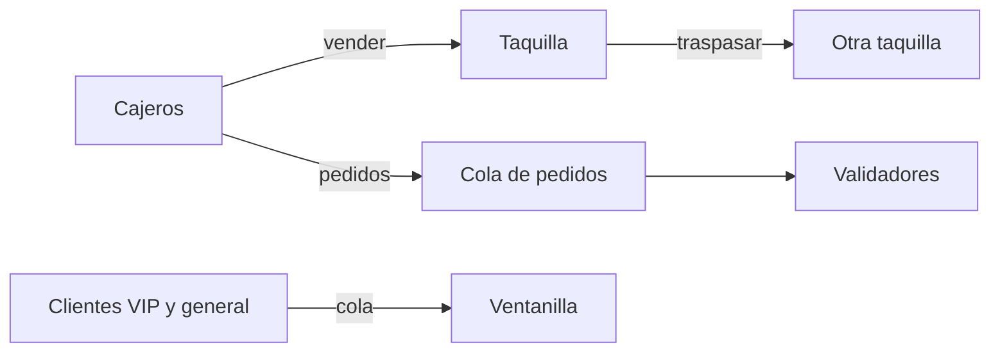
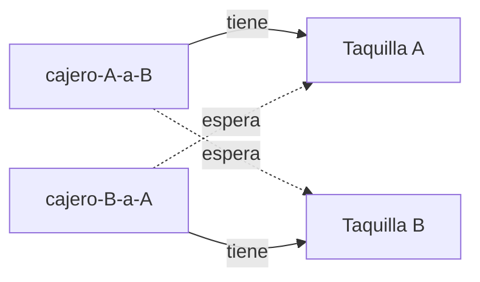

# El encargo

El festival **Luna Nueva** abre la venta de entradas el viernes a las 10:00. La plataforma ya funciona en las pruebas con un cajero, pero en la venta real habrá **muchos hilos a la vez**: ocho cajeros, taquillas que se pasan entradas entre sí, clientes VIP, validadores en la puerta. Eres la persona de guardia de ingeniería y tu trabajo es llegar al viernes con la plataforma a prueba de fallos.

El problema es que el sistema **ya falla**, y no siempre del mismo modo. Cada parte de este caso te da un programa con un fallo de concurrencia distinto. Tu trabajo en cada una es el mismo:

1. **Provócalo:** ejecuta el programa hasta ver el fallo.
2. **Obsérvalo:** anota qué ocurre exactamente y qué esperabas que ocurriera.
3. **Diagnostícalo:** explica la causa con tus palabras, no con el nombre del fallo.
4. **Arréglalo:** corrige el programa con la herramienta de Java adecuada.
5. **Compruébalo:** ejecuta de nuevo varias veces y confirma que el fallo no vuelve.



::: nota
Necesitas un JDK (Java 17 o posterior), que incluye `javac` y `jstack`. Compila todos los archivos con `javac *.java` y ejecuta un escenario con `java Main carrera`, `java Main visibilidad`, `java Main interbloqueo`, `java Main livelock`, `java Main inanicion` o `java Main pedidos`.

Los programas escriben con tres prefijos: `[+]` para el registro de lo que hace el programa, `[!]` para un aviso y `[X]` para un error.
:::

::: aviso
Los fallos de concurrencia **dependen de la máquina**: el número de núcleos, la carga del equipo y la versión de Java cambian las cifras y, a veces, el momento en que aparece el fallo. Si en tu equipo un escenario no falla a la primera, repítelo cinco o diez veces y anota cuántas veces falla.
:::

# Conocimientos previos

- Crear y arrancar hilos con `Thread` y esperar su final con `join()`.
- Qué es una **condición de carrera** y una **sección crítica**.
- `synchronized`, `wait()` y `notify()`.
- Lo básico de `java.util.concurrent`: `ReentrantLock`, `AtomicInteger` y las colas bloqueantes.

# El programa y su punto de entrada

Todos los escenarios cuelgan de una misma clase `Main`, que elige qué parte ejecutar según el argumento. Guárdala junto al resto de archivos de las partes siguientes.

```java
public class Main {

    public static void main(String[] args) throws Exception {
        String escenario = args.length > 0 ? args[0] : "";
        switch (escenario) {
            case "carrera":
                Carrera.ejecutar();
                break;
            case "visibilidad":
                Visibilidad.ejecutar();
                break;
            case "interbloqueo":
                Interbloqueo.ejecutar();
                break;
            case "livelock":
                Livelock.ejecutar();
                break;
            case "inanicion":
                Inanicion.ejecutar();
                break;
            case "pedidos":
                Pedidos.ejecutar();
                break;
            default:
                System.out.println("[!] Uso: java Main carrera | visibilidad | interbloqueo | livelock | inanicion | pedidos");
        }
    }
}
```

| Parte | Escenario | Qué sale mal |
| --- | --- | --- |
| 1 | `carrera` | Se pierden ventas. |
| 2 | `visibilidad` | Un hilo no se entera de que la taquilla ha cerrado. |
| 3 | `interbloqueo` | Dos taquillas se quedan esperando para siempre. |
| 4 | `livelock` | Todos se mueven y nadie avanza. |
| 5 | `inanicion` | Una parte del público no recibe atención nunca. |
| 6 | `pedidos` | Los hilos se duermen y nadie los despierta. |

# Parte 1. Las entradas que desaparecen

Ocho cajeros venden 100 000 entradas cada uno sobre **el mismo contador**. Al final, el contador debería marcar 800 000.

```java
/** Parte 1. Varios cajeros venden entradas a la vez sobre el mismo contador. */
public class Carrera {

    static class Taquilla {
        private int vendidas = 0;

        void venderEntrada() {
            vendidas++;
        }

        int vendidas() {
            return vendidas;
        }
    }

    static class Cajero extends Thread {
        private final Taquilla taquilla;
        private final int ventas;

        Cajero(String nombre, Taquilla taquilla, int ventas) {
            super(nombre);
            this.taquilla = taquilla;
            this.ventas = ventas;
        }

        @Override
        public void run() {
            for (int v = 0; v < ventas; v++) {
                taquilla.venderEntrada();
            }
        }
    }

    static void ejecutar() throws InterruptedException {
        final int cajeros = 8;
        final int ventasPorCajero = 100_000;
        Taquilla taquilla = new Taquilla();

        Cajero[] hilos = new Cajero[cajeros];
        for (int i = 0; i < cajeros; i++) {
            hilos[i] = new Cajero("cajero-" + (i + 1), taquilla, ventasPorCajero);
            hilos[i].start();
        }
        for (Cajero hilo : hilos) {
            hilo.join();
        }

        int esperadas = cajeros * ventasPorCajero;
        System.out.println("[+] Entradas esperadas: " + esperadas);
        System.out.println("[+] Entradas contadas:  " + taquilla.vendidas());
        if (taquilla.vendidas() != esperadas) {
            System.out.println("[X] Se han perdido " + (esperadas - taquilla.vendidas()) + " ventas");
        }
    }
}
```

**Provócalo y obsérvalo.** Ejecuta `java Main carrera` cinco veces. Anota las entradas contadas en cada ejecución.

:::ejercicio[Diagnostica la carrera]
1. ¿Coincide el contador con las entradas esperadas en alguna ejecución? ¿Y entre una ejecución y otra?
2. La instrucción `vendidas++` parece una sola, pero se ejecuta en varios pasos. ¿Cuáles son? Dibuja una tabla con dos cajeros y escribe un reparto de turnos de la CPU en el que **dos ventas cuenten como una sola**.
3. ¿Qué parte del programa es la sección crítica?
:::

:::ejercicio[Arréglalo]
Corrige `Carrera` de **dos formas distintas** y compáralas: una con un candado (`synchronized`) y otra con una clase del paquete `java.util.concurrent.atomic`. ¿Cuál te parece más sencilla de leer y por qué? Después, ejecuta el escenario cinco veces: el contador debe coincidir siempre con las entradas esperadas.
:::

# Parte 2. El cajero que no cierra

Un cajero vende entradas en bucle hasta que alguien cierra la taquilla. A los 1000 ms, el hilo principal cambia la variable `cerrada` a `true` y espera hasta 3 segundos a que el cajero termine.

```java
/** Parte 2. Un cajero vende hasta que alguien cierra la taquilla. */
public class Visibilidad {

    private static boolean cerrada = false;
    private static long vendidas = 0;

    static class Cajero extends Thread {

        Cajero() {
            super("cajero");
            setDaemon(true);
        }

        @Override
        public void run() {
            while (!cerrada) {
                vendidas++;
            }
        }
    }

    static void ejecutar() throws InterruptedException {
        Cajero cajero = new Cajero();
        cajero.start();

        Thread.sleep(1000);
        cerrada = true;
        System.out.println("[+] Taquilla cerrada. Espero al cajero...");

        cajero.join(3000);
        if (cajero.isAlive()) {
            System.out.println("[X] El cajero sigue vendiendo 3 segundos después del cierre");
        } else {
            System.out.println("[+] El cajero ha parado tras vender " + vendidas + " entradas");
        }
    }
}
```

**Provócalo y obsérvalo.** Ejecuta `java Main visibilidad`. El hilo principal cambia `cerrada` **antes** de esperar. ¿Debería parar el cajero? ¿Para?

:::ejercicio[Diagnostica la visibilidad]
1. Ejecuta `java -Xint Main visibilidad` (que obliga a la máquina virtual a interpretar el código sin optimizarlo). ¿Qué ocurre ahora? ¿Qué te dice eso sobre la causa del fallo?
2. Añade `System.out.print("");` dentro del bucle del cajero y ejecuta de nuevo. ¿Se arregla? Investiga por qué, aunque la línea no haga nada visible.
3. Explica con tus palabras por qué un hilo puede no ver nunca el cambio que ha hecho otro hilo en una variable. ¿Qué garantiza el lenguaje cuando no se usa ninguna herramienta de sincronización?
:::

:::ejercicio[Arréglalo]
Corrige `Visibilidad` con **una sola palabra clave** en la declaración de la variable `cerrada`. Después, responde: ¿bastaría esa palabra clave para arreglar la parte 1? ¿Por qué sí o por qué no?
:::

# Parte 3. Dos taquillas, un traspaso

Las taquillas A y B se pasan entradas entre sí. Un cajero traspasa de A a B y otro de B a A, a la vez. Para que el traspaso sea seguro, cada cajero bloquea **primero** la taquilla de origen y **después** la de destino.

```java
/** Parte 3. Dos taquillas se traspasan entradas la una a la otra. */
public class Interbloqueo {

    static class Taquilla {
        final String nombre;
        int entradas;

        Taquilla(String nombre, int entradas) {
            this.nombre = nombre;
            this.entradas = entradas;
        }
    }

    static void traspasar(Taquilla origen, Taquilla destino, int cantidad) throws InterruptedException {
        synchronized (origen) {
            Thread.sleep(10);                      // el cajero cuenta las entradas
            synchronized (destino) {
                origen.entradas -= cantidad;
                destino.entradas += cantidad;
            }
        }
    }

    static class Cajero extends Thread {
        private final Taquilla origen;
        private final Taquilla destino;

        Cajero(String nombre, Taquilla origen, Taquilla destino) {
            super(nombre);
            this.origen = origen;
            this.destino = destino;
            setDaemon(true);
        }

        @Override
        public void run() {
            try {
                for (int i = 0; i < 100; i++) {
                    traspasar(origen, destino, 1);
                }
                System.out.println("[+] " + getName() + " ha terminado sus traspasos");
            } catch (InterruptedException e) {
                Thread.currentThread().interrupt();
            }
        }
    }

    static void ejecutar() throws InterruptedException {
        Taquilla a = new Taquilla("A", 1000);
        Taquilla b = new Taquilla("B", 1000);
        Cajero deAaB = new Cajero("cajero-A-a-B", a, b);
        Cajero deBaA = new Cajero("cajero-B-a-A", b, a);
        deAaB.start();
        deBaA.start();

        long limite = System.currentTimeMillis() + 5000;
        deAaB.join(5000);
        deBaA.join(Math.max(1, limite - System.currentTimeMillis()));
        if (deAaB.isAlive() || deBaA.isAlive()) {
            long pid = ProcessHandle.current().pid();
            System.out.println("[X] Llevan 5 segundos sin terminar");
            System.out.println("[!] Abre otra terminal y ejecuta: jstack " + pid);
            System.out.println("[!] El programa se cierra solo en 60 segundos");
            deAaB.join(60_000);
        } else {
            System.out.println("[+] Traspasos completados. A=" + a.entradas + " B=" + b.entradas);
        }
    }
}
```

**Provócalo y obsérvalo.** Ejecuta `java Main interbloqueo`. El programa te avisa a los cinco segundos y te da el número del proceso. Sin cerrarlo, abre otra terminal y ejecuta `jstack <número>`.

:::ejercicio[Diagnostica el interbloqueo]
1. Busca en la salida de `jstack` el texto `Found one Java-level deadlock`. ¿Qué hilo espera qué taquilla y quién la tiene?
2. Dibuja un diagrama con los dos hilos y las dos taquillas, con flechas de «espera a» y «tiene».
3. Un interbloqueo necesita que se cumplan cuatro condiciones a la vez: exclusión mutua, retención y espera, no expropiación y espera circular. Identifica cada una en este programa.
:::



:::ejercicio[Arréglalo]
Rompe **una** de las cuatro condiciones sin cambiar lo que hace el traspaso. Pista: si todos los cajeros bloquean las taquillas en el mismo orden, no puede haber espera circular. ¿Qué dato de cada taquilla puedes usar para decidir cuál se bloquea primero? Comprueba con tres ejecuciones que los 100 traspasos de cada cajero terminan y que A y B acaban con 1000 entradas cada una.
:::

::: aviso
Un buen arreglo no cambia el resultado del programa: `A + B` debe valer 2000 al terminar, ocurra lo que ocurra con el reparto de la CPU.
:::

# Parte 4. Después de usted

Para evitar el interbloqueo, la dirección cambia el protocolo: cada cajero se queda con la llave de su taquilla, **intenta** coger la de la otra con `tryLock()` y, si no puede, **cede la suya** y lo reintenta pasado un rato. Nadie espera para siempre, así que no puede haber interbloqueo.

```java
import java.util.concurrent.atomic.AtomicInteger;
import java.util.concurrent.locks.ReentrantLock;

/** Parte 4. Cada taquilla se queda con su llave y pide prestada la de la otra; si no puede, cede. */
public class Livelock {

    static final AtomicInteger fallidos = new AtomicInteger();
    static final AtomicInteger completados = new AtomicInteger();

    static void traspasar(ReentrantLock propia, ReentrantLock otra) throws InterruptedException {
        while (true) {
            propia.lock();
            try {
                Thread.sleep(100);                  // prepara el traspaso
                if (otra.tryLock()) {
                    try {
                        completados.incrementAndGet();
                        return;
                    } finally {
                        otra.unlock();
                    }
                }
                fallidos.incrementAndGet();
                Thread.sleep(50);                   // «después de usted»: se lo piensa un momento
            } finally {
                propia.unlock();                    // cede la llave
            }
            Thread.sleep(100);                      // y vuelve a intentarlo
        }
    }

    static class Cajero extends Thread {
        private final ReentrantLock propia;
        private final ReentrantLock otra;

        Cajero(String nombre, ReentrantLock propia, ReentrantLock otra) {
            super(nombre);
            this.propia = propia;
            this.otra = otra;
            setDaemon(true);
        }

        @Override
        public void run() {
            try {
                traspasar(propia, otra);
            } catch (InterruptedException e) {
                Thread.currentThread().interrupt();
            }
        }
    }

    static void ejecutar() throws InterruptedException {
        ReentrantLock llaveA = new ReentrantLock();
        ReentrantLock llaveB = new ReentrantLock();
        new Cajero("cajero-A", llaveA, llaveB).start();
        new Cajero("cajero-B", llaveB, llaveA).start();

        Thread.sleep(4000);
        System.out.println("[+] Traspasos completados: " + completados.get());
        System.out.println("[+] Intentos cedidos:      " + fallidos.get());
        if (completados.get() == 0) {
            System.out.println("[X] Nadie está bloqueado, pero en 4 segundos no ha avanzado nadie");
        }
    }
}
```

**Provócalo y obsérvalo.** Ejecuta `java Main livelock`. Cuenta cuántos traspasos se completan y cuántos intentos se ceden.

:::ejercicio[Diagnostica el livelock]
1. Mientras corre el escenario, ejecuta `jstack` sobre el proceso. ¿Aparece el texto `Found one Java-level deadlock`? ¿En qué estado están los dos hilos?
2. ¿En qué se parece este fallo al interbloqueo y en qué se diferencia? Explica por qué los dos hilos **hacen cosas** (se despiertan, comprueban, ceden) y aun así **no avanzan**.
3. ¿Por qué las pausas de 50 y 100 ms hacen que los dos cajeros se mantengan sincronizados en cada ronda?
:::

:::ejercicio[Arréglalo]
Cambia **una sola cosa** del protocolo para que los dos cajeros dejen de actuar al unísono, sin quitar el `tryLock()`. Pista: mira qué pasa si cada uno espera un tiempo distinto antes de reintentar. Comprueba con tres ejecuciones que los dos traspasos se completan.
:::

# Parte 5. La ventanilla VIP

Una sola ventanilla atiende a todo el mundo. Los clientes VIP tienen prioridad y pasan por delante del público general. Hay 20 personas del público general esperando desde el principio y llega un VIP nuevo cada 5 ms; atender a cualquiera tarda 10 ms.

```java
import java.util.Comparator;
import java.util.concurrent.PriorityBlockingQueue;
import java.util.concurrent.atomic.AtomicInteger;

/** Parte 5. Una sola ventanilla atiende a los VIP antes que al público general. */
public class Inanicion {

    record Cliente(int id, boolean vip, long llegada) { }

    static final AtomicInteger atendidosVip = new AtomicInteger();
    static final AtomicInteger atendidosGeneral = new AtomicInteger();

    /** Los VIP primero y, entre iguales, por orden de llegada. */
    static class OrdenDeTurno implements Comparator<Cliente> {
        @Override
        public int compare(Cliente a, Cliente b) {
            if (a.vip() != b.vip()) {
                return a.vip() ? -1 : 1;
            }
            return Long.compare(a.llegada(), b.llegada());
        }
    }

    static class LlegadasVip extends Thread {
        private final PriorityBlockingQueue<Cliente> cola;

        LlegadasVip(PriorityBlockingQueue<Cliente> cola) {
            super("llegadas-vip");
            this.cola = cola;
        }

        @Override
        public void run() {
            try {
                for (int id = 1001; ; id++) {
                    Thread.sleep(5);                 // llega un VIP cada 5 ms
                    cola.add(new Cliente(id, true, System.nanoTime()));
                }
            } catch (InterruptedException e) {
                Thread.currentThread().interrupt();
            }
        }
    }

    static class Ventanilla extends Thread {
        private final PriorityBlockingQueue<Cliente> cola;

        Ventanilla(PriorityBlockingQueue<Cliente> cola) {
            super("ventanilla");
            this.cola = cola;
        }

        @Override
        public void run() {
            try {
                while (true) {
                    Cliente c = cola.take();
                    Thread.sleep(10);                // atender a un cliente tarda 10 ms
                    if (c.vip()) {
                        atendidosVip.incrementAndGet();
                    } else {
                        atendidosGeneral.incrementAndGet();
                    }
                }
            } catch (InterruptedException e) {
                Thread.currentThread().interrupt();
            }
        }
    }

    static void ejecutar() throws InterruptedException {
        PriorityBlockingQueue<Cliente> cola = new PriorityBlockingQueue<>(11, new OrdenDeTurno());

        for (int i = 1; i <= 20; i++) {
            cola.add(new Cliente(i, false, System.nanoTime()));
        }

        LlegadasVip llegadasVip = new LlegadasVip(cola);
        Ventanilla ventanilla = new Ventanilla(cola);
        llegadasVip.start();
        ventanilla.start();
        Thread.sleep(4000);
        llegadasVip.interrupt();
        ventanilla.interrupt();

        System.out.println("[+] Atendidos VIP:     " + atendidosVip.get());
        System.out.println("[+] Atendidos general: " + atendidosGeneral.get() + " de 20 que esperaban desde el principio");
        if (atendidosGeneral.get() < 20) {
            System.out.println("[X] Hay clientes que llevan 4 segundos esperando sin que les toque");
        }
    }
}
```

**Provócalo y obsérvalo.** Ejecuta `java Main inanicion` y compara el número de VIP atendidos con el del público general.

:::ejercicio[Diagnostica la inanición]
1. ¿Cuántas personas del público general se atienden de las 20 que esperaban desde el principio? ¿Qué conclusión sacas?
2. Ejecuta `jstack` mientras corre. ¿Ves algún hilo bloqueado? ¿Qué diferencia esto de las partes 3 y 4?
3. Calcula con los datos del enunciado (llega un VIP cada 5 ms y atender tarda 10 ms) si la cola VIP se vacía en algún momento. ¿Qué tiene que cumplirse para que el público general llegue a recibir atención?
:::

:::ejercicio[Arréglalo]
Modifica **solo el criterio de orden** de la cola para que un VIP pueda adelantar al público general **durante un tiempo limitado**, pero que ninguna persona del público general espere indefinidamente. Comprueba que se atienden las 20 y que sigues atendiendo a los VIP. Después, describe otra forma de evitar la inanición (por ejemplo, un cupo de VIP seguidos) y explica qué ventajas tiene cada una.
:::

::: nota
Cambiar la prioridad de un `Thread` con `setPriority()` no arregla esto: aquí los que esperan son clientes de una cola, no hilos, y la prioridad de un hilo es solo una sugerencia que cada sistema operativo trata a su manera.
:::

# Parte 6. Pedidos que nadie recoge

Dos cajeros dejan pedidos en una cola con **capacidad para uno** y dos validadores los recogen. La cola usa un monitor: cuando está llena, los cajeros esperan con `wait()`; cuando está vacía, esperan los validadores. Cada vez que cambia algo, avisan con `notify()`.

```java
import java.util.ArrayDeque;
import java.util.Queue;
import java.util.concurrent.atomic.AtomicInteger;

/** Parte 6. Los cajeros dejan pedidos en una cola de capacidad 1 y los validadores los recogen. */
public class Pedidos {

    static class ColaDePedidos {
        private final Queue<Integer> pedidos = new ArrayDeque<>();
        private final int capacidad;

        ColaDePedidos(int capacidad) {
            this.capacidad = capacidad;
        }

        synchronized void poner(int pedido) throws InterruptedException {
            while (pedidos.size() == capacidad) {
                wait();
            }
            pedidos.add(pedido);
            notify();
        }

        synchronized int tomar() throws InterruptedException {
            while (pedidos.isEmpty()) {
                wait();
            }
            int pedido = pedidos.poll();
            notify();
            return pedido;
        }
    }

    static final AtomicInteger puestos = new AtomicInteger();
    static final AtomicInteger validados = new AtomicInteger();

    static class Cajero extends Thread {
        private final ColaDePedidos cola;
        private final int pedidos;

        Cajero(String nombre, ColaDePedidos cola, int pedidos) {
            super(nombre);
            this.cola = cola;
            this.pedidos = pedidos;
            setDaemon(true);
        }

        @Override
        public void run() {
            try {
                for (int p = 0; p < pedidos; p++) {
                    cola.poner(p);
                    puestos.incrementAndGet();
                }
            } catch (InterruptedException e) {
                Thread.currentThread().interrupt();
            }
        }
    }

    static class Validador extends Thread {
        private final ColaDePedidos cola;
        private final int pedidos;

        Validador(String nombre, ColaDePedidos cola, int pedidos) {
            super(nombre);
            this.cola = cola;
            this.pedidos = pedidos;
            setDaemon(true);
        }

        @Override
        public void run() {
            try {
                for (int p = 0; p < pedidos; p++) {
                    cola.tomar();
                    validados.incrementAndGet();
                }
            } catch (InterruptedException e) {
                Thread.currentThread().interrupt();
            }
        }
    }

    static void ejecutar() throws InterruptedException {
        final int pedidosPorHilo = 5000;
        ColaDePedidos cola = new ColaDePedidos(1);

        Thread[] hilos = {
            new Cajero("cajero-1", cola, pedidosPorHilo),
            new Cajero("cajero-2", cola, pedidosPorHilo),
            new Validador("validador-1", cola, pedidosPorHilo),
            new Validador("validador-2", cola, pedidosPorHilo)
        };
        for (Thread hilo : hilos) {
            hilo.start();
        }

        long limite = System.currentTimeMillis() + 5000;
        for (Thread hilo : hilos) {
            hilo.join(Math.max(1, limite - System.currentTimeMillis()));
        }

        System.out.println("[+] Pedidos puestos:   " + puestos.get() + " de " + 2 * pedidosPorHilo);
        System.out.println("[+] Pedidos validados: " + validados.get() + " de " + 2 * pedidosPorHilo);
        if (validados.get() < 2 * pedidosPorHilo) {
            System.out.println("[X] Se han atascado: todos esperan y nadie los despierta");
        }
    }
}
```

**Provócalo y obsérvalo.** Ejecuta `java Main pedidos`. Cada hilo debería procesar 5000 pedidos.

:::ejercicio[Diagnostica el despertar perdido]
1. ¿Cuántos pedidos se procesan antes de que se atasque el programa? Ejecuta `jstack` y anota en qué estado están los cuatro hilos. ¿Aparece `Found one Java-level deadlock`? Si no aparece, ¿en qué se diferencia este atasco del de la parte 3?
2. `notify()` despierta **a un solo hilo cualquiera** que espere en ese monitor. Imagina la cola vacía y el cajero 1 dejando un pedido: ¿a quién puede despertar? Escribe una secuencia concreta en la que **todos** los hilos acaban esperando.
3. Cambia `notify()` por `notifyAll()` y ejecuta tres veces. ¿Se arregla? Después, cambia además los dos `while` por `if` y ejecuta de nuevo. ¿Qué ocurre y por qué? ¿Qué significa «despertar» en `wait()` y cuándo debe volver a comprobarse la condición?
:::

:::ejercicio[Arréglalo]
Sustituye `ColaDePedidos` por una clase del paquete `java.util.concurrent` que ya bloquee al que espera, sin escribir tú ningún `wait()` ni `notify()`. Comprueba con tres ejecuciones que se procesan los 10 000 pedidos. ¿Qué parte del problema desaparece al delegar en la librería?
:::

# Entrega

Un informe con:

1. Una tabla con **una fila por parte** (problema, síntoma observado, causa, solución aplicada).
2. En cada fila, la salida real que obtuviste al provocar el fallo y la que obtuviste tras arreglarlo.
3. Para las partes 3, 4 y 6, qué te dijo `jstack` y qué conclusión sacaste.
4. Una reflexión breve: ¿cuál de los seis fallos te parece más peligroso en un sistema real, y por qué?

# Criterios de revisión

| Aspecto | Evidencia |
| --- | --- |
| Parte 1. Carrera | Explica los pasos de `vendidas++` y un reparto de turnos que pierde ventas; el contador coincide en todas las ejecuciones. |
| Parte 2. Visibilidad | Explica que el cambio no es visible para el otro hilo; usa `volatile` y razona por qué no basta para la parte 1. |
| Parte 3. Interbloqueo | Identifica en `jstack` quién espera qué y las cuatro condiciones; rompe la espera circular con un orden global. |
| Parte 4. Livelock | Distingue livelock de interbloqueo con la salida de `jstack`; rompe la simetría sin quitar `tryLock()`. |
| Parte 5. Inanición | Justifica con datos que el público general nunca se atiende; limita la ventaja del VIP sin eliminarla y propone una alternativa. |
| Parte 6. Productor-consumidor | Muestra una secuencia en la que todos esperan; explica `notify` frente a `notifyAll` y `while` frente a `if`; delega en una cola bloqueante. |
| Informe | Tabla completa, salidas reales antes y después, y reflexión final razonada. |
