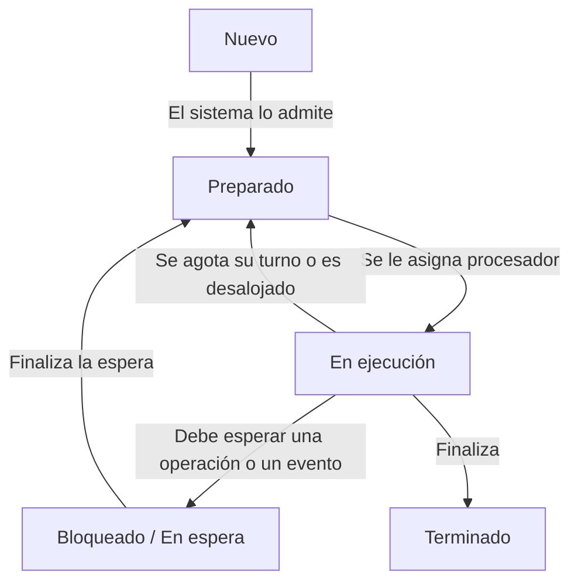

# 1. Introducción

Imagina que enciendes un ordenador, abres un navegador, descargas un documento y lo envías a imprimir. Aunque parezcan acciones sencillas, requieren la participación de varios componentes: el procesador ejecuta instrucciones, la memoria mantiene los datos utilizados, la tarjeta de red recibe información, la unidad de almacenamiento guarda el documento y la impresora lo lleva al papel.

Cada dispositivo tiene sus propias características y su forma de funcionar. Sin embargo, **no necesitas conocer todos esos detalles para utilizarlo**. Tampoco el navegador tiene que controlar por su cuenta cada modelo de tarjeta de red o de unidad de almacenamiento.

Esta coordinación es posible gracias al **sistema operativo**.

## ¿Qué es un sistema operativo?

El **sistema operativo (SO)** es el software que **administra los recursos del equipo y proporciona servicios a las aplicaciones**, permitiendo que los usuarios trabajen con el ordenador.

Podemos distinguir tres elementos:

| Elemento | Qué representa | Ejemplos |
| --- | --- | --- |
| **Hardware** | Los componentes físicos que permiten procesar, almacenar y transmitir información. | Procesador, memoria RAM, unidad de almacenamiento y tarjeta de red. |
| **Sistema operativo** | El software que administra esos recursos y ofrece servicios comunes para utilizarlos. | Windows o una distribución GNU/Linux. |
| **Aplicaciones** | Los programas con los que realizamos tareas concretas. | Navegador, editor de texto o reproductor multimedia. |

Las aplicaciones utilizan los servicios del sistema operativo para realizar operaciones como abrir archivos, solicitar memoria o enviar datos por la red. El sistema coordina esas peticiones y controla el acceso a los recursos.

::: tip
Cuando guardas un documento, el editor solicita escribir su contenido en un archivo. El sistema operativo gestiona esa operación y, mediante los controladores correspondientes, se comunica con el dispositivo de almacenamiento. El editor no necesita implementar un mecanismo diferente para cada modelo de disco.
:::

## El sistema operativo como administrador de recursos

Habitualmente tenemos varias aplicaciones abiertas al mismo tiempo. Todas necesitan recursos, pero estos son limitados: la memoria tiene una capacidad determinada y el procesador debe repartir su tiempo entre las tareas que requieren ejecutarse.

El sistema operativo se encarga de **organizar ese uso compartido**. Entre otras tareas, decide qué procesos pueden ejecutarse, administra la memoria que utilizan y comprueba sus permisos de acceso a los archivos.

Además, ofrece una forma más sencilla de trabajar con el equipo. Utilizamos conceptos como **archivos, carpetas y procesos** sin tener que manipular directamente los detalles físicos que hay detrás. Esta simplificación se denomina **abstracción**.

::: nota
Abstraer significa ocultar detalles que no necesitamos manejar para realizar una operación. Al trabajar con un archivo, utilizamos su nombre y su contenido; no necesitamos conocer la ubicación física de cada fragmento dentro del dispositivo.
:::

## El núcleo y las herramientas del sistema

El **núcleo**, o *kernel*, es la parte central del sistema operativo. Interviene en tareas como la gestión del procesador, la memoria y el acceso a los dispositivos, y controla operaciones que requieren privilegios especiales.

Junto al núcleo encontramos servicios y herramientas que permiten utilizar y administrar el sistema. Para interactuar con él podemos emplear:

- **Una interfaz gráfica (GUI):** utiliza ventanas, iconos, menús y otros elementos visuales.
- **Una interfaz de línea de comandos (CLI):** permite introducir órdenes mediante texto.

Ambas formas de interacción pueden coexistir en un mismo equipo.

::: aviso
**El sistema operativo no es únicamente el escritorio.** El escritorio es una forma de interactuar con el sistema. Un equipo puede ejecutar aplicaciones, compartir archivos y administrarse mediante comandos sin disponer de un entorno gráfico.
:::

## Equipos de usuario y servidores

Un **equipo de usuario** se prepara principalmente para las tareas de la persona que lo utiliza, como redactar documentos, navegar o programar.

Un **servidor** se prepara para proporcionar servicios a otros equipos o aplicaciones. Por ejemplo, puede almacenar carpetas compartidas, alojar una aplicación web o gestionar las solicitudes de impresión de un aula.

En ambos casos, el sistema operativo administra los recursos. Lo que cambia es el uso previsto y la configuración necesaria.

::: tip
En un aula, los ordenadores de los alumnos pueden actuar como clientes de un servidor de archivos. Cada ordenador ejecuta sus propias aplicaciones, mientras que el servidor atiende las peticiones de acceso a los documentos compartidos.
:::

Esta distinción describe **el papel del equipo**. Un ordenador de escritorio también puede compartir recursos, y un servidor puede disponer de interfaz gráfica. Tener o no escritorio no determina por sí solo que un equipo sea un servidor.

# 2. Objetivos de un sistema operativo

Los **objetivos** explican qué se pretende conseguir con un sistema operativo: facilitar el trabajo, aprovechar los recursos y mantener un entorno protegido y fiable.

Las **funciones**, que veremos después, son las tareas concretas que realiza para alcanzar esos objetivos. Por ejemplo, proteger la información es un objetivo; comprobar los permisos de acceso a un archivo es una función que contribuye a conseguirlo.

## 2.1. Facilitar el uso: abstracción

Los componentes de un ordenador tienen características y mecanismos de funcionamiento diferentes. Si cada aplicación tuviera que controlar directamente todos esos detalles, desarrollar programas y utilizar el equipo sería mucho más complicado.

El sistema operativo ofrece **formas de trabajar que ocultan parte de esa complejidad**, como archivos, carpetas y procesos. Esta simplificación se denomina **abstracción**.

Gracias a ella, podemos solicitar operaciones conocidas —guardar, abrir, copiar o imprimir— sin indicar todas las acciones necesarias para realizarlas sobre el hardware.

::: tip
Cuando guardas un documento, eliges un nombre y una carpeta. No decides en qué posiciones físicas del dispositivo se almacenará cada fragmento. El sistema operativo, los controladores y el propio dispositivo se encargan de realizar las operaciones necesarias.
:::

La abstracción también facilita el desarrollo de aplicaciones: un editor puede utilizar los servicios de archivos del sistema sin tener que incorporar instrucciones específicas para cada modelo de unidad de almacenamiento.

## 2.2. Aprovechar los recursos

El procesador, la memoria y los dispositivos tienen una capacidad limitada. Cuando varias aplicaciones los necesitan, el sistema operativo debe **organizar su utilización para evitar desperdicios y ofrecer una respuesta adecuada**.

Esto implica repartir el tiempo de procesador, administrar la memoria disponible y coordinar las operaciones de entrada y salida.

Por ejemplo, mientras un proceso espera que termine una lectura del disco, el procesador puede ejecutar otro que esté preparado para trabajar. Así se aprovecha un tiempo que, de otra forma, podría quedar sin utilizar.

::: tip
Puedes escuchar música mientras descargas un archivo y escribes un documento. Estas aplicaciones tienen necesidades diferentes: unas esperan datos de la red, otras procesan sonido y otras responden al teclado. El sistema operativo coordina sus recursos para que puedan progresar.
:::

**Eficiencia no significa únicamente mantener el procesador ocupado.** También importa que el equipo responda con agilidad, que no se desperdicie memoria y que una tarea no acapare los recursos de forma que impida trabajar a las demás.

## 2.3. Proteger los datos y los procesos

Cuando varios usuarios o aplicaciones comparten un equipo, necesitamos establecer límites. El sistema operativo proporciona mecanismos para **controlar quién puede utilizar cada recurso y qué operaciones puede realizar**.

Esta protección incluye:

- **Permisos de acceso:** determinan quién puede leer, modificar o ejecutar determinados archivos.
- **Aislamiento entre procesos:** limita el acceso de un proceso a la memoria y los recursos de otros.
- **Operaciones privilegiadas:** restringen acciones que podrían afectar al conjunto del sistema.

Por ejemplo, una aplicación no debería poder modificar libremente la memoria de otra ni cambiar una configuración protegida sin la autorización correspondiente.

### Modo usuario y modo núcleo

El procesador dispone de mecanismos que permiten distinguir niveles de ejecución. Para esta introducción utilizaremos dos conceptos:

- **Modo usuario:** las aplicaciones se ejecutan con acceso restringido a determinadas instrucciones y recursos.
- **Modo núcleo:** el núcleo puede realizar las operaciones privilegiadas necesarias para administrar el sistema.

Cuando una aplicación necesita un servicio del núcleo, lo solicita mediante un mecanismo controlado, como una **llamada al sistema**.

::: aviso
**Modo usuario y modo núcleo no equivalen a cuenta normal y cuenta de administrador.** Los primeros son niveles de ejecución del procesador; las cuentas determinan permisos e identidad. Ejecutar una aplicación como administrador no significa que toda ella pase a ejecutarse en modo núcleo.
:::

## 2.4. Mantener un funcionamiento fiable

Un sistema fiable debe funcionar de manera estable y **gestionar los errores para reducir sus consecuencias**. Pueden aparecer fallos en las aplicaciones, problemas con los dispositivos o situaciones en las que se agote un recurso.

El sistema operativo intenta detectar estas situaciones, registrar información útil y, cuando es posible, mantener operativas las partes que no están afectadas.

::: tip
Si un editor de texto deja de responder, podemos intentar finalizar ese proceso y seguir utilizando otras aplicaciones. El aislamiento entre procesos ayuda a limitar el fallo, aunque no garantiza que todos los problemas puedan resolverse sin afectar al resto del equipo.
:::

Los **registros del sistema**, o *logs*, ayudan a investigar lo ocurrido: pueden recoger errores de dispositivos, fallos de servicios o problemas durante el arranque.

::: aviso
**Fiabilidad no significa ausencia absoluta de errores.** También significa detectar problemas, limitar sus efectos y facilitar la recuperación. Algunos fallos graves pueden requerir reiniciar el sistema o reparar sus componentes.
:::

## 2.5. Equilibrar los objetivos

Estos objetivos se relacionan entre sí y deben adaptarse al uso del equipo. Un servidor de archivos necesita proteger la información y atender las peticiones de sus clientes; un ordenador de aula debe, además, ofrecer una interacción cómoda para el alumnado.

En ocasiones hay que asumir compromisos. Comprobar permisos consume recursos, pero permite proteger los datos. Mantener registros ocupa espacio, pero facilita el diagnóstico de incidencias.

Sin embargo, **facilidad de uso y eficiencia no son necesariamente opuestas**: una herramienta que automatiza una tarea puede ahorrar tiempo al usuario y reducir errores de administración.

| Objetivo | Pregunta que nos ayuda a reconocerlo |
| --- | --- |
| **Facilidad de uso y abstracción** | ¿Podemos realizar tareas sin controlar todos los detalles del hardware? |
| **Aprovechamiento de recursos** | ¿Se reparten los recursos de forma adecuada para el trabajo que debe realizarse? |
| **Protección** | ¿Se impiden accesos y modificaciones no autorizados? |
| **Fiabilidad** | ¿Se detectan los fallos y se limitan sus consecuencias? |

# 3. Funciones de un sistema operativo

## 3.1. Gestión de procesos

Un **programa** es un conjunto de instrucciones que puede estar almacenado en un archivo. Un **proceso** es una instancia de un programa en ejecución, con su estado y sus recursos, como la memoria que utiliza y los archivos que tiene abiertos.

Cuando iniciamos una aplicación, el sistema operativo crea los procesos necesarios para ejecutarla. **Una misma aplicación puede utilizar varios procesos**, y un mismo programa puede ejecutarse en varias instancias.

La gestión de procesos incluye:

- **Crear y finalizar procesos**, asignando y liberando sus recursos.
- **Planificar su ejecución**, decidiendo cuáles reciben tiempo de procesador.
- **Proporcionar mecanismos de comunicación y sincronización**, para que puedan intercambiar información y coordinar su trabajo.
- **Mantener información sobre su estado**, para saber cuáles pueden ejecutarse y cuáles están esperando.

### Estados de un proceso

Un proceso no utiliza el procesador durante toda su existencia. Puede estar preparado para ejecutarse, ejecutándose o esperando un acontecimiento.

En un modelo básico distinguimos **cinco estados**:

| Estado | ¿Qué significa? | Ejemplo |
| --- | --- | --- |
| **Nuevo** | El proceso se está creando y el sistema prepara la información necesaria para gestionarlo. | Se inicia una aplicación. |
| **Preparado** | Puede ejecutarse, pero espera que se le asigne tiempo de procesador. | Está listo para continuar sus cálculos. |
| **En ejecución** | Está ejecutando instrucciones en un procesador. | Procesa los datos de un documento. |
| **Bloqueado o en espera** | No puede continuar hasta que ocurra un acontecimiento. | Espera a que termine una lectura del disco. |
| **Terminado** | Ha finalizado su ejecución y el sistema realiza las tareas de cierre y liberación de recursos. | El programa termina o se fuerza su finalización. |

### Esquema de transiciones

El esquema representa las transiciones habituales del modelo básico:

1. **Nuevo → Preparado:** el sistema admite el proceso para su ejecución.
2. **Preparado → En ejecución:** se le asigna tiempo de procesador.
3. **En ejecución → Preparado:** deja de utilizar el procesador, por ejemplo, porque termina su turno, aunque podría seguir ejecutándose.
4. **En ejecución → Bloqueado:** necesita esperar una operación o un acontecimiento para continuar.
5. **Bloqueado → Preparado:** termina la espera y vuelve a estar disponible para ejecutarse.
6. **En ejecución → Terminado:** finaliza su ejecución.

::: aviso
**Preparado y bloqueado no significan lo mismo.** Un proceso preparado solo necesita que se le asigne procesador. Un proceso bloqueado necesita que ocurra algo antes de poder continuar, aunque haya un procesador disponible.
:::

### Ejemplo: un programa que lee un archivo

Imagina un programa que lee un archivo, realiza un cálculo y termina:

1. Al iniciarlo, se crea un proceso: está **nuevo**.
2. Cuando puede competir por el procesador, pasa a **preparado**.
3. Al recibir tiempo de procesador, entra **en ejecución**.
4. Si solicita datos del disco y debe esperar a que lleguen, pasa a **bloqueado**.
5. Cuando los datos están disponibles, vuelve a **preparado**.
6. Cuando recibe de nuevo el procesador, continúa **en ejecución**.
7. Tras completar el cálculo, pasa a **terminado**.

::: tip
Mientras este proceso espera al disco, el sistema puede ejecutar otro que esté preparado. Así aprovecha el procesador durante la espera.
:::

::: aviso
**Cuando termina una espera, el proceso no pasa necesariamente a ejecutarse de inmediato.** Primero vuelve al estado preparado y espera a que se le asigne procesador.
:::

### Planificación, concurrencia y paralelismo

La **planificación** decide qué procesos o hilos preparados reciben tiempo de procesador. Un **hilo** es una unidad de ejecución dentro de un proceso; un proceso puede contener uno o varios.

Para introducir los estados hemos utilizado un modelo simplificado de proceso con un único hilo. Más adelante podremos estudiar cómo se aplica la planificación en sistemas con varios hilos.

- **Concurrencia:** varias tareas progresan durante un mismo periodo, aunque sus instrucciones puedan ejecutarse por turnos.
- **Paralelismo:** varias tareas ejecutan instrucciones al mismo tiempo utilizando diferentes unidades de ejecución.

::: aviso
Tener varias aplicaciones abiertas no significa que todas ejecuten instrucciones exactamente al mismo tiempo. En un solo núcleo pueden alternarse; con varios núcleos también puede existir ejecución en paralelo.
:::

## 3.2. Gestión de memoria

Para ejecutar un programa, el equipo necesita mantener en **memoria principal (RAM)** las instrucciones y los datos que utiliza en ese momento. Como varios procesos pueden necesitar memoria simultáneamente, el sistema operativo debe organizar su uso.

La **gestión de memoria** permite asignar espacio a los procesos, controlar cómo lo utilizan y recuperar los recursos que dejan de necesitar.

### Funciones principales

| Función | ¿En qué consiste? |
| --- | --- |
| **Asignación** | Proporcionar memoria a los procesos según sus necesidades y los recursos disponibles. |
| **Liberación** | Recuperar la memoria que deja de utilizarse para que pueda aprovecharse de nuevo. |
| **Protección** | Impedir que un proceso acceda sin autorización a la memoria de otro o del núcleo. |
| **Compartición controlada** | Permitir que varios procesos compartan determinadas regiones de memoria cuando sea necesario. |
| **Traducción de direcciones** | Relacionar las direcciones que utilizan los procesos con las ubicaciones físicas correspondientes, con ayuda del hardware. |

::: tip
Si tienes abiertos un navegador y un editor de texto, ambos necesitan memoria. El sistema mantiene sus espacios separados para que un error del navegador no le permita modificar libremente el documento que está utilizando el editor.
:::

### El espacio de direcciones de un proceso

Una **dirección de memoria** permite identificar una posición a la que un programa puede acceder. El conjunto de direcciones que puede utilizar un proceso constituye su **espacio de direcciones**.

En los sistemas con memoria virtual, los procesos utilizan **direcciones virtuales**, que no coinciden necesariamente con las posiciones físicas de la RAM. El sistema operativo y el hardware de gestión de memoria colaboran para traducirlas y comprobar los permisos de acceso.

Esto permite que cada proceso tenga su propia visión de la memoria, sin tener que conocer cómo está distribuida físicamente.

::: aviso
**Separar los espacios de memoria no impide compartir información.** El sistema puede permitir que varios procesos accedan a una región compartida, pero debe hacerlo de forma controlada.
:::

### ¿Qué es la memoria virtual?

La **memoria virtual** es un mecanismo que separa la memoria que ve un proceso de su ubicación física. Facilita la organización, la protección y el uso de la memoria.

No es necesario que todo el espacio de un proceso esté presente en RAM al mismo tiempo. Según el sistema y su configuración, algunas partes pueden mantenerse temporalmente en almacenamiento secundario o cargarse desde un archivo cuando se necesitan.

Cuando un proceso intenta acceder a una parte que no está en RAM, el sistema puede tener que recuperarla antes de permitirle continuar.

::: tip
Imagina una mesa de trabajo y un archivador. En la mesa mantienes los documentos que estás utilizando; otros permanecen en el archivador hasta que los necesitas. Traerlos lleva tiempo. Esta comparación ayuda a entender el movimiento de datos entre RAM y almacenamiento, aunque la memoria virtual también proporciona aislamiento y traducción de direcciones.
:::

### ¿Qué ocurre si falta memoria?

Cuando aumenta la demanda, el sistema puede intentar recuperar memoria que pueda reutilizarse o trasladar ciertos datos al almacenamiento secundario, si dispone de ese mecanismo.

Sin embargo, **acceder al almacenamiento suele ser mucho más lento que acceder a la RAM**. Si el equipo necesita mover datos continuamente entre ambos, puede perder mucha capacidad de respuesta.

Si no consigue satisfacer una petición de memoria, la asignación puede fallar y, dependiendo del sistema, pueden finalizarse procesos para recuperar recursos.

::: aviso
**La memoria virtual no proporciona memoria ilimitada ni equivale únicamente a utilizar disco como RAM.** Su función también incluye organizar los espacios de direcciones y protegerlos. Disponer de espacio libre en disco no garantiza que podamos ejecutar cualquier cantidad de aplicaciones.
:::

### Memoria y almacenamiento no son lo mismo

| Recurso | Uso principal | ¿Conserva normalmente los datos al apagar el equipo? |
| --- | --- | --- |
| **Memoria RAM** | Mantener instrucciones y datos utilizados durante la ejecución. | No. |
| **Almacenamiento, como SSD o HDD** | Conservar archivos, aplicaciones y el propio sistema operativo. | Sí. |

Cerrar una aplicación permite al sistema recuperar los recursos de memoria que le correspondían. **No elimina el programa instalado ni los documentos guardados**, porque estos se conservan en el almacenamiento.

## 3.3. Gestión de archivos y almacenamiento

Los programas y los datos necesitan conservarse para poder utilizarlos después de cerrar una aplicación o apagar el equipo. Para ello utilizamos dispositivos de **almacenamiento**, como unidades SSD o discos duros.

El sistema operativo permite trabajar con esa información mediante **archivos y directorios**, sin que tengamos que conocer la ubicación física de cada dato.

### Archivos y directorios

Un **archivo**, o **fichero**, es una unidad lógica de información identificable dentro de un sistema de archivos. Puede contener un documento, una imagen, instrucciones de un programa o datos de configuración.

Un **directorio**, habitualmente llamado carpeta, permite organizar archivos y otros directorios. Esta organización facilita localizar la información mediante una **ruta**, que indica dónde se encuentra.

::: tip
En la ruta `/home/ana/Documentos/practica.txt`, el archivo `practica.txt` se encuentra dentro del directorio `Documentos`, que pertenece a la estructura de directorios indicada. La ruta describe su ubicación lógica; no indica en qué posiciones físicas del dispositivo están sus datos.
:::

### El sistema de archivos

Un **sistema de archivos** establece cómo se organizan y representan los archivos, los directorios y su información asociada dentro de un volumen de almacenamiento.

El sistema operativo utiliza esa estructura para localizar datos, gestionar el espacio y realizar las operaciones solicitadas. Algunos ejemplos de sistemas de archivos son **NTFS, FAT32, ext4 y XFS**.

Sus características no son idénticas: pueden variar los límites de tamaño, la compatibilidad y los mecanismos de permisos o recuperación.

::: aviso
**El sistema de archivos no es el dispositivo físico.** Una unidad de almacenamiento puede contener varias particiones, y estas pueden utilizar sistemas de archivos diferentes.
:::

### Operaciones sobre archivos y directorios

El sistema operativo proporciona servicios para realizar operaciones como las siguientes:

| Operación | ¿Qué permite hacer? | Ejemplo |
| --- | --- | --- |
| **Crear** | Generar un archivo o directorio nuevo. | Crear una carpeta para las prácticas. |
| **Leer** | Consultar el contenido de un archivo. | Abrir los apuntes del tema. |
| **Escribir** | Añadir o modificar datos. | Guardar cambios en un documento. |
| **Renombrar** | Cambiar el nombre de una entrada. | Cambiar `borrador.txt` por `entrega.txt`. |
| **Copiar o mover** | Duplicar información o cambiar su ubicación. | Copiar una práctica a otra carpeta. |
| **Eliminar** | Retirar un archivo o directorio y gestionar el espacio que deja disponible. | Borrar un archivo que ya no necesitamos. |

Las aplicaciones solicitan estas operaciones al sistema. Por ejemplo, el editor de texto se ocupa de la edición del documento y utiliza los servicios de archivos para guardarlo.

### Metadatos y permisos

Además de su contenido, los archivos tienen **metadatos**: información que permite describirlos y administrarlos.

Según el sistema de archivos, pueden incluir:

- **Tamaño:** cantidad de datos que contiene el archivo.
- **Fechas:** como las de modificación o acceso.
- **Propietario:** usuario al que pertenece.
- **Permisos:** operaciones que pueden realizar los usuarios o grupos.

El sistema también mantiene la relación entre los nombres, los directorios y los archivos correspondientes.

::: tip
Dos alumnos pueden localizar el mismo archivo compartido, pero tener permisos diferentes. Uno puede leerlo y otro modificarlo. **Saber dónde está un archivo no implica tener autorización para utilizarlo de cualquier manera.**
:::

::: aviso
**La extensión del nombre no garantiza el formato del contenido.** Cambiar `foto.jpg` por `foto.txt` no convierte la imagen en un documento de texto.
:::

### Organización del espacio de almacenamiento

El sistema necesita registrar qué espacio está ocupado y cuál puede utilizarse para nuevos datos. También mantiene la información necesaria para localizar las partes que componen cada archivo.

Un archivo puede ocupar varias regiones del dispositivo: **no tiene que almacenarse necesariamente en una única zona continua**. El sistema de archivos permite presentar su contenido como una unidad, aunque físicamente esté repartido.

Cuando guardamos o ampliamos un archivo, debe haber espacio disponible y cumplirse las restricciones correspondientes, como permisos, cuotas o límites del sistema de archivos.

::: aviso
**Borrar un archivo no implica necesariamente sobrescribir de inmediato todos sus datos.** La eliminación habitual permite reutilizar el espacio, pero no equivale a un borrado seguro.
:::

La gestión de archivos y almacenamiento nos permite, por tanto, **conservar, localizar, organizar y controlar el acceso a la información** sin administrar manualmente su disposición física.

## 3.4. Gestión de entrada y salida

Para trabajar, un ordenador necesita intercambiar información con sus dispositivos. Estas operaciones se denominan **entrada y salida**, o **E/S**:

- **Entrada:** el sistema recibe información, como las pulsaciones del teclado.
- **Salida:** el sistema envía información, como una imagen a la pantalla.
- **Entrada y salida:** algunos dispositivos permiten ambas operaciones, como una unidad de almacenamiento al leer y escribir datos.

El sistema operativo **coordina estas operaciones y proporciona servicios para utilizar los dispositivos**, evitando que cada aplicación tenga que controlar por su cuenta todos los detalles del hardware.

### Los controladores de dispositivos

Un **controlador**, o *driver*, es un componente de software que permite al sistema comunicarse con un dispositivo o una familia de dispositivos.

Los controladores conocen los mecanismos necesarios para solicitar operaciones al hardware y gestionar sus respuestas. Gracias a ellos, las aplicaciones pueden utilizar servicios comunes aunque cambie el modelo del dispositivo.

::: tip
Un editor de texto puede imprimir un documento en distintos modelos de impresora. Solicita la impresión mediante los servicios del sistema; el sistema de impresión y los controladores correspondientes se encargan de preparar y entregar la información al dispositivo.
:::

::: aviso
**Conectar físicamente un dispositivo no garantiza que todas sus funciones estén disponibles.** El sistema necesita un controlador compatible. Algunos controladores ya están incluidos; otros deben instalarse.
:::

### Coordinación de las operaciones

Los dispositivos funcionan a velocidades diferentes y pueden recibir peticiones de varios programas. El sistema debe organizar esas solicitudes, comprobar los permisos y gestionar las esperas y los errores.

Entre sus tareas se encuentran:

| Tarea | Ejemplo |
| --- | --- |
| **Recibir y tramitar solicitudes** | Una aplicación pide leer un archivo de una unidad USB. |
| **Organizar el uso compartido** | Varios programas envían documentos a una impresora. |
| **Gestionar la finalización de operaciones** | Una lectura termina y los datos quedan disponibles para el proceso. |
| **Comunicar errores** | Una escritura falla porque se ha desconectado el dispositivo. |

Un proceso que necesita esperar a que termine una operación puede quedar bloqueado. Mientras tanto, el sistema puede ejecutar otros procesos que estén preparados.

### Almacenamiento temporal: buffering

Un **búfer** es una zona de memoria que almacena datos temporalmente durante su transferencia o procesamiento. Su uso se denomina **buffering**.

Permite gestionar diferencias de velocidad o de tamaño entre las operaciones de quien produce los datos y quien los recibe.

::: tip
Al reproducir audio, la aplicación puede preparar datos en un búfer para que el dispositivo de sonido los vaya consumiendo. Si los nuevos datos no llegan a tiempo y el búfer se vacía, pueden producirse cortes.
:::

### Colas de trabajo: spooling

El **spooling** consiste en almacenar trabajos pendientes para que un servicio los entregue a un dispositivo cuando corresponda. Un ejemplo habitual es la **cola de impresión**.

Si varias aplicaciones envían documentos a una impresora, los trabajos quedan organizados en una cola. El servicio de impresión gestiona su entrega y permite realizar acciones como consultar su estado o cancelarlos.

La aplicación puede continuar trabajando después de entregar el documento al sistema de impresión, sin esperar necesariamente a que todas las páginas salgan de la impresora.

::: aviso
**Buffering y spooling no son lo mismo.** Un búfer mantiene datos temporalmente durante una operación; una cola de impresión organiza trabajos pendientes para su procesamiento. Ambos mecanismos pueden participar en una misma tarea.
:::

La gestión de entrada y salida permite que las aplicaciones **utilicen los dispositivos de forma coordinada**, mientras el sistema y sus controladores se ocupan de los mecanismos específicos de comunicación.

## 3.5. Gestión de comunicaciones

Muchas aplicaciones necesitan intercambiar información con otros equipos: un navegador solicita páginas web, un programa de mensajería envía mensajes y un cliente de archivos descarga documentos.

El sistema operativo proporciona **servicios y mecanismos de comunicación por red** que las aplicaciones utilizan para enviar y recibir datos. Así, cada programa no necesita implementar por su cuenta todo el funcionamiento de la conexión.

### ¿Qué tareas realiza el sistema operativo?

La gestión de comunicaciones incluye tareas como las siguientes:

| Tarea | ¿En qué consiste? | Ejemplo |
| --- | --- | --- |
| **Gestionar las interfaces de red** | Coordinar el uso de los adaptadores mediante sus controladores. | Utilizar una tarjeta Ethernet o un adaptador Wi-Fi. |
| **Mantener la configuración de red** | Administrar parámetros como las direcciones IP y las rutas. | Utilizar una configuración recibida mediante DHCP. |
| **Procesar los protocolos de comunicación** | Aplicar las reglas necesarias para transportar datos. | Gestionar comunicaciones mediante TCP o UDP sobre IP. |
| **Entregar los datos a la aplicación correspondiente** | Distinguir las comunicaciones de los distintos programas. | Separar los datos del navegador de los de otra aplicación. |
| **Aplicar controles de comunicación** | Permitir o bloquear tráfico según las reglas configuradas. | Filtrar conexiones mediante un cortafuegos del sistema. |

### ¿Cómo utilizan las aplicaciones estos servicios?

Las aplicaciones pueden solicitar al sistema que establezca una comunicación o envíe datos a un destino. Para ello utilizan interfaces de programación que incluyen mecanismos como los **sockets**.

Un **socket** es un punto de comunicación que una aplicación utiliza para enviar o recibir datos. En comunicaciones habituales con TCP o UDP intervienen direcciones IP y puertos, que ayudan a identificar los extremos de la comunicación y a entregar los datos al programa correspondiente.

No necesitamos conocer todavía su programación: lo importante es entender que **la aplicación solicita la comunicación y el sistema proporciona los mecanismos para realizarla**.

::: tip
Puedes descargar un documento y utilizar una aplicación de mensajería al mismo tiempo. Ambas comparten la conexión de red, pero el sistema mantiene la información necesaria para que los datos de cada comunicación lleguen al programa correspondiente.
:::

### Ejemplo: acceder a una página web

Cuando el navegador solicita una página, intervienen distintos elementos:

1. **El navegador prepara la solicitud** del recurso que necesita.
2. **Utiliza los servicios de comunicación del sistema operativo** para enviar los datos.
3. **El sistema gestiona su transmisión** mediante los protocolos, las rutas y la interfaz de red correspondientes.
4. **Cuando llegan datos de respuesta**, el sistema los entrega al navegador.
5. **El navegador interpreta el contenido** y presenta la página al usuario.

La gestión de comunicaciones coopera, por tanto, con otras funciones del sistema: necesita procesos, memoria y operaciones de entrada y salida.

::: aviso
**El navegador no forma parte de la gestión de red del sistema operativo.** Es una aplicación que utiliza sus servicios. Interpretar una página web corresponde al navegador; gestionar el envío y la recepción de sus datos implica los servicios de comunicación del sistema.
:::

### Comunicación local y acceso a Internet

Las comunicaciones de red no se limitan a Internet. También permiten utilizar recursos dentro de una red local, como carpetas compartidas, impresoras o aplicaciones del centro.

::: nota
**Un equipo puede comunicarse dentro de su red local sin disponer de acceso a Internet.** Por ejemplo, puede acceder a un servidor de archivos del aula aunque falle la conexión exterior del centro.
:::

## 3.6. Protección, usuarios y acceso

Un ordenador puede ser utilizado por varias personas y ejecutar numerosos procesos. Para que compartan sus recursos, el sistema operativo necesita **identificar a los usuarios, controlar sus permisos y limitar las acciones de los programas**.

La protección no se dirige únicamente a impedir acciones malintencionadas. También ayuda a evitar que un error accidental afecte a otros usuarios o al funcionamiento del equipo.

### Usuarios y grupos

Una **cuenta de usuario** representa una identidad que el sistema utiliza para asociar permisos, configuraciones y recursos.

Los **grupos** permiten administrar conjuntamente los permisos de varios usuarios. En lugar de asignar el mismo permiso a cada persona por separado, podemos concedérselo a un grupo.

::: tip
En un ordenador del aula podemos tener cuentas individuales para los alumnos y un grupo llamado `profesorado`. Una carpeta con materiales de evaluación puede permitir el acceso al profesorado y restringirlo al resto de usuarios.
:::

El sistema puede gestionar cuentas locales o, si está integrado con los servicios correspondientes, utilizar identidades administradas de forma centralizada.

### Identificación, autenticación y autorización

Aunque están relacionadas, estas operaciones tienen funciones distintas:

| Concepto | ¿Qué permite establecer? | Ejemplo |
| --- | --- | --- |
| **Identificación** | Qué identidad declara el usuario. | Introducir el nombre de usuario `ana`. |
| **Autenticación** | Si puede demostrar que le corresponde esa identidad. | Verificar su contraseña u otro método de autenticación. |
| **Autorización** | Qué acciones puede realizar esa identidad. | Comprobar si tiene permiso para modificar una carpeta. |

Después del inicio de sesión, los procesos se ejecutan con una identidad y unos permisos asociados. El sistema utiliza esa información para comprobar las operaciones que solicitan.

::: aviso
**Iniciar sesión correctamente no concede acceso a todos los recursos.** Un usuario puede estar autenticado y no tener permiso para instalar software, modificar un archivo o cambiar la configuración del equipo.
:::

### Permisos y privilegios

Los **permisos** determinan qué operaciones se pueden realizar sobre un recurso. En archivos y directorios encontramos permisos como lectura, escritura y ejecución, aunque su significado concreto depende del recurso y del sistema utilizado.

Los **privilegios administrativos** permiten realizar determinadas tareas que afectan al conjunto del equipo, como administrar cuentas o modificar configuraciones protegidas.

El **principio de mínimo privilegio** consiste en proporcionar únicamente los permisos necesarios para realizar una tarea.

::: tip
Para redactar una práctica no necesitas administrar las cuentas del equipo. Utilizar una cuenta con permisos adecuados para el trabajo cotidiano reduce las consecuencias de un error o de la ejecución de un programa malintencionado.
:::

### Aislamiento y protección de recursos

El sistema también establece límites entre procesos. Por ejemplo, una aplicación no debería poder leer libremente la memoria de otra ni modificar las partes protegidas del sistema.

Esta protección se apoya en distintos mecanismos:

- **Separación de espacios de memoria**, para limitar accesos entre procesos.
- **Comprobación de permisos**, antes de permitir operaciones sobre recursos.
- **Niveles de ejecución y operaciones privilegiadas**, para controlar acciones que afectan al sistema.
- **Registros y auditoría**, que, según la configuración, permiten revisar accesos e incidencias.

::: aviso
**Los mecanismos de protección no garantizan una seguridad absoluta.** Su eficacia depende también de la configuración, las actualizaciones y el uso adecuado de las cuentas y sus permisos.
:::

### Las funciones del sistema trabajan juntas

Las funciones que hemos estudiado no actúan de forma aislada. Una tarea cotidiana suele necesitar varias de ellas:

| Situación | Funciones que intervienen |
| --- | --- |
| **Abrir un navegador** | Gestión de procesos, memoria y lectura de los archivos del programa. |
| **Descargar y guardar un documento** | Comunicaciones, memoria, archivos, almacenamiento y permisos. |
| **Imprimir el documento** | Entrada/salida, controladores y servicios de impresión. |
| **Impedir que otro usuario lo modifique** | Identidades, permisos y protección del sistema de archivos. |

**El sistema operativo coordina estas funciones para que las aplicaciones puedan trabajar y compartir recursos de forma controlada.**

# 4. Historia de los sistemas operativos — Ampliación

::: nota
**Lectura de ampliación.** Este apartado permite comprender cómo surgieron las funciones que hemos estudiado. El objetivo es relacionar cada avance con una necesidad, sin memorizar una lista de fechas o nombres.
:::

Los sistemas operativos han evolucionado para responder a problemas concretos: reducir el tiempo de preparación de los trabajos, aprovechar el procesador, permitir la interacción de varios usuarios y proteger los recursos compartidos.

Las etapas siguientes son una secuencia orientativa. **Se solapan y no se sustituyen completamente:** algunas técnicas, como el procesamiento por lotes, siguen utilizándose.

## 4.1. Uso directo de la máquina

En los primeros entornos de cálculo, preparar y ejecutar un programa exigía mucha intervención manual. Era necesario introducir el programa y sus datos, organizar la ejecución y recoger los resultados.

Mientras se preparaba el siguiente trabajo, la máquina podía permanecer inactiva. Esto suponía desaprovechar un recurso caro y limitado.

**La necesidad principal era reducir los tiempos de preparación y organizar mejor la ejecución de los trabajos.**

## 4.2. Trabajo por lotes y monitor residente

Una forma de mejorar el aprovechamiento consistió en **agrupar trabajos y ejecutarlos consecutivamente**, sin que sus autores interactuasen continuamente con la máquina. Este modo de funcionamiento se denomina **procesamiento por lotes**, o *batch*.

Después, parte de la coordinación se automatizó mediante un **monitor residente**: un programa que permanecía en memoria y transfería el control de un trabajo al siguiente.

**El avance consistió en trasladar al software parte del trabajo de coordinación que realizaba el operador.**

::: tip
Imagina una colección de programas que deben procesar datos y generar resultados. En lugar de preparar manualmente cada ejecución, se organiza una secuencia para que, al terminar uno, pueda comenzar el siguiente.
:::

## 4.3. Multiprogramación

La ejecución consecutiva de trabajos no resolvía todos los tiempos de espera. Un programa podía necesitar datos de un dispositivo y dejar el procesador sin trabajo mientras llegaban.

La **multiprogramación** permitió mantener varios trabajos en memoria. Cuando uno debía esperar una operación de entrada o salida, el sistema podía ejecutar otro que estuviera preparado.

Esto hizo necesario mejorar la planificación, la gestión de memoria y la protección entre procesos.

**El avance consistió en aprovechar las esperas de un proceso para hacer progresar otro.**

::: aviso
**Multiprogramación no significa necesariamente ejecución en paralelo.** Un único procesador puede alternar entre varios trabajos sin ejecutar sus instrucciones al mismo tiempo.
:::

## 4.4. Tiempo compartido

El **tiempo compartido** permitió ofrecer acceso interactivo a varios usuarios mediante el reparto frecuente del tiempo de procesador.

Cada usuario podía introducir órdenes y recibir respuestas desde un terminal, mientras el sistema atendía también a los demás. Sistemas como **CTSS y Multics** forman parte de esta evolución.

**El avance consistió en facilitar la interacción con los programas, en lugar de limitar al usuario a entregar un trabajo y esperar su resultado final.**

[Referencia histórica: proyecto Multics](https://www.multicians.org/history.html).

## 4.5. Ordenadores personales, interfaces gráficas y redes

La expansión de los ordenadores personales aumentó la importancia de que una persona pudiera utilizar directamente el equipo para tareas cotidianas.

Las interfaces gráficas facilitaron muchas operaciones mediante ventanas, iconos y menús. Al mismo tiempo, las redes ampliaron las posibilidades de compartir archivos, dispositivos y servicios entre equipos.

**Las necesidades se ampliaron:** además de aprovechar el hardware, había que facilitar la interacción, ejecutar aplicaciones diversas y gestionar las comunicaciones y los accesos.

## 4.6. Diversidad de entornos

Los sistemas operativos se utilizan en entornos con necesidades diferentes:

| Entorno | Aspectos especialmente relevantes |
| --- | --- |
| **Ordenador personal** | Interacción con el usuario y ejecución de aplicaciones. |
| **Servidor** | Atención a clientes, protección de recursos y disponibilidad. |
| **Dispositivo móvil** | Consumo energético, conectividad e interacción táctil. |
| **Sistema integrado** | Adaptación a una función y a recursos concretos. |
| **Entorno virtualizado** | Reparto de recursos y aislamiento entre sistemas. |

Estas necesidades no son exclusivas de cada entorno, pero ayudan a comprender por qué no todos los sistemas se diseñan y configuran de la misma manera.

::: nota
**La historia explica las funciones actuales.** Aprovechar el procesador exige planificación; mantener varios procesos requiere gestionar y proteger la memoria; compartir información hace necesario controlar los permisos.
:::

# 5. Instalación de sistemas operativos

Instalar un sistema operativo consiste en preparar un equipo para que pueda arrancarlo y utilizarlo: colocar sus componentes en el destino, organizar el almacenamiento y establecer su configuración inicial.

Antes de instalar debemos decidir qué sistema necesitamos, comprobar su compatibilidad y preparar un medio desde el que iniciar el proceso.

## 5.1. Preparación previa

Antes de instalar un sistema operativo, debemos comprobar **qué necesita el equipo, qué sistema vamos a utilizar y dónde lo instalaremos**. Esta preparación ayuda a evitar incompatibilidades, pérdidas de información y errores al seleccionar el destino.

### Identificar el uso del equipo

La elección del sistema depende del trabajo que deberá realizar:

- **Puesto de trabajo:** destinado a aplicaciones de usuario, como navegadores, editores o herramientas de desarrollo.
- **Servidor:** preparado para proporcionar servicios a otros equipos.
- **Entorno de pruebas:** utilizado para experimentar y practicar, por ejemplo, mediante máquinas virtuales.

También debemos comprobar qué aplicaciones y dispositivos necesitamos utilizar, porque pueden condicionar la elección del sistema operativo.

### Comprobar los requisitos y la compatibilidad

Los requisitos deben consultarse en la documentación oficial de **la versión y edición concretas** que vayamos a instalar.

| Aspecto | ¿Qué debemos comprobar? |
| --- | --- |
| **Arquitectura** | Que el sistema sea compatible con la arquitectura del equipo, como x86-64 o ARM64. |
| **Memoria RAM** | Que haya memoria suficiente para el sistema y las aplicaciones previstas. |
| **Almacenamiento** | Que exista espacio para la instalación, las actualizaciones, las aplicaciones y los datos. |
| **Dispositivos** | Que el sistema disponga de soporte y controladores para el hardware necesario. |
| **Firmware y arranque** | Que el equipo pueda iniciar el medio de instalación con una configuración compatible. |

::: aviso
**Los requisitos mínimos no garantizan un funcionamiento cómodo para cualquier tarea.** Un equipo puede permitir la instalación y resultar insuficiente para ejecutar las aplicaciones que necesitamos.
:::

En una máquina virtual debemos revisar tanto los recursos asignados a la máquina como los que necesita conservar el equipo anfitrión para seguir funcionando.

### Obtener la imagen de instalación

Debemos obtener el medio desde la **fuente oficial del proyecto o fabricante**, seleccionando la versión, edición y arquitectura adecuadas.

Es habitual que se distribuya como una **imagen ISO**: un archivo que contiene los datos y la estructura de una imagen de disco. Puede incluir el instalador, herramientas de recuperación y los elementos necesarios para arrancar.

Una ISO de instalación compatible puede utilizarse para preparar un USB arrancable o conectarse como una unidad óptica virtual a una máquina virtual.

::: aviso
**ISO es un formato de imagen, no una garantía de que sea arrancable.** Su contenido debe incluir los elementos de arranque adecuados para el equipo donde se utilizará.
:::

Cuando la fuente proporcione sumas de comprobación o firmas, debemos seguir sus instrucciones para verificar la descarga.

Una **suma de comprobación**, como SHA-256, permite comparar el archivo descargado con el valor publicado. Si no coinciden, el archivo no es idéntico al esperado y debemos investigar la causa antes de utilizarlo.

::: nota
La referencia utilizada para verificar una descarga también debe proceder de una fuente fiable. Comparar una imagen con un valor obtenido de un origen desconocido no demuestra que sea auténtica.
:::

### Revisar los datos e identificar el destino

Antes de modificar el almacenamiento, debemos averiguar si contiene información que necesitamos conservar y disponer de una **copia de seguridad comprobada**.

También tenemos que identificar el disco de destino y revisar sus particiones. Una **partición** es una división lógica de un dispositivo de almacenamiento; el instalador puede crearla, modificarla o eliminarla según las opciones elegidas.

::: tip
Si el equipo tiene un SSD interno y un disco externo con copias de seguridad, no basta con seleccionar «el primer disco» de la lista. Debemos comprobar su capacidad, modelo y contenido para reconocer el destino correcto.
:::

::: aviso
**Formatear o eliminar particiones puede destruir información.** Antes de confirmar los cambios, revisa qué dispositivo y qué particiones modificará el instalador.
:::

### Comprender cómo se inicia el instalador

Al encender el equipo, interviene el **firmware**, un software integrado que realiza la preparación inicial del hardware y permite iniciar una opción de arranque. En muchos equipos se utiliza **UEFI**; también podemos encontrar equipos con BIOS tradicional.

Mediante el menú de arranque podemos seleccionar un medio, como el disco interno, una memoria USB o una opción de arranque por red. El firmware inicia una cadena de carga que termina ejecutando el sistema operativo o el entorno de instalación.

La tecla y las opciones del menú dependen del fabricante y del modelo del equipo.

::: aviso
**Arrancar e instalar son acciones distintas.** Iniciar desde un USB puede abrir un instalador, un entorno de recuperación o un sistema de prueba. El sistema del disco no queda sustituido simplemente por arrancar el medio: los cambios dependen de las operaciones que realicemos después.
:::

Antes de continuar, debemos tener identificados **el sistema que instalaremos, el medio desde el que arrancaremos y el almacenamiento que podremos modificar**.

## 5.2. Instalación mediante USB arrancable

Un **USB arrancable**, o *booteable*, contiene los elementos necesarios para iniciar un entorno compatible con el equipo.

Con herramientas como **Rufus** podemos preparar un USB a partir de una imagen de instalación. Seleccionamos el dispositivo de destino y la imagen, revisamos las opciones de compatibilidad y ejecutamos la creación del medio. [Referencia: Rufus](https://rufus.ie/es/).

Después:

1. Conectamos el USB al equipo de destino.
2. Seleccionamos su entrada en el menú de arranque del firmware.
3. Comprobamos que se inicia el instalador esperado.
4. Elegimos el disco y las opciones de instalación.
5. Tras finalizar, arrancamos el sistema instalado y comprobamos su funcionamiento.

::: aviso
**Comprueba el dispositivo antes de escribir el medio:** su preparación puede borrar el USB seleccionado. Copiar una ISO como un archivo a un USB cualquiera no lo convierte automáticamente en arrancable; hace falta prepararlo con un método compatible.
:::

La capacidad necesaria y las opciones de particionado y sistema de archivos dependen de la imagen, la herramienta y el firmware. No existe una combinación única válida para todos los equipos.

## 5.3. Instalación por red: PXE

Cuando necesitamos instalar varios equipos, podemos preparar un USB para cada uno o reutilizar el mismo dispositivo. Otra posibilidad es **proporcionar los recursos de arranque e instalación a través de la red**.

**PXE** significa *Preboot eXecution Environment*, o **entorno de ejecución previo al arranque**. Permite que un equipo obtenga por la red un programa de arranque, sin necesitar un sistema operativo instalado en su disco.

Ese programa puede iniciar un entorno de instalación, recuperación o diagnóstico.

::: tip
Imagina que tenemos veinte ordenadores nuevos en un aula. Mediante el arranque por red, pueden acceder a los recursos de instalación preparados en un servidor, sin conectar una memoria USB a cada equipo.
:::

### ¿Qué elementos necesitamos?

El arranque mediante PXE requiere varios componentes que deben trabajar de forma coordinada:

| Elemento | Función |
| --- | --- |
| **Cliente compatible con arranque por red** | Inicia la comunicación desde su firmware y adaptador de red. |
| **Servicio DHCP** | Proporciona la configuración de red necesaria para comunicarse. |
| **Información de arranque** | Indica qué programa debe descargar el cliente y dónde encontrarlo. Puede proporcionarse mediante DHCP o un servicio PXE adicional, según el despliegue. |
| **Servicio de transferencia de archivos** | Entrega el programa de arranque y los demás archivos necesarios. |
| **Recursos de instalación** | Contienen el entorno y los datos utilizados para instalar el sistema operativo. |

Estas funciones pueden ejecutarse en **un mismo servidor o en varios equipos**. Lo importante es que el cliente pueda localizar los recursos y acceder a ellos.

### ¿Cómo funciona el proceso?

#### 1. Selección del arranque por red

Al encender el equipo, seleccionamos la opción de arranque por red en el firmware. El cliente inicia este proceso utilizando las capacidades de su firmware y adaptador, antes de cargar un sistema operativo desde el disco.

#### 2. Obtención de configuración e información de arranque

El cliente solicita configuración de red y obtiene la información necesaria para localizar el programa de arranque.

En un despliegue habitual, DHCP proporciona la dirección IP y otros parámetros. Los datos específicos de arranque pueden proceder del mismo servicio o de otro preparado para esa función.

#### 3. Descarga del programa de arranque

El cliente descarga un **programa de arranque de red**, compatible con su arquitectura y firmware, y comienza a ejecutarlo.

Tradicionalmente, esta primera transferencia utiliza **TFTP**, un protocolo sencillo de transferencia de archivos.

#### 4. Carga del entorno de instalación

El programa de arranque continúa la carga de los componentes necesarios. Puede mostrar un menú o iniciar directamente el entorno preparado.

Según la solución utilizada, los archivos posteriores pueden descargarse mediante **HTTP u otros mecanismos**. No es obligatorio que toda la instalación se transfiera mediante TFTP.

#### 5. Instalación en el equipo de destino

Una vez cargado el instalador, se seleccionan o aplican las opciones de instalación: disco de destino, particiones, cuentas y demás parámetros.

El sistema puede quedar instalado en el almacenamiento local y, después, arrancar desde él sin repetir el proceso PXE.

::: aviso
**DHCP proporciona configuración; no transmite el sistema operativo.** La descarga de los programas y archivos corresponde a los servicios de transferencia.
:::

### Arranque por red e instalación desatendida

**PXE permite iniciar un entorno por red, pero no decide por sí solo cómo instalar el sistema.**

El instalador puede seguir solicitando que una persona elija el idioma, el disco o las cuentas. Para evitar esa intervención debemos preparar un mecanismo de **instalación desatendida**, con las respuestas y reglas que admita el sistema elegido.

::: nota
Son dos cuestiones diferentes:

- **Arranque por red:** ¿desde dónde obtenemos el entorno inicial?
- **Instalación desatendida:** ¿cómo se proporcionan las respuestas al instalador?

Podemos realizar una instalación interactiva mediante PXE o preparar una instalación automatizada desde un USB.
:::

### Ventajas y aspectos que debemos preparar

El arranque por red permite **centralizar los recursos de instalación** y reutilizarlos para varios equipos. Sin embargo, requiere preparar los servicios y comprobar su funcionamiento.

Antes de utilizarlo, debemos revisar:

- **La compatibilidad del cliente:** firmware, adaptador y programa de arranque.
- **La conectividad:** el cliente debe poder comunicarse con los servicios necesarios.
- **La configuración de DHCP y del arranque:** debe indicar recursos adecuados y accesibles.
- **La capacidad de la red y los servidores:** varios equipos descargando a la vez comparten esos recursos.
- **El destino de la instalación:** cada cliente debe utilizar el disco y las opciones previstos.

::: aviso
**Arrancar por PXE no modifica por sí solo el disco, pero el entorno que se cargue sí puede hacerlo.** Antes de utilizar una instalación automatizada, debemos comprobar qué equipos la recibirán y qué operaciones realizará sobre su almacenamiento.
:::

[Referencia: Ubuntu Server, arranque del instalador por red](https://ubuntu.com/server/docs/how-to/installation/how-to-netboot-the-server-installer-on-amd64/).

## 5.4. Elegir el método y comprobar el resultado

La elección entre USB y PXE depende del número de equipos, los recursos disponibles y la frecuencia con la que realizaremos instalaciones. **Ambos permiten iniciar un instalador**, pero requieren una preparación diferente.

### Comparación de los métodos

| Criterio | USB arrancable | Arranque por red PXE |
| --- | --- | --- |
| **Medio inicial** | Memoria USB preparada con los elementos de arranque. | Servicios de red que proporcionan los recursos de arranque. |
| **Preparación** | Crear el medio y comprobar su compatibilidad. | Configurar los servicios, los recursos y la conectividad. |
| **Uso en varios equipos** | Reutilizar el USB o preparar varias unidades. | Compartir los recursos de instalación desde servidores. |
| **Dependencias** | USB, puerto y medio compatibles con el equipo. | Cliente compatible y acceso a los servicios necesarios. |
| **Actualización del material** | Actualizar o volver a preparar los USB utilizados. | Actualizar los recursos centrales y comprobar su funcionamiento. |
| **Automatización** | Posible si se prepara un método de instalación desatendida. | Posible si se prepara; PXE por sí solo no automatiza las respuestas. |

::: tip
Para instalar un equipo aislado, un USB puede requerir menos preparación. Para reinstalar periódicamente un aula completa, puede compensar preparar un servicio de arranque por red. La elección depende del trabajo previsto, no únicamente de cuántos equipos tengamos.
:::

::: nota
**Arrancar desde USB no garantiza que toda la instalación pueda realizarse sin red.** Algunos medios incluyen todos los componentes necesarios; otros descargan paquetes o archivos durante el proceso.
:::

### Comprobar que la instalación funciona

Que el instalador indique que ha terminado no significa que el equipo esté preparado para su uso. Debemos verificar el resultado desde el **sistema recién instalado**.

| Comprobación | ¿Qué debemos verificar? |
| --- | --- |
| **Arranque** | Que el equipo inicia el sistema desde el almacenamiento previsto, sin depender del medio de instalación. |
| **Sistema instalado** | Que la versión, edición y arquitectura corresponden a lo planificado. |
| **Almacenamiento** | Que las particiones, los volúmenes y el espacio disponible son los esperados. |
| **Dispositivos** | Que se reconocen y funcionan los componentes necesarios. |
| **Red** | Que la configuración permite acceder a los recursos previstos. |
| **Cuentas y permisos** | Que podemos iniciar sesión y que cada cuenta tiene los permisos correspondientes. |
| **Actualizaciones** | Que se han aplicado las previstas y resuelto los reinicios pendientes. |
| **Uso previsto** | Que el equipo puede realizar una tarea representativa de su función. |

La última comprobación debe adaptarse al destino del equipo. En un puesto de trabajo podemos abrir una aplicación y guardar un documento. En un servidor, comprobaremos el servicio que se haya configurado y el acceso de sus clientes.

::: aviso
**Una prueba satisfactoria no demuestra que todo funcione.** Poder iniciar sesión no confirma que la red esté bien configurada, y tener conexión de red no garantiza que los permisos sean correctos. Cada comprobación responde a una pregunta diferente.
:::

### Documentar la instalación

La documentación permite conocer qué se ha instalado, repetir el procedimiento y resolver incidencias posteriores.

Como mínimo, registraremos:

- **Identificación del equipo y fecha de instalación.**
- **Sistema instalado:** versión, edición y arquitectura.
- **Método utilizado:** USB o PXE y medio de instalación empleado.
- **Organización del almacenamiento:** disco de destino, particiones y sistemas de archivos.
- **Configuración relevante:** nombre del equipo, red y cuentas o grupos creados, sin incluir contraseñas.
- **Comprobaciones realizadas y sus resultados.**
- **Incidencias y tareas pendientes**, indicando cómo se han resuelto o qué falta por hacer.

::: tip
Un equipo arranca correctamente desde el USB, pero deja de arrancar cuando lo retiramos.

¿Hemos comprobado el sistema instalado o solamente el entorno del USB? Antes de repetir la instalación, revisaríamos qué dispositivo está seleccionado para arrancar, dónde se instaló el sistema y si su mecanismo de arranque quedó preparado correctamente.
:::
